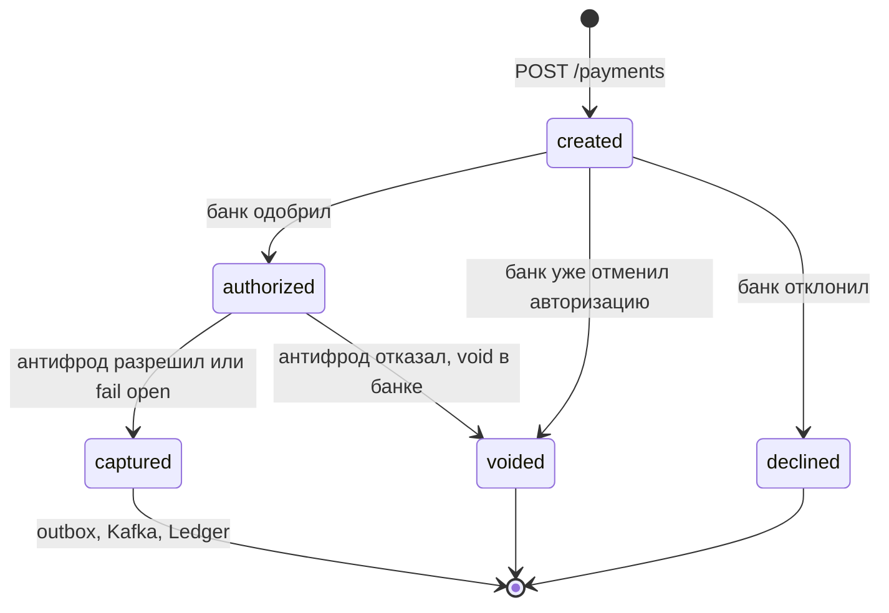

# payments-platform

[](https://github.com/zr-roman/Highload/actions/workflows/backend-ci.yml)

Платёжая платформа на микросервисах — пет-проект о высокой нагрузке. Архитектура выведена из замеров на PostgreSQL: пять экспериментов, их цифры и выводы — в [docs/postgres-experiments.md](docs/postgres-experiments.md). Как этап 1 держит нагрузку и во что упирается — в [docs/load-testing.md](docs/load-testing.md). Стенд в Kubernetes, включая React-интерфейс, и выкатка через git — в [deploy/k8s/README.md](deploy/k8s/README.md) и [docs/gitops.md](docs/gitops.md); backend-тесты и образы собирает [Backend CI](.github/workflows/backend-ci.yml), фронтенд-образ собирает и выкатывает [Frontend CI](.github/workflows/frontend-ci.yml). Метрики, дашборды и опыты с отказом нод — в [docs/observability.md](docs/observability.md). Сетевые политики, ограничения подов и проверка образов — в [docs/security.md](docs/security.md). PostgreSQL в кластере и отказ основной базы — в [docs/postgres-failover.md](docs/postgres-failover.md). Kafka под оператором Strimzi и отказ брокера — в [docs/kafka-failover.md](docs/kafka-failover.md). Redis с Sentinel — в [docs/redis.md](docs/redis.md).

## Этап 1: что уже работает

- **Payments.Api (C#).** Приём платежа с ключом идемпотентности, решение банка (на этапе 1 — заглушка внутри процесса, на этапе 2 — [эмулятор на Go](src/bank-emulator) по HTTP), transactional outbox, восстановление платежей, по которым банк не ответил, лимит запросов на продавца в Redis с локальным запасным лимитом на время сбоя Redis.
- **Ledger.Service (C#).** Консьюмер Kafka, двойная запись пачками, балансы продавцов, проверка инвариантов.
- **Инфраструктура.** Kafka и дашборд телеметрии — в Docker; PostgreSQL и сервисы — нативно.
- **Нагрузка.** Сценарий k6 с открытой моделью.

```
                POST /payments + Idempotency-Key
   k6 / клиент ─────────────────────► Payments.Api ───► эмулятор банка на Go (HTTP)
                                          │  1. INSERT платежа в статусе 'created'
                                          │  2. вызов банка — без открытой транзакции
                                          │  3. UPDATE 'captured' + INSERT в outbox — одной SQL-командой
                                          ▼
                                     БД payments ──► OutboxRelay ──► Kafka: payments.captured
                                                                     8 партиций, ключ = merchantId,
                                                                     у крупного продавца — с солью
                                                                          │
                                                                          ▼
                                                     Ledger.Service: пачка на партицию, один писатель,
                                                     одна SQL-команда: дедупликация, 3 проводки
                                                     на платёж, один upsert на счёт
                                                                          │
                                                                          ▼
                                                                      БД ledger
```

## Статусы платежа

Статус платежа — это и состояние саги ([`PaymentSaga`](src/Payments.Api/Payments/PaymentSaga.cs)): каждый шаг записывается раньше, чем начнётся следующий, поэтому упавший процесс оставляет платёж там, откуда восстановление его продолжит.



- **`created` и `authorized` — платёж в работе.** Он лежит в очереди восстановления `pending_payments`, клиент получил 202 и узнаёт итог через `GET /payments/{id}`. В `created` платёж остаётся, если банк не ответил. В `authorized` — если не ответил антифрод, а платёж от 500 ₽ или его проверяет восстановление, или если банк не ответил на void. На стенде в Kubernetes платёж, который в работе дольше 5 минут, поднимает алерт `PaymentsStuckInCreated` или `PaymentsStuckInAuthorized`.
- **Восстановление продолжает с записанного статуса.** Из `created` оно спрашивает у банка решение, а не авторизует заново; если решения нет (404), платёж становится `declined`. Из `authorized` оно идёт к антифроду, и тот на повторную проверку отвечает сохранённым решением. Без проверки (fail open) проводится только платёж меньше 500 ₽ (`Antifraud:FailOpenBelowAmount`) и только в запросе: в фоне клиент не ждёт.
- **`captured`, `declined` и `voided` — итоговые.** В outbox и дальше в Ledger попадает только `captured`. У `declined` и `voided` деньги не двигались: холд в банке снят или не ставился.
- **`created` → `voided`** — редкий случай: на авторизацию или на запрос решения банк ответил, что авторизацию этого платежа уже отменили.

## Запуск (Windows, PowerShell)

Нужны Docker Desktop, .NET 10 SDK, Go 1.24, Python 3.12 с [uv](https://docs.astral.sh/uv/) и PostgreSQL на порту 5433. Для нагрузки — k6: `winget install k6 --source winget`.

1. **Kafka и дашборд:**
   ```powershell
   docker compose up -d
   ```
2. **Пароль Postgres** (один раз). В репозитории пароля нет: сервисы, как и `psql`, берут его из стандартного файла паролей PostgreSQL. Npgsql читает этот файл сам, если пароль не указан в строке подключения.
   ```powershell
   New-Item -ItemType Directory -Force "$env:APPDATA\postgresql" | Out-Null
   notepad "$env:APPDATA\postgresql\pgpass.conf"
   ```
   В файле одна строка — хост, порт, база (`*` — любая), пользователь и пароль: `localhost:5433:*:postgres:твой_пароль`. Двоеточие и `\` внутри пароля экранируются обратным слешем.
3. **Базы данных** (один раз):
   ```powershell
   $env:PGPORT = "5433"
   psql -U postgres -f db\create-databases.sql
   ```
4. **Эмулятор банка и антифрод** — каждый в отдельном окне:
   ```powershell
   cd src\bank-emulator
   go run .
   ```
   Payments.Api ходит в него по HTTP на порт 5300. Без эмулятора платежи не проводятся: банк не отвечает, и каждый платёж получает ответ 202 и остаётся в `created` (шаг 6). После запуска эмулятора восстановление спросит у него исход и отклонит эти платежи: банк о них не знает. Заглушка банка внутри процесса, как на этапе 1, включается переменной `$env:Acquirer__Mode = "Fake"` перед запуском Payments.Api. Заглушка не хранит решений, поэтому в этом режиме восстановление отклоняет зависшие платежи. Задержка и отказы банка настраиваются переменными `BANK_*`, см. [README эмулятора](src/bank-emulator/README.md).
   ```powershell
   cd src\antifraud-service
   uv sync
   uv run uvicorn antifraud.main:app --host 127.0.0.1 --port 5400 --workers 1
   ```
   Антифрод слушает порт 5400, счётчики и решения держит в Redis из `docker compose`. Одного процесса для стенда хватает, а с несколькими (`--workers`) на Windows uvicorn перезапускает их с WinError 10022. Без антифрода сага не получает решения: платёж меньше 500 ₽ проводится без проверки (fail open), а платёж от 500 ₽ получает 202, ждёт в `authorized`, и восстановление ждёт антифрод — в его логе `Antifraud unavailable`. Заглушка антифрода внутри процесса включается переменной `$env:Antifraud__Mode = "Fake"` перед запуском Payments.Api: она разрешает все платежи, а с `$env:Antifraud__DenyRatePercent = "10"` отклоняет 10 %. У отклонённых сага отменяет авторизацию в банке, и платёж получает статус `voided`.
5. **Сервисы** — в двух окнах:
   ```powershell
   dotnet run --project src\Ledger.Service
   dotnet run --project src\Payments.Api
   ```
   Таблицы и топик Kafka сервисы создают сами при старте.
6. **Платёж:**
   ```powershell
   $body = '{"merchantId": 42, "amount": 150000, "currency": "RUB"}'
   $headers = @{ "Idempotency-Key" = [guid]::NewGuid().ToString() }
   Invoke-RestMethod -Method Post -Uri http://localhost:5100/payments -Headers $headers -ContentType "application/json" -Body $body
   Invoke-RestMethod http://localhost:5200/balances/merchants/42
   Invoke-RestMethod http://localhost:5200/invariants
   ```
   Повтори POST с теми же `$headers` — вернётся тот же платёж, второго списания не будет. С тем же ключом и другой суммой — ответ 422.

   Если банк не ответил вовремя, ответ — `202 Accepted` со статусом `created` и заголовком `Location`: решения пока нет. Повтор с тем же ключом, пока решения нет, тоже получает 202, а итоговый статус показывает `GET /payments/{id}`. Через 30–40 секунд фоновое восстановление спросит у банка исход и проведёт или отклонит платёж (секция `Recovery` в `appsettings.json`). Если банк одобрил, а антифрод не ответил, платёж от 500 ₽ тоже получает 202, но со статусом `authorized`: восстановление спросит антифрод ещё раз и проведёт платёж или отменит авторизацию.
7. **Телеметрия:** http://localhost:18888 — трейсы запросов вместе с SQL-командами, метрики `payments.*` и `ledger.*`, логи.

   Отставание асинхронной части показывают три метрики: `payments.outbox.oldest_age` — сколько ждёт самая старая строка outbox, `ledger.consumer.lag` — сколько сообщений партиции ещё не в журнале, `ledger.payment.delay` — сколько платёж идёт от проведения в Payments.Api до записи в журнал. У `ledger.consumer.lag`, `ledger.payment.delay` и `ledger.batch.*` есть тег `partition`: перегрузка одной партиции видна только в разрезе по нему, в сумме она теряется. `payments.outbox.oldest_age` и `ledger.consumer.lag` — gauge, то есть снимки на момент экспорта, а метрики по умолчанию экспортируются раз в 60 секунд (`OTEL_METRIC_EXPORT_INTERVAL`): на графике у них одна точка в минуту.

   Сагу показывают ещё пять метрик:
   - `payments.antifraud.decisions` — решения антифрода, тег `outcome`: `allow`, `deny` или `unknown`;
   - `payments.antifraud.fail_open` — платежи, проведённые без решения антифрода; бывает только в запросе;
   - `payments.voided` — отменённые платежи, тег `reason`: `antifraud_deny` — антифрод отказал и банк отменил авторизацию, `void_not_found` и `void_conflict` — void ответил 404 или 409, `bank_voided` — банк сам ответил, что авторизация уже отменена;
   - `payments.left_in_progress` — саги, оставившие платёж в работе, тег `waits_for`: `bank` или `antifraud`;
   - `payments.in_progress.oldest_age` — gauge: сколько ждёт самый старый платёж в `created` и в `authorized` (тег `status`). Его обновляет лидер восстановления после каждого прохода, остальные экземпляры показывают 0, поэтому по экземплярам берут максимум. Под нагрузкой он ходит пилой от 0 до 10 секунд — интервала восстановления.

   У решений, отмен и оставленных в работе есть ещё тег `path`: сагу вёл запрос (`request`) или восстановление (`recovery`). Время ответа антифрода — стандартная метрика `http.client.request.duration`: локально банк и антифрод оба на `localhost`, и различает их `server.port` (5300 и 5400), в кластере — `server.address`. Панели и алерты саги в кластере — в [docs/observability.md](docs/observability.md).

   Отставание Ledger глазами брокера, по закоммиченным смещениям:
   ```powershell
   docker exec payments-kafka /opt/kafka/bin/kafka-consumer-groups.sh --bootstrap-server localhost:9092 --describe --group ledger
   ```
   Колонка `LAG` — сообщения партиции после последнего коммита Ledger. Так же отставание считает `LedgerLagAsync` в сквозных тестах. Команда работает и тогда, когда Ledger лежит: метрику `ledger.consumer.lag` в это время отправлять некому.
8. **Нагрузка.** Для замеров запускай оба сервиса в Release и с выборкой трейсов 1% — в каждом окне:
   ```powershell
   $env:OTEL_TRACES_SAMPLER = "parentbased_traceidratio"
   $env:OTEL_TRACES_SAMPLER_ARG = "0.01"
   dotnet run -c Release --project src\Payments.Api
   ```
   Трейс на каждый запрос — это тысячи спанов в секунду, и дашборд принимает их на том же ноутбуке, отнимая процессор у сервисов. Метрики выборка не затрагивает: в них по-прежнему все запросы. Затем прогон:
   ```powershell
   mkdir load\reports -Force | Out-Null
   $env:K6_WEB_DASHBOARD = "true"                              # графики по ходу прогона: http://localhost:5665 (пока вкладка открыта, k6 не завершится)
   $env:K6_WEB_DASHBOARD_EXPORT = "load\reports\rate-200.html" # они же в HTML-файле после прогона
   k6 run -e RATE=200 -e DURATION=60s load\payments.js
   ```
   Ступени подряд, с проверкой инвариантов и lag группы `ledger` после каждой: `powershell -ExecutionPolicy Bypass -File load\ladder.ps1` (свои ступени — `-Rates "2000,2500,3000"`).

   Горячий продавец (этап 3): `k6 run -e RATE=1000 -e HOT_SHARE=0.5 -e MERCHANTS=50 load\payments.js` — половина платежей идёт продавцу 1 (`HOT_MERCHANT`), вторую половину поровну делят остальные 49; в `ladder.ps1` то же самое — `-HotShare 0.5 -Merchants 50`. Запросы помечены `merchant:hot` и `merchant:other`, и пороги стоят на `other`: прогон проверяет, не мешает ли горячий продавец остальным. Ответ 429 от лимитера в любом прогоне — ожидаемый, а не сбой: `http_req_failed` его не считает, а считает отдельный счётчик `rate_limited`.

   Матрица этапа 3 — шесть прогонов с горячим продавцом и без, каждый дважды по 120 секунд, — одной командой:
   ```powershell
   dotnet run --project load\Matrix -c Release
   ```
   Заранее нужны только Postgres и контейнеры `docker compose up -d` — Kafka, Redis, дашборд. Эмулятор банка и оба сервиса матрица запускает сама — в Release, с выборкой трейсов 1 % и метриками раз в секунду, — а перед прогоном без лимитера перезапускает Payments.Api. Антифрод в матрице — заглушка внутри процесса (`Antifraud__Mode=Fake`, разрешает все платежи): матрица меряет путь платежа и остаётся сравнимой с матрицами до саги, а сервис антифрода меряет свой стенд, `load\AntifraudBench` ([отчёт](docs/load-testing.md)). Переменные стенда из окна (`Acquirer__Mode` и другие `Секция__Ключ`, `BANK_*`, `OTEL_*`, `K6_*`) процессы стенда не получают: эксперимент, забытый в окне, не попадёт в замер. Каждый прогон начинается, когда outbox пуст и lag всех партиций равен 0; во время прогона матрица раз в секунду замеряет возраст outbox и lag по партициям, после — проверяет `/invariants`. Итог — `load\reports\matrix-<время>\table.md`: медиана повторов, каждый повтор и время повторов для дашборда, а рядом итоги k6, HTML-отчёты, замеры по секундам и логи сервисов. Всё вместе — около 50 минут; отдельные прогоны — `-- --runs 3,6 --repeats 1`, остальные параметры — `-- --help`. С `-- --fresh` матрица перед стартом очищает базы payments и ledger и удаляет топик `payments.captured` с группой Ledger: проверка `/invariants` и поиск зависших платежей в `PaymentRecovery` замедляются с ростом таблиц, поэтому сравнимы только матрицы с одинаковой стартовой точки. С `-- --instances 2` матрица запускает два экземпляра Payments.Api, на портах 5100 и 5101, и k6 шлёт им запросы по очереди; с `-- --redis-pause 10` в середине каждого повтора все команды к Redis 10 секунд ждут (`CLIENT PAUSE`), как у зависшего Redis; с `-- --bank-fails-hot` эмулятор отвечает 500 на каждую авторизацию горячего продавца, а остальных обслуживает как обычно (`BANK_ERROR_MERCHANT`); с `-- --ledgers 2` запускает второй экземпляр Ledger на порту 5201, и Kafka делит партиции между ними; с `-- --ledger-batch 1` Ledger пишет каждый платёж отдельной SQL-командой и отдельным коммитом смещения (`Consumer:BatchSize`). Приоритет процесса Docker (следующий абзац) матрица проверяет сама.

   Перед прогоном проверь приоритет процесса Docker, через который идёт трафик Kafka, — должен быть `Normal`. В режиме эффективности Windows ставит ему `Idle`, и под нагрузкой relay почти останавливается ([отчёт](docs/load-testing.md#асинхронная-часть-почему-отстаёт-журнал)):
   ```powershell
   Get-Process -Id (Get-NetTCPConnection -LocalPort 9092 -State Listen).OwningProcess | Select-Object Id, ProcessName, PriorityClass
   ```

   Поднимай `RATE`, пока не вырастут p95/p99, ошибки или `dropped_iterations`, — это «колено» стенда. `dropped_iterations` — платежи, которые k6 не отправил, потому что все его виртуальные пользователи ждали ответа: больше 1% — прогон не засчитывается. После прогона `/invariants` должен вернуть `"ok": true`.
9. **Второй экземпляр Ledger:**
   ```powershell
   dotnet run --project src\Ledger.Service -- --urls http://localhost:5201
   ```
   Kafka разделит 8 партиций между экземплярами — это видно в логах по строкам `Assigned partitions` и в колонке `CONSUMER-ID` команды из шага 7.

Остановка: Ctrl+C в окнах сервисов и эмулятора, затем `docker compose down`. Данные Kafka при этом удаляются — для стенда это нормально.

## Тесты

```powershell
dotnet test
```
Нужен запущенный Docker Desktop: тесты поднимают Postgres, Kafka и Redis в контейнерах через Testcontainers, локальный стенд и пароль не нужны. Первый запуск дольше — скачиваются образы. Тесты Payments.Api идут около 20 секунд, сквозные — около минуты: дольше всех стартует Kafka. Только тесты одного сервиса: `dotnet test --project tests\Payments.Api.Tests\Payments.Api.Tests.csproj` или `dotnet test --project tests\Ledger.Service.Tests\Ledger.Service.Tests.csproj`.

Сейчас покрыты восемь частей.

**Клиент банка** ([`tests/Payments.Api.Tests/Acquiring`](tests/Payments.Api.Tests/Acquiring)) — 27 тестов без сети: `HttpAcquirer` с настоящим конвейером устойчивости над подменным `HttpMessageHandler`, с настройками из `appsettings.json` (короче сделан только таймаут попытки):
- **ответы** — одобрено, отклонено и отменено раньше (повтор авторизации отменённого платежа), с кодом авторизации; контракт с эмулятором: путь и поля запроса;
- **сбои** — 500, а потом 200: повтор с тем же `paymentId`; банк всё время отвечает 5xx или недоступен — `Unknown` после всех попыток; банк молчит — `Unknown` раньше общего таймаута;
- **ошибки, которые не повторяют** — 400 и 409, незнакомый статус в ответе; отмена вызывающим — это отмена, а не `Unknown`;
- **circuit breaker** — после серии отказов размыкается, и банк больше не получает запросов;
- **свой конвейер у крупного продавца** — банк отказывает продавцу со своей квотой, его breaker размыкается, а остальные продавцы по-прежнему получают ответы банка;
- **поиск решения** — 200: решение, в том числе «отменено», и это ответ, а не ошибка; 404: «решения нет», без повторов; 5xx: `Unknown`;
- **отмена авторизации (void)** — POST без тела по пути платежа; 404 и 409 — свои исходы, без повторов; 5xx — повтор с тем же `paymentId`, а после всех попыток `Unknown`; банк молчит — `Unknown` в пределах общего таймаута; незнакомый статус в ответе — нарушение контракта; отказы void крупного продавца размыкают только его breaker.

**Клиент антифрода** ([`tests/Payments.Api.Tests/Antifraud`](tests/Payments.Api.Tests/Antifraud)) — 14 тестов без сети: `HttpAntifraud` с настоящим конвейером устойчивости над подменным обработчиком, как у клиента банка, и заглушка `FakeAntifraud`:
- **ответы** — allow и deny с баллом, причинами и версией правил; контракт с сервисом на Python: путь, поля в camelCase, `createdAt` со смещением; обычный продавец не передаёт класс и квоту, крупный передаёт `large` и свою квоту;
- **сбои** — неудачная попытка повторяется с тем же `paymentId`; 500 и 503 (антифрод без Redis) — `Unknown` после всех попыток; зависший антифрод — `Unknown` за доли секунды, а не через 100 секунд таймаута `HttpClient` по умолчанию;
- **ошибки контракта** — 400 и незнакомое решение в ответе: исключение, а не `Unknown`, иначе fail open спрятал бы ошибку;
- **circuit breaker** — разомкнутый breaker антифрода перестаёт его вызывать и не мешает вызовам банка; решение помечает, что breaker разомкнут, а 5xx после всех попыток такой пометки не даёт;
- **заглушка** — по умолчанию разрешает всё, отклоняет примерно заданную долю платежей, повторная проверка получает тот же ответ.

**Лимитер продавцов** ([`tests/Payments.Api.Tests/RateLimiting`](tests/Payments.Api.Tests/RateLimiting)) — 30 тестов:
- **бакет и квоты** — всплеск проходит, следующий платёж ждёт, токены возвращаются со временем; у каждого продавца свой бакет, у новой квоты — новый; квоты читаются из конфигурации и меняются без перезапуска, неверная правка игнорируется, а неверные настройки при старте останавливают сервис;
- **Redis не отвечает** — продавец сохраняет свой лимит, сбой начинается с того, что у продавца осталось, а после сбоя Redis не пропускает лишний всплеск; один продавец не тратит лимит другого; после одного таймаута остальные платежи Redis не ждут, а возвращает его одна пробная попытка;
- **circuit breaker Redis** — пауза после отказа, ровно одна пробная попытка, поздний ответ на запрос до сбоя breaker не замыкает;
- **с настоящим Redis** (Testcontainers) — 429 с `Retry-After` сверх лимита, продавец с квотой проходит со своей скоростью, новая квота действует без перезапуска.

Ключ сообщения о проведённом платеже проверяют ещё 2 теста ([`tests/Payments.Api.Tests/Payments`](tests/Payments.Api.Tests/Payments)): у обычного продавца ключ — его id, у крупного — восемь ключей с солью.

**Сага** ([`tests/Payments.Api.Tests/Payments`](tests/Payments.Api.Tests/Payments)) — 37 тестов на настоящей базе, банк и антифрод отвечают по сценарию:
- **путь запроса** (`PaymentSagaTests`) — каждый ответ банка и антифрода ведёт к своему статусу: allow — `captured` с комиссией и одним событием в outbox; deny — void в банке и `voided` без события; void ответил 404 или 409 — тоже `voided`, с предупреждением; void не ответил — платёж ждёт в `authorized`; банк отклонил или не ответил — антифрод не вызывается. Исходы проверяются и по метрикам: решение антифрода, причина отмены, fail open, оставленные в работе — с путём `request`;
- **fail open** — без решения антифрода платёж на копейку дешевле порога проводится, ровно на пороге ждёт в `authorized`, с порогом 0 ждёт любой;
- **гонка** — восстановление провело платёж, пока антифрод отвечал запросу: запрос отвечает записанным, второго события нет;
- **переходы в хранилище** (`PaymentStoreTests`) — каждый переход только из своих статусов: `authorized` — из `created`, проведение — только из `authorized`, `voided` — из `created` и `authorized`; повторный переход возвращает `false`, и по нему сага понимает, что платёж уже довели;
- **статусы в схеме** (`PaymentStatusesTests`) — платёж читается в любом статусе схемы; `authorized` остаётся в очереди восстановления и находится поиском, `voided` из неё уходит; итоговый платёж, оставшийся в очереди по ошибке, не занимает место в пачке.

**Фоновое восстановление** ([`tests/Payments.Api.Tests/Recovery`](tests/Payments.Api.Tests/Recovery)) — 21 тест на настоящей базе:
- **ответы банка и антифрода** — одобрено и разрешено, отклонено, решения нет, отменено в банке: итоговый статус, комиссия, событие в outbox, метрика и поля лога; платёж в `authorized` продолжается с антифрода, банк повторно не спрашивают; отказ антифрода — void в банке;
- **без fail open** — антифрод не дал решения: платёж ждёт в `authorized` даже ниже порога и проводится следующим проходом; одна проверка без решения задерживает только свой платёж, остальные платежи прохода проводятся;
- **возраст самого старого платежа** — gauge растёт, пока платёж ждёт в `authorized`, и падает до 0, когда платёж проведён;
- **гонки и сбои** — эндпоинт успел первым, и второго события нет; разбор одного платежа падает, а остальные в пачке восстановлены; банк недоступен или circuit breaker антифрода разомкнут — остаток пачки пропускается, повтор через `Interval`;
- **выборка** — свежие и завершённые платежи не трогаются, самые старые идут первыми;
- **цикл** — после полной пачки следующая берётся сразу, после неполной пауза ровно `Interval`, пачка «ядовитых» платежей не крутит цикл;
- **лидерство и остановка** — с банком говорит только лидер; когда он останавливается, лидером становится другой экземпляр; остановка посреди прохода оставляет платёж до следующего запуска.

**Схема и старт Payments.Api** ([`tests/Payments.Api.Tests/Infrastructure`](tests/Payments.Api.Tests/Infrastructure)) — 12 тестов, схема и миграция — на настоящей базе:
- **схема** — экземпляры, стартующие вместе на пустой базе, все применяют `schema.sql`; на новой базе CHECK статусов проверен сразу;
- **миграция статусов** — старый CHECK из трёх статусов заменяется на `NOT VALID` и проверяется после коммита; повторный запуск ничего не меняет; CHECK с `voided`, но с другим набором статусов тоже заменяется; неизвестный статус отклоняется и до проверки, и после; проверка возвращает соединению `statement_timeout` из строки подключения; миграция, упёршаяся в чужую блокировку, сдаётся по `lock_timeout`, а не держит в очереди все записи;
- **старт** — недоступные Postgres и Kafka пробуются снова, а ошибка — сломанный скрипт схемы или неверный пароль — роняет старт сразу; таймаут блокировки (55P03) — временная ошибка. И одна проверка самой фикстуры Postgres.

**Журнал** ([`tests/Ledger.Service.Tests`](tests/Ledger.Service.Tests)) — 17 тестов на настоящем Postgres, без Kafka и HTTP:
- **запись пачки** — платёж ложится тремя проводками с нулевой суммой на суб-счета партиции своей пачки; платежи одного продавца в одной пачке складываются в одну строку счёта (без `GROUP BY` upsert падает: «cannot affect row a second time»); у крупного продавца в каждой партиции свой суб-счёт;
- **повторы** — повторная пачка ничего не меняет; в пачке из учтённых и новых платежей проводятся только новые, и `WriteBatchAsync` считает только их; платёж, попавший в пачку дважды, проводится один раз; два писателя одной пачки одновременно проводят её один раз — так бывает, когда консьюмер, потерявший партицию, дописывает свою пачку, а новый владелец партиции пишет те же сообщения;
- **ответы API** — баланс продавца складывается из его суб-счетов и старого счёта `merchant:{id}`, у неизвестного продавца баланса нет (404), комиссии платформы — сумма суб-счетов `fee:*`, на пустом журнале — 0;
- **инварианты** — журнал, который пишет `LedgerWriter`, их выдерживает, а для каждой из трёх проверок есть поломка, которую ловит только она (подробнее — в «Гарантиях», пункт «Деньги сходятся»);
- **схема** — четыре экземпляра, стартующие вместе на пустой базе, все применяют `schema.sql`; повторный старт не трогает проводки.

**Сквозные тесты** ([`tests/EndToEnd.Tests`](tests/EndToEnd.Tests)) — 7 тестов. Четыре из них — вся платформа в процессе теста: Payments.Api и Ledger.Service через `WebApplicationFactory`, банк — встроенная заглушка. 2000 платежей по 50 продавцам идут по 16 одновременно, а 20 из них ещё и пятью одновременными копиями с одним ключом идемпотентности. В каждом из четырёх проверяется:
- **двойного списания нет** — каждый заказ становится ровно одним платежом, копии получают его же;
- **ничего не теряется** — outbox пустеет, Ledger дочитывает Kafka до конца, и у него есть каждый проведённый платёж;
- **деньги сходятся между сервисами** — баланс каждого продавца в Ledger равен сумме `amount − fee` его проведённых платежей в Payments.Api, комиссии и клиринг тоже сходятся, `/invariants` — ok.

Антифрод в сквозных тестах — заглушка внутри процесса (`FakeAntifraud`), которая отклоняет 5 % платежей: эти платежи проходят через void и в журнал не попадают. Решение заглушки зависит от `paymentId`, поэтому повторная проверка получает тот же ответ, как у настоящего сервиса.

Тесты отличаются тем, что происходит с Ledger:
- **ничего** — только нагрузка;
- **перезапуск посреди нагрузки** — Ledger останавливается, как при деплое. Пока он лежит, тест отправляет ещё платежи: Payments.Api их принимает, а события ждут в Kafka. Новый экземпляр продолжает с закоммиченных смещений и заново читает пачки, которые старый прочитал, но не записал. Если коммитить смещения раньше записи (например, включить `EnableAutoCommit`), тест это ловит: платежей в Ledger оказывается меньше, чем проведённых;
- **потерянные коммиты смещений** — пачка уже в базе, а её смещения до Kafka не дошли, поэтому после рестарта её прочитают снова. Уронить Ledger ровно в этой точке тест не может, так что он останавливает Ledger и откатывает смещения группы в начало топика — худший случай. Ledger перечитывает все уже учтённые платежи, а `processed_payments` пропускает каждый: ни проводок, ни балансов не прибавляется. Без дедупликации балансы перечитанных платежей удвоились бы.

Четвёртый тест меняет не Ledger, а нагрузку: **горячий продавец** получает 90 % заказов, а остальные 49 делят оставшиеся поровну. У него своя квота, то есть он крупный, поэтому ключ его сообщений — с солью: платежи расходятся по всем 8 партициям, и у каждой партиции свой суб-счёт продавца. Тест проверяет, что у горячего продавца суб-счёт есть в каждой партиции, а у остальных — по одному. Кроме общих проверок, его баланс сверяется через API Ledger, `GET /balances/merchants/1`: ответ — сумма суб-счетов, и она должна совпасть с суммой его проведённых платежей.

Ещё три теста проверяют, что сервисы стартуют как в кластере: в окружении `Production` и без настроенных источников CORS. Однажды лишний `app.UseCors()` прошёл все тесты в `Development` и уронил Ledger при старте в кластере.

Как устроено:
- клиент банка тесты регистрируют тем же `AddHttpAcquirer`, что и `Program.cs`, поэтому проверяется конвейер, который работает в сервисе;
- в тестах восстановления банк — подменный `IAcquirer` (`FakeBank`): ответ задаётся для каждого платежа, обращения считаются;
- время — `FakeTimeProvider`: `PaymentRecovery` берёт паузы из `TimeProvider`, поэтому тест проверяет «пауза ровно `Interval`», двигая часы, а не ожидая 10 секунд;
- сервис собирается так же, как в `Program.cs` (`RecoveryHost`), а проверки идут по базе, логам (`FakeLogger`), метрикам (`MetricCollector`) и спанам;
- у каждого экземпляра восстановления свой пул соединений: закрытие пула закрывает сессию с advisory-блокировкой, как при остановке процесса;
- в тестах журнала `LedgerWriter` и `LedgerQueries` создаются напрямую над `NpgsqlDataSource`, как их собирает DI в `Program.cs`; HTTP и Kafka проверяют сквозные тесты. Каждый тест начинается с пустых таблиц. Чтобы два писателя одной пачки шли действительно одновременно, тест держит их у «шлагбаума»: транзакция с `LOCK TABLE processed_payments IN SHARE MODE` не пускает обе вставки, пока обе не встанут в очередь блокировки (её видно в `pg_locks`), а потом откатывается и отпускает их разом;
- в сквозных тестах сервисы получают настройки через конфигурацию хоста: `Program.cs` читает строки подключения до `builder.Build()`, а обычные переопределения `WebApplicationFactory` приходят позже ([dotnet/aspnetcore#37680](https://github.com/dotnet/aspnetcore/issues/37680)). `schema.sql` сервисы читают из корня контента, а не из папки сборки: в общем процессе теста у обоих сервисов она одна.
- остановка Ledger — это `DisposeAsync` его фабрики: хост останавливается, консьюмер выходит из группы. Запуск — новая фабрика с теми же настройками. Смещения откатывает `AdminClient` (`AlterConsumerGroupOffsets`), и только пока Ledger остановлен: Kafka меняет смещения группы, лишь когда в ней нет участников. «Ledger догнал» — это сначала пустой outbox, а потом нулевой lag группы: закоммиченные смещения дошли до конца каждой партиции, а коммитит Ledger только записанное.
- телеметрия в сквозных тестах выключена (`OTEL_SDK_DISABLED`): коллектора в тестах нет, а включённый SDK при каждой остановке сервиса ждёт экспортёры — до 5 с на сигнал. На Windows один только отказ соединения с localhost занимает секунды: Ledger останавливался так долго, что нагрузка успевала закончиться.

## Как читать код

1. [`src/Contracts`](src/Contracts) — событие `PaymentCaptured` и топик. Ключ сообщения — merchantId: все платежи продавца попадают в одну партицию. У крупного продавца к ключу добавлена соль из paymentId, и его платежи расходятся по всем партициям (`Topics.PaymentsCapturedKey`).
2. [`Payments.Api/Payments/PaymentEndpoints.cs`](src/Payments.Api/Payments/PaymentEndpoints.cs) — приём платежа: запись в `created`, сага, ответ 201 или 202; обработка повтора по ключу идемпотентности.
3. [`Payments.Api/Payments/PaymentSaga.cs`](src/Payments.Api/Payments/PaymentSaga.cs) — сага платежа: банк, антифрод, проводка или отмена авторизации. Один код для запроса и для восстановления (раздел «Статусы платежа»).
4. [`Payments.Api/Payments/PaymentStore.cs`](src/Payments.Api/Payments/PaymentStore.cs) — весь SQL сервиса. Каждый метод — одна команда: одно обращение к базе и одна неявная транзакция.
5. [`Payments.Api/Outbox/OutboxRelay.cs`](src/Payments.Api/Outbox/OutboxRelay.cs) — публикация в Kafka без открытой транзакции, лидер через advisory lock.
6. [`Payments.Api/Recovery/PaymentRecovery.cs`](src/Payments.Api/Recovery/PaymentRecovery.cs) — восстановление зависших платежей: продолжает сагу с записанного статуса (`PaymentSaga.ContinueAsync`) — тот же код, что у эндпоинта.
7. [`Ledger.Service/Consuming/PaymentsConsumer.cs`](src/Ledger.Service/Consuming/PaymentsConsumer.cs) — пачки по партициям, коммит смещений после записи, поведение при ребалансировке.
8. [`Ledger.Service/Ledger/LedgerWriter.cs`](src/Ledger.Service/Ledger/LedgerWriter.cs) — одна SQL-команда на пачку: дедупликация, проводки, балансы.
9. [`Ledger.Service/Ledger/LedgerQueries.cs`](src/Ledger.Service/Ledger/LedgerQueries.cs) — инварианты: деньги не появились и не исчезли.
10. [`src/Platform`](src/Platform) — телеметрия, схема БД, создание топика.

## Решения и откуда они взялись

| Решение | Где в коде | Почему |
|---|---|---|
| Платёж записывается до вызова банка | `PaymentEndpoints`, шаг 1 | Если процесс упадёт, платёж останется в `created`, и его можно довести до конца |
| Банк и антифрод вызываются без открытой транзакции | `PaymentEndpoints`, шаг 2; `PaymentSaga` | Ждущая транзакция держит горизонт и тормозит всех (эксперимент 2) |
| После одобрения банком токен отмены запроса не используется | `PaymentEndpoints`, шаги 2–3 | Иначе уход клиента оставит одобренный платёж в `created` |
| Статус и outbox — одной командой | `PaymentStore.MarkCapturedAsync` | Атомарно, одно обращение к базе; событие пишется, только если статус действительно сменился |
| `fillfactor = 80` у `payments` | `Payments.Api/Database/schema.sql` | Смена статуса остаётся HOT-обновлением и не трогает индексы |
| Relay не держит транзакцию, пока ждёт Kafka | `OutboxRelay` | То же, что и с банком (эксперимент 2) |
| Один relay через advisory lock | `OutboxRelay` | При нескольких экземплярах Payments.Api не будет гонки за outbox |
| Один писатель на партицию, суб-счета продавцов, клиринга и комиссий на партицию | `PaymentsConsumer`, `LedgerWriter`, `LedgerAccounts` | Нет очередей к горячим строкам (эксперименты 4 и 5). Баланс продавца — сумма его суб-счетов, `merchant:{id}:p{партиция}`; запрос баланса учитывает и счёт `merchant:{id}`, куда журнал писал раньше: проводки не переписываются |
| Ключ сообщения у крупного продавца — с солью: `merchantId:n`, где n — последний байт paymentId по модулю 8 | `Topics.PaymentsCapturedKey`, `PaymentCompletion` | Партиция целиком у одного экземпляра Ledger, и второй экземпляр горячему продавцу не помогает (этап 3, шаг 7). С солью его поток делят все партиции и все экземпляры. Восемь ключей продавца попадают в восемь разных партиций: партиционер librdkafka берёт CRC32 ключа по модулю 8, а ключи отличаются только младшими тремя битами последнего байта. Цена — порядок событий продавца между партициями: журналу он не нужен, балансы — суммы. Крупный — тот, у кого своя квота, как и для отдельного конвейера банка |
| Пачка — одна SQL-команда | `LedgerWriter` | Один коммит на сотни платежей: в 25–33 раза быстрее UPDATE на каждый платёж (эксперимент 5) |
| Смещения коммитятся после записи, повторы отсекает `processed_payments` | `PaymentsConsumer`, `LedgerWriter` | Kafka доставляет хотя бы один раз, а учитывается платёж ровно один раз |
| Нет внешнего ключа от проводок к счетам | `Ledger.Service/Database/schema.sql` | Проверка FK блокирует строку счёта, на который ссылается проводка, — а это горячая строка |
| Без ответа банка платёж остаётся в `created`, клиент получает 202 | `PaymentEndpoints`, `HttpAcquirer` | Банк мог успеть одобрить платёж: отказ оставил бы деньги клиента заблокированными, а проводка вслепую могла бы провести отклонённый платёж |
| Таймауты, повторы и circuit breaker на вызове банка: 300 мс на попытку, 2 повтора, 2 с на всё | `Program.cs`, `appsettings.json` (`Acquirer:Resilience`) | Банк отвечает за 50–70 мс, а значения по умолчанию (10 с на попытку, 30 с на всё) рассчитаны на медленные зависимости. Повтор POST безопасен только потому, что банк идемпотентен по `paymentId`: повтор получает уже принятое решение. Breaker размыкается при 50 % отказов, чтобы обычные 10 % сбоев банка его не трогали |
| Зависшие платежи доводит до конца фоновое восстановление: продолжает сагу с того статуса, где она остановилась — из `created` спрашивает у банка исход, из `authorized` идёт к антифроду | `PaymentRecovery`, `PaymentSaga.ContinueAsync` | Ответ 202 не должен оставлять платёж в работе навсегда. Эндпоинт и восстановление проходят одну сагу, с одними переходами и метриками |
| Восстановление берёт платежи старше 30 с; при старте проверяется, что это больше двух самых долгих саг запроса: авторизация, проверка антифрода и void, каждый по общему таймауту своего конвейера | `RecoveryOptions`, `Program.cs` | Иначе восстановление спросит банк, пока исходный запрос ещё ждёт ответа, и отклонит платёж, который банк вот-вот одобрит |
| Решения у банка нет (404) — платёж отклоняется | `PaymentSaga.ContinueAsync` | Банк деньги не блокировал: запрос до него не дошёл или оборвался до решения. Поздний ответ банка этому не мешает: решение сохраняется до задержки, и `GET` его видит |
| Свой конвейер устойчивости у каждого продавца со своей квотой, один общий — у остальных | `BankPipeline`, `AddHttpAcquirer` (`SelectPipelineBy`) | Банк может отказывать одному продавцу. В общем конвейере 90 % вызовов горячего продавца разомкнули бы breaker и для всех остальных. Конвейер на каждого продавца — это тысячи экземпляров, а мелкий продавец не наберёт за 10 с тех 20 вызовов, после которых breaker вообще решает. Поиск решения идёт через общий конвейер: открытый breaker продавца не должен мешать восстановлению узнать, что решения нет |
| Сага — оркестрация в Payments.Api, а не хореография через Kafka | `PaymentSaga` | Все шаги принадлежат одному платежу, и его статус сразу показывает, где сага остановилась. Банк — HTTP API, на наши события он не подпишется. Хореография понадобится для возвратов: Ledger будет делать обратные проводки по событию |
| Антифрод проверяет платёж после одобрения банком, а не до него: сознательный учебный компромисс | `PaymentSaga` | Так у саги есть компенсация: шаг, который уже изменил чужую систему (холд в банке), откатывается void, и на стенде видны все её ветки: отказ, void без ответа, продолжение при восстановлении. В реальных системах быстрые правила обычно стоят до банка: их отказ ничего не стоит и холда не оставляет. Проверка после авторизации там тоже бывает, для медленных проверок вроде ручного разбора или тяжёлой модели: деньги зарезервированы, а списание ждёт решения. Отсюда направление, когда в антифроде появится модель ([«Что дальше»](src/antifraud-service/README.md)): правила до банка, модель после него, с той же компенсацией. Цена нынешнего порядка — в «Известных ограничениях» |
| После одобрения банком всегда пишется `authorized`; проводится платёж только из `authorized` | `PaymentStore`, `PaymentSaga` | У каждого перехода один исходный статус, и по базе видно, где сага остановилась. Процесс, упавший во время проверки, оставляет платёж там, откуда восстановление продолжит с антифрода, не спрашивая банк. Цена — лишний UPDATE на каждый платёж |
| Антифрод не ответил: платёж меньше 500 ₽ проводится без проверки (fail open), от 500 ₽ ждёт в `authorized`; fail open — только в запросе | `PaymentSaga`, `appsettings.json` (`Antifraud:FailOpenBelowAmount`) | Мелкий фрод дешевле потерянной продажи, крупный платёж подождёт настоящей проверки. В фоне клиент не ждёт, и брать риск не за что; пока антифрод лежит, деньги покупателя держит холд в банке |
| Отказ антифрода после одобрения банка — void; void ответил 404 или 409 — платёж всё равно `voided`, с предупреждением в логе | `PaymentSaga` | Компенсация авторизации снимает холд. При 404 и 409 банк деньги не держит, а повтор ответит то же. Void без ответа оставляет платёж в `authorized`: восстановление повторит его, банк примет повтор |
| Клиент антифрода — со своим конвейером устойчивости: попытка 50 мс, один повтор, 150 мс на всё, свой circuit breaker; на стенде в кластере — 150 и 400 мс | `HttpAntifraud`, `AddHttpAntifraud`, `appsettings.json` (`Antifraud:Resilience`), `deploy/k8s/payments-api.yaml` | Проверка стоит на пути платежа и отвечает за миллисекунды; без Redis антифрод отвечает 503 за 20 мс, поэтому 50 мс на попытку хватает. Повтор POST безопасен: решение хранится по `paymentId`. Свой breaker — чтобы лежащий антифрод не размыкал путь к банку и наоборот. 503, таймаут и открытый breaker — исход «неизвестно», его разбирает сага (fail open ниже порога суммы); 400 — исключение: это ошибка контракта на стороне Payments.Api, и fail open её бы спрятал. Крупный продавец передаёт класс `large` и свою квоту, обычный — ни того, ни другого. 50 мс выбраны по замеру антифрода с процессором для него одного. На стенде в кластере все поды делят процессор ноутбука, и под нагрузкой проверка отвечает с p99 до 240 мс даже изнутри своего пода. С 50 мс там без решения оставались 30–92 % проверок, с 150 мс — 0,1 % ([отчёт](docs/load-testing.md#этап-4-антифрод-в-пути-платежа-на-стенде-в-kubernetes)) |
| Зависшие платежи ищутся в очереди `pending_payments`, а не в `payments`: строка очереди пишется той же командой, что платёж, и удаляется той же, что даёт ему итоговый статус (`authorized` остаётся в очереди) | `PaymentStore`, `schema.sql` | Без индекса поиск раз в 10 секунд читал всю `payments` и на 5 млн строк под нагрузкой срывался по `statement_timeout`. Частичный индекс `WHERE status = 'created'` сделал бы смену статуса не-HOT: на 1500 платежах в секунду p99 671 мс против 400. С очередью поиск — доли миллисекунды при любом размере `payments`, HOT сохраняется; цена — p99 460 мс против 400 ([отчёт, «Индекс для поиска зависших»](docs/load-testing.md)) |
| Новый CHECK статусов (`authorized`, `voided`) добавляется в старую базу как `NOT VALID` с `lock_timeout` 2 с, а `VALIDATE CONSTRAINT` идёт отдельным скриптом в фоне после старта сервиса | `schema.sql`, `schema-after.sql`, `DatabaseSchema`, `SchemaAfterStart` | `ALTER TABLE ... ADD CONSTRAINT` берёт `ACCESS EXCLUSIVE` на `payments` до коммита: пока он держится, ждут все записи всех экземпляров. С проверкой старых строк в той же транзакции это время скана всей таблицы. `NOT VALID` не читает старые строки, новые проверяет сразу, и замок держится мгновение. `VALIDATE` читает таблицу под `SHARE UPDATE EXCLUSIVE`, который не мешает вставкам и обновлениям; из двух одновременно стартующих экземпляров один проверяет, второй ждёт его и ничего не делает. `lock_timeout`: запрос `ACCESS EXCLUSIVE` в очереди блокировок держит всех, кто встал за ним, и одна долгая транзакция на `payments` остановила бы приём платежей на всё время ожидания; с таймаутом скрипт откатывается целиком, а старт повторяет попытку (`StartupRetry`, 55P03 — временная ошибка). `VALIDATE` в фоне: скан большой таблицы дольше 60 секунд, которые даёт поду startup probe, и Kubernetes убивал бы под на каждом старте. Повторный старт сравнивает набор статусов в CHECK с ожидаемым целиком и при совпадении ничего не меняет |
| Банк недоступен или circuit breaker антифрода разомкнут — пачка прерывается до следующего прохода. Одна проверка без решения (таймаут, 503) задерживает только свой платёж | `PaymentRecovery`, `HttpAntifraud` | Восстановление делит с приёмом платежей rate limiter и circuit breaker и не должно забивать их запросами, обречёнными на отказ. Лежит ли антифрод, решает его breaker: он размыкается при половине отказов из 20 и больше вызовов за 10 с. Под нагрузкой отдельные проверки без решения бывают всегда, и пауза на каждой разбирала очередь после отказа антифрода со скоростью 2–9 платежей в секунду вместо 58–91 ([учения саги](docs/load-testing.md#восстановление-после-возвращения-антифрода)) |
| Один разборщик через advisory lock, без блокировки строк на время вызова банка | `PaymentRecovery` | Двойную запись исключают переходы статусов (`WHERE status = <исходный>`) и идемпотентность банка и антифрода, лидерство только экономит лишние запросы. Транзакция на время HTTP-вызова держала бы горизонт (эксперимент 2) |
| Лимит на продавца — token bucket в Redis, общий для всех экземпляров: 200 платежей в секунду, всплеск 400; сверх лимита — 429 с `Retry-After` | `MerchantRateLimitFilter`, `RedisTokenBucket` | Без лимита горячий продавец с 90 % из 1500 платежей в секунду поднимал p99 остальных до 758 мс, и k6 не отправлял 15 % платежей; с лимитом — 126 мс ([отчёт, этап 3](docs/load-testing.md)). Скрипт Lua берёт время у Redis, а не у экземпляров. 429, а не очередь: клиент знает, когда повторить, а стенд не копит ожидающих |
| Redis не ответил за 100 мс — экземпляр ограничивает продавцов сам, а Redis не спрашивает секунду | `MerchantRateLimitFilter`, `LocalMerchantLimiter`, `RedisCircuitBreaker` | Раньше лимитер на время сбоя Redis пропускал всех, и худший повтор дал 37 036 платежей сверх лимита за 2 минуты. Локальный бакет — лимит экземпляра, а не отсутствие лимита. Пока Redis отвечает, платёж проходит, только если согласны оба бакета, и они идут в ногу: сверх лимита — 0 во всех 15 повторах (этап 3, шаг 4а). Breaker нужен, чтобы зависший Redis стоил один таймаут в секунду, а не таймаут на каждый платёж |
| Квота крупного продавца — в конфигурации (`RateLimiting:Merchant:Overrides`), меняется без перезапуска | `MerchantQuotas` | Крупный продавец — условие договора, а не догадка системы. С квотой 1000 в секунду горячий продавец получает 429 только сверх неё, а p99 остальных — как при равномерной нагрузке того же объёма: 209 мс против 202 (итог этапа 3). Неверная правка файла не ломает приём: она попадает в лог, а действуют последние верные настройки. Квота заодно включает продавцу свой конвейер банка и соль ключа |
| Небольшой пул и таймауты в строке подключения; `Minimum Pool Size` равен максимуму | `appsettings.json` | Большой пул на конкурентной записи добавляет задержку; `ALTER DATABASE` не доходит до открытых соединений (эксперименты 3 и 4). С минимумом меньше максимума Npgsql раз в 5 минут закрывал простаивающие соединения, нагрузка тут же открывала их снова, и стенд тормозил (этап 3, шаг 4а) |
| Открытая модель нагрузки в k6 | `load/payments.js` | Медленный сервис не может незаметно снизить себе нагрузку |

## Гарантии и их цена

- **Двойного списания нет.** Уникальный ключ `(merchant_id, idempotency_key)` решает, кто был первым, а отпечаток тела запроса отличает повтор от ошибки клиента.
- **Без ответа банка платёж не отклоняется и не проводится вслепую.** Банк мог успеть одобрить платёж, а мог и не получить запрос, поэтому платёж остаётся в `created`, а клиент получает 202.
- **Платёж не зависает в `created` и `authorized`.** Восстановление берёт платежи старше 30 секунд и проходит раз в 10 секунд. Если банк и антифрод отвечают, итоговый статус появляется не позже чем через 40 секунд после создания платежа; если банк или антифрод лежит — в первом проходе после того, как он снова ответит. Исключение — платёж, разбор которого падает каждый раз (пункт 7 в «Задачах на доработку»). Цена — всё это время клиент видит 202 и узнаёт итог через `GET /payments/{id}`.
- **Отказ антифрода не оставляет деньги покупателя под холдом.** Сага отменяет авторизацию в банке (void). Если банк на void не ответил, платёж ждёт в `authorized`, и восстановление повторяет void. Цена — холд держится, пока банк не ответит.
- **Событие о платеже не теряется.** Строка outbox пишется в той же команде, что и смена статуса. Relay удаляет её только после подтверждения Kafka (`acks=all`).
- **Платёж не учитывается дважды.** Повторная доставка и повторная пачка после сбоя ничего не меняют: `processed_payments` пропускает уже учтённые платежи.
- **Деньги сходятся.** `/invariants` проверяет двойную запись, совпадение балансов с проводками и нулевую сумму всех балансов. Каждая из трёх проверок ловит поломку, которую две другие пропускают (тесты журнала): проводку, записанную на чужой платёж, — только первая; деньги, переложенные между балансами без проводок, — только вторая; проводки счёта, у которого нет строки в `accounts`, — только третья: внешнего ключа на `accounts` у проводок нет намеренно. Чего проверки не видят — двойной проводки платежа: у шести проводок сумма тоже ноль, и балансы с ними совпадают. От неё защищают `processed_payments` и `DISTINCT ON` в пачке, а заметить её может только сверка с Payments.Api, как в сквозных тестах (пункт 2 в «Задачах на доработку»).
- **Горячий продавец не мешает остальным.** Сверх своего лимита он получает 429 с `Retry-After`, остальные продавцы — ни одного 429, и их p99 такой же, как при равномерной нагрузке того же объёма: 209 мс против 202 на 1000 платежах в секунду, из которых 90 % у горячего продавца с квотой 1000 в секунду. Журнал от него тоже не отстаёт: lag прочих партиций — до 92 сообщений, как без перекоса, и после нагрузки журнал догоняет за секунду ([итог этапа 3](docs/load-testing.md)). Если банк откажет крупному продавцу, разомкнётся только его circuit breaker: у остальных 0 % ответов 202, а с общим breaker было 99,9 %. Цена — 429 сверх квоты: клиент продавца должен повторять по `Retry-After`. И пока Redis не отвечает, лимит считает каждый экземпляр сам (см. «Известные ограничения»).
- **Баланс в Ledger отстаёт от платежа**: в обычном режиме на десятки миллисекунд (relay плюс набор пачки). Это осознанная согласованность в конечном счёте: для баланса продавца это нормально. Под перегрузкой отставание растёт — на стенде до сотен тысяч событий, — а outbox работает как буфер и разбирается после пика без потерь ([отчёт](docs/load-testing.md)).

## Задачи на доработку

1. **Сквозной трейс через Kafka.** Сохраняй `traceparent` в строке outbox, передавай его в заголовках сообщения, а в консьюмере создавай спан пачки со ссылками (`ActivityLink`) на трейсы платежей. Тогда в дашборде будет видно путь от HTTP-запроса до записи в журнал.
2. **Четвёртая проверка в `/invariants`: у каждого платежа три проводки.** Двойную проводку три нынешние проверки не видят: если убрать `DISTINCT ON` из `LedgerWriter`, повтор платежа в одной пачке даёт шесть проводок с нулевой суммой, и `/invariants` отвечает ok — из тестов журнала тогда падает только `Payment_Twice_In_One_Batch_Is_Booked_Once`. Число проводок платежа можно считать в той же группировке по `payment_id`, что и первую проверку, без лишнего прохода по `postings`.
3. **Метрика возраста самой старой транзакции** по `pg_stat_activity` — наблюдаемый gauge в `Platform` (эксперимент 2).
4. **Аккуратная ребалансировка.** Сейчас при отзыве партиции незаписанная пачка отбрасывается и потом читается заново. Дописывай её перед отзывом.
5. **Алерт на отставание журнала.** Отправку в Kafka уже стережёт `OutboxBacklog` ([docs/observability.md](docs/observability.md)), а отставание Ledger — нет: если журнал стоит или не успевает, outbox пуст и алерт молчит, а балансы продавцов отстают от платежей. Подвох в том, что `ledger.consumer.lag` отправляет сам Ledger: мёртвый Ledger её не шлёт, через 5 минут серия пропадает, и алерт на ней гаснет ровно тогда, когда нужен. Lag надо брать со стороны брокера — Kafka Exporter у Strimzi (`kafka_consumergroup_lag`), — или добавить к правилу `absent()` на метрику Ledger.
6. **Микропачки в Payments.Api.** [Отчёт](docs/load-testing.md) показал, что потолок приёма — процессор, и половину его забирает Postgres: меньше команд и коммитов на платёж — выше потолок. Учти: если сменить статус у пачки платежей одной транзакцией, обновления перестанут быть HOT, потому что старые версии нельзя вычистить до коммита. Проверь это тем же запросом к `pg_stat_user_tables`.
7. **«Ядовитые» платежи в восстановлении.** Если разбор платежа падает каждый раз — банк отвечает 400 на запрос решения, присылает незнакомый статус, запись в базу падает на конкретной строке, — платёж остаётся в `created` и попадает в каждую следующую пачку. Вхолостую цикл на таких платежах уже не крутится: если ни один платёж пачки не ушёл из `created`, восстановление ждёт `Interval`. Но выборка берёт самые старые платежи, поэтому, если «ядовитых» наберётся на целую пачку (`BatchSize`), они займут её навсегда, и до более новых зависших платежей восстановление не дойдёт. Решение — как с poison message в очередях: счётчик попыток и `next_attempt_at` с растущей задержкой (выборка пропускает платёж, пока это время не наступило), а после N попыток — отдельный статус для ручного разбора и алерт. Отклонять такой платёж автоматически нельзя: банк мог его одобрить. Алерт на возраст самого старого платежа в `created` уже есть (`PaymentsStuckInCreated`, [docs/observability.md](docs/observability.md)): «ядовитый» платёж он заметит через 5 минут, но разобрать его не поможет.
8. **Партиции экземпляра Ledger — параллельно.** Экземпляр пишет все свои партиции одним циклом, по очереди, и отстающая партиция задерживает остальные: сообщения всех партиций приходят в одну очередь консьюмера ([отчёт, этап 3, шаг 7](docs/load-testing.md)). Решение — своя задача записи на партицию и пауза выборки у партиции, чей писатель не успевает (`Pause`/`Resume` консьюмера). Соль ключа это не заменяет: она ускоряет горячего продавца, но не защищает его соседей по экземпляру.
9. **Процессор стенда в кластере.** На 50 платежах в секунду ноды k3d заняли около 4,2 из 8 логических ядер ноутбука, у которого физических всего 4. k6 при этом получил медиану 221 мс и p99 1,9 с, а до саги тот же стенд держал 100 платежей в секунду с медианой 156 мс ([PostgreSQL в кластере](docs/postgres-failover.md)). Больше всех тратят основной PostgreSQL — 0,68 ядра, Payments.Api — 0,76 на два пода, около 15 мс процессора на платёж против 4 мс в замере 14.11, Kafka — 0,72, Redis — 0,33 ([отчёт](docs/load-testing.md#этап-4-антифрод-в-пути-платежа-на-стенде-в-kubernetes)). Эти снимки сняты, когда антифрод ещё не укладывался в бюджет, и часть работы в них — повторы и перепроверки. Начать с нового снимка `kubectl top` и профиля Payments.Api. Заодно проверить, не стал ли дороже Redis после обновления с 7.4 до 8.0 (Dependabot, 15.11). Пока процессора не хватает, HPA на 50 платежах в секунду каждый раз добавляет поды, и они стартуют холодными посреди нагрузки. Как это сказывается на саге, видно по учениям 22.11: в одной предпроверке из трёх 503 антифрода в первую минуту открыли circuit breaker в Payments.Api, и до конца прогрева 90 % проверок оставались без решения. С таймаутом Redis у антифрода 40 мс вместо 20 провала не было, но, пока HPA поднимает поды, отказов всё равно 12–15 % ([отчёт](docs/load-testing.md#этап-4-учения-саги-на-стенде)).

## Следующие этапы

- **Этап 2.** Готово: [эмулятор банка на Go](src/bank-emulator) — HTTP API с идемпотентностью по `paymentId` и тремя видами сбоев: ошибка до решения, поздний ответ после решения, обрыв запроса клиентом. Payments.Api ходит в него по HTTP: три исхода вызова (одобрено, отклонено, неизвестно — ответ 202), таймауты, повторы и circuit breaker через `Microsoft.Extensions.Http.Resilience`, восстановление платежей, ответ по которым не дошёл. Антифрод и отмена авторизации при его отказе перенесены в этап 4.
- **Этап 3.** Готово: хаос-тесты Ledger — перезапуск посреди нагрузки и потерянные коммиты смещений (раздел «Тесты»), метрики отставания и перекоса по партициям (шаг 7 в «Запуске»), «горячий продавец» сквозь всю систему: лимитер, переживающий сбой Redis, квоты продавцов, свой конвейер банка и солёный ключ у крупного продавца. Цифры «до» и «после» — в [отчёте](docs/load-testing.md), раздел «Этап 3». Правило скорости в антифроде сделано в этапе 4.
- **Этап 4: антифрод и сага.** В работе. Готово: [антифрод на Python](src/antifraud-service) (FastAPI, правило частоты на счётчиках в Redis, ограничение одновременных проверок, клиенты Redis и Sentinel без повторов), отмена авторизации (void) в [эмуляторе банка](src/bank-emulator), статусы `authorized` и `voided`, клиент антифрода и void в Payments.Api, сага-оркестратор с компенсацией (антифрод отклонил после одобрения банка — void) и fail open ниже 500 ₽, продолжение саги при восстановлении (пауза — только при разомкнутом breaker антифрода), диаграмма статусов (раздел «Статусы платежа»), метрики саги, строка «Сага» на дашборде и три алерта с тестами в CI ([docs/observability.md](docs/observability.md)). Учения саги на стенде в Kubernetes ([load/SagaDrill](load/SagaDrill)): отказы антифрода кончаются отменой, при остановленном антифроде мелкие платежи проходят без проверки, крупные ждут, алерты срабатывают и гаснут; без Redis лимитер переходит на локальный лимит и платежи принимаются; при нулевом лимите антифрода и убитых посреди нагрузки подах Payments.Api ни один крупный платёж не проведён, а брошенные саги восстановление доводит до отмены, что подтверждает и банк ([отчёт](docs/load-testing.md#этап-4-учения-саги-на-стенде)). Матрица с антифродом (`--antifraud`): на ноутбуке прогон 3 с ним не помещается в процессор — стенд и без антифрода занимает около 7 из 8 логических ядер, и circuit breaker антифрода уходит в колебания; критерий плана не выполнен, замер отложен до машины с запасом ([отчёт](docs/load-testing.md#этап-4-матрица-с-антифродом)).
- **Этап 5: история платежей в MongoDB.** В работе. Готово: событие итогового статуса в Kafka — проведённый платёж описывает `PaymentCaptured` в `payments.captured`, отклонённый и отменённый — `PaymentFinalized` в `payments.finalized`; оба события собирает SQL из записанной строки. Одна тема на все итоги удваивала строки outbox у проведённых платежей, и под нагрузкой матрицы outbox отставал на минуту; с двумя темами возраст outbox тот же, что до этапа, ~1 с ([отчёт](docs/load-testing.md#этап-5-цена-события-итогового-статуса)). Дальше: отдельный History.Service пишет историю в MongoDB и отдаёт `GET /merchants/{id}/payments`. Тот же список из PostgreSQL служит базой для сравнения: под одной нагрузкой меряются p99 чтения и записи и процессор Postgres. Гарантии платежа и журнала остаются в PostgreSQL, потеря или отставание истории не ломает ни один платёж.
- **Этап 6.** Уведомления продавцам на Go: вебхуки с ретраями и DLQ, на событии итогового статуса из этапа 5.

## Известные ограничения

- Миграции схемы — тот же скрипт, что создаёт схему при старте сервиса (`schema.sql`, плюс `schema-after.sql` для шагов после коммита), а не отдельный инструмент вроде Flyway или EF Migrations: нет версий схемы и истории применённых шагов, каждый шаг сам проверяет, нужен ли он, а схему меняет первый стартующий экземпляр новой версии.
- Поддерживается одна валюта (RUB).
- Восстановление отклоняет платёж, по которому у банка нет решения. С эмулятором это безопасно, а у реального банка остаётся узкое окно гонки: решение может появиться позже. Его закрыл бы void перед отклонением: void в Payments.Api уже есть, но вызывается только после отказа антифрода.
- Антифрод проверяет платёж после одобрения банком (см. «Решения»), и за это платят отклонённые им платежи. Каждый стоит двух вызовов банка, авторизации и void, вместо ни одного. У реального эквайера авторизация обычно платная, и void её не возвращает, а покупатель может на время увидеть резерв денег, который потом исчезнет. И правило частоты видит только одобренные банком платежи: всплеск попыток, которые банк отклоняет, например перебор карт, до антифрода не доходит, а банк получает их все.
- К банку одновременно идёт не больше 1000 запросов на конвейер (общий и у каждого крупного продавца): это внешний слой стандартного обработчика устойчивости. Запросы сверх предела сразу получат 202. На стенде предел недостижим. По закону Литтла вызовов в полёте — темп × длительность вызова: 1500 в секунду × 0,07 с ≈ 105. Даже банк, который отвечает на грани таймаута попытки (300 мс), держит около 450. Медленнее он не ответит: попытка оборвётся и станет отказом для breaker. Предел начнёт срабатывать от 1000 / 0,3 с ≈ 3300 вызовов в секунду на конвейер.
- Retention Kafka на стенде — 1 час и 64 МБ на партицию: если Ledger отстанет сильнее, события удалятся непрочитанными.
- `processed_payments` растёт без очистки.
- Крупные продавцы задаются в конфигурации вручную: горячих продавцов система сама не находит. Квота, свой конвейер банка и соль ключа включаются одной записью в `RateLimiting:Merchant:Overrides`.
- Пока Redis не отвечает, лимит продавца считает каждый экземпляр Payments.Api сам, поэтому с N экземплярами продавец получает до N лимитов. На стенде 10 секунд сбоя с двумя экземплярами стоили около 3 000 платежей сверх лимита, с одним — до 83.
- Свой конвейер банка — только у продавцов со своей квотой. Отказы банка мелкому продавцу идут в общий breaker; разомкнуть его они могут, только если это больше половины вызовов общего конвейера.
- С солью ключа отставание журнала у крупного продавца делят все партиции: при медленном писателе отстают и все его соседи, а не только те, что в его партиции (задача 8).
- Если соединение relay с блокировкой оборвётся, а процесс продолжит работать, на время может появиться второй лидер. Дубли тогда отсечёт Ledger.
- `Consume` в Ledger блокирует поток пула до 100 мс. Для одного консьюмера на процесс это допустимо; при нескольких нужен выделенный поток на каждый.

## Исследования

[docs/load-testing.md](docs/load-testing.md) — нагрузочное тестирование этапа 1 на этом же ноутбуке.

- Приём платежей держит 1500 в секунду с p99 = 48 мс; колено — между 1500 и 2000, потолок — около 2000 при загрузке процессора 94 %.
- Вся система без отставания журнала держит около 1500 в секунду; выше outbox копит события и разбирает их после пика.
- После перегрузки до 3000 в секунду сверка сошлась до единицы: 1 553 112 платежей в базе платежей и в журнале.
- Асинхронная часть на стенде упиралась в проброс порта Docker Desktop, который Windows держала с приоритетом `Idle`.

Этап 3 в том же отчёте — горячий продавец с 90 % платежей:

- Лимитер защищает остальных: на 1500 в секунду их p99 = 126 мс против 758 без лимитера. После шага 4а сбой Redis лимит не снимает: сверх лимита — 0 во всех 15 повторах, до него — до 37 036.
- Итог: с квотой 1000 в секунду горячий продавец получает 429 только сверх неё, а остальные его не замечают: p99 — 209 мс против 202 при равномерной нагрузке того же объёма, lag прочих партиций — 92 против 92, сверх лимита — 0.
- Отказ банка одному продавцу с общим circuit breaker давал остальным 99,9 % ответов 202; со своим конвейером у крупного продавца — 0 %.
- Второй экземпляр Ledger горячему продавцу не помогает: его партиция целиком у одного экземпляра. С солью ключа горячий продавец пишется так же быстро, как равномерная нагрузка: 627 платежей в секунду против 346 при медленном писателе.

Этап 4 там же — антифрод:

- Четыре процесса антифрода держат 600 проверок в секунду с p99 = 6 мс. Дальше упирается ноутбук, а не сервис.
- В пути платежа на стенде в Kubernetes бюджет попытки в 50 мс оставлял без решения 30–92 % проверок. Под нагрузкой проверка отвечает медленнее, а каждый обрыв попытки закрывает соединение. С бюджетом 150 мс на попытку и 400 на всё без решения остаётся 0,1 %.
- Учения саги: антифрод остановлен на 450 секунд под нагрузкой. Без проверки прошли только платежи меньше 500 ₽, и ни один крупный не проведён без его решения. Алерты сработали через 332 секунды при самом раннем возможном 330. Провал одной предпроверки держал circuit breaker, а открывали его отказы антифрода с таймаутом Redis 20 мс.

[docs/postgres-experiments.md](docs/postgres-experiments.md) — пять экспериментов на этом же ноутбуке. Сценарии pgbench лежат в [bench/](bench).

1. Периодические провалы TPS вызывал autoanalyze большой таблицы: он держит снимок и мешает вакууму чистить горячие строки.
2. Долгая транзакция, которая ничего не пишет, сняла 37–62 % пропускной способности записи.
3. `idle_in_transaction_session_timeout` защищает от таких транзакций, но `ALTER DATABASE` не действует на уже открытые соединения.
4. Одна горячая строка вдвое снижает пропускную способность, а лишние писатели только удлиняют очередь к ней.
5. Пачки с одним писателем на партицию дали в 25–33 раза больше платежей в секунду на этапе записи в журнал.
