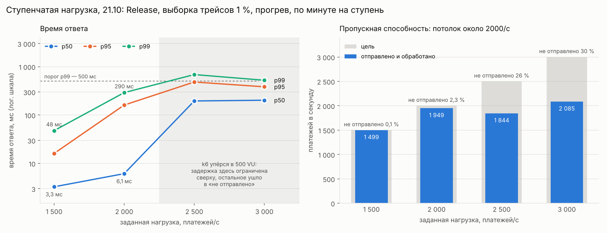
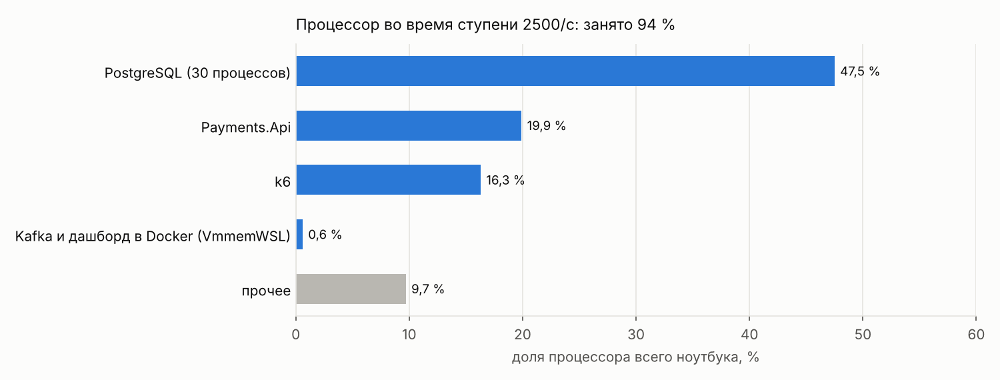
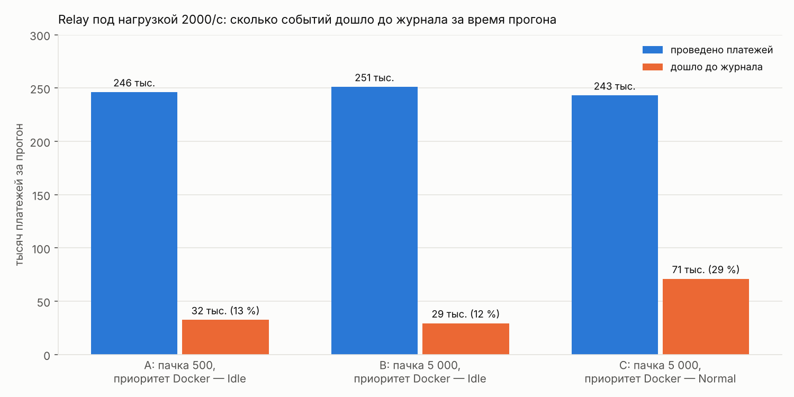
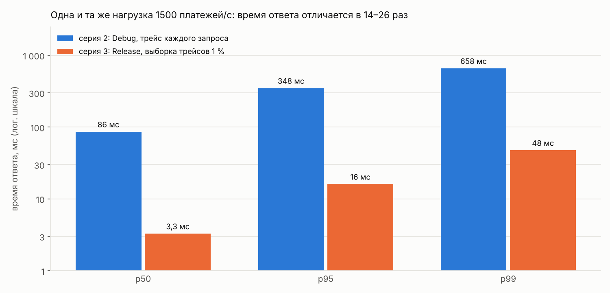
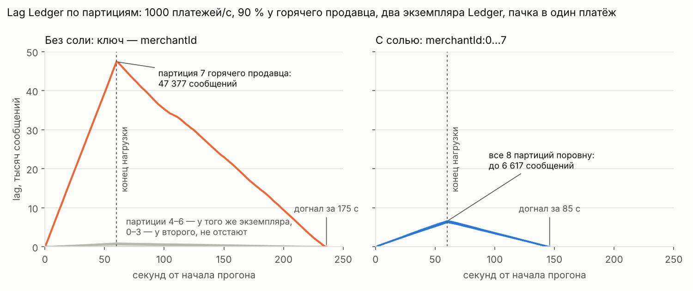

# Нагрузочное тестирование этапа 1

Сколько платежей в секунду выдерживает этап 1 на ноутбуке, где у него колено, во что он упирается и сходятся ли деньги под перегрузкой. Путь платежа: k6 → Payments.Api → БД payments (платёж и строка outbox) → OutboxRelay → Kafka → Ledger.Service → БД ledger.

## Коротко

- **Приём платежей держит 1500 в секунду с p99 = 48 мс.** Колено — между 1500 и 2000: на 2000 p99 вырастает в 6 раз, до 290 мс, и k6 уже не успевает отправить 2,3 % платежей. Потолок — около 1850–2100 платежей в секунду, когда процессор ноутбука занят на 94 %.
- **Вся система без отставания журнала держит около 1500 в секунду.** Выше платежи по-прежнему принимаются, а события копятся в outbox и разбираются после пика: outbox работает как буфер.
- **Деньги сходятся и под перегрузкой.** После ступеней до 3000 в секунду, когда в outbox копилось до 116 тысяч событий, сверка показала 1 553 112 проведённых платежей в базе платежей и ровно столько же в журнале. Зависших платежей нет.
- **Асинхронная часть на стенде упирается в проброс порта Docker Desktop.** Весь трафик Kafka идёт через процесс `com.docker.backend`, а Windows держала его в режиме эффективности с приоритетом `Idle`. При загрузке процессора 94 % он почти не получал времени, и relay переносил около 100 событий в секунду вместо 1900.
- **Методика важна не меньше железа.** Одна и та же нагрузка 1500 в секунду в Debug с трейсом каждого запроса и в Release с выборкой трейсов 1 % отличается по времени ответа в 14–26 раз.

## Стенд

| | |
|---|---|
| Ноутбук | тот же, что в [исследовании PostgreSQL](postgres-experiments.md): Intel Core i5-8250U (4 ядра / 8 потоков, под нагрузкой ~2,27 ГГц), 24 ГБ, SSD, Windows 11 |
| PostgreSQL | 15.12, нативно, порт 5433, `shared_buffers` = 1 ГБ |
| Kafka | apache/kafka 4.0.0, один узел в режиме KRaft, в Docker Desktop (WSL2); топик `payments.captured`, 8 партиций |
| Телеметрия | Aspire Dashboard в Docker, OTLP |
| Payments.Api | .NET 10, Release; пул 16 соединений, `statement_timeout` = 5 с; relay читает outbox пачками по 500 |
| Ledger.Service | .NET 10, Release; пул 8 соединений; пачка на партицию — до 500 платежей или 20 мс |
| Банк | заглушка внутри Payments.Api: отвечает без задержки, отклоняет 2 % платежей |
| Генератор нагрузки | k6 на той же машине |

Всё работает на одном ноутбуке и делит один процессор. Это главное ограничение стенда, и ниже оно видно во всех выводах.

## Методика

- **Открытая модель нагрузки.** Сценарий `constant-arrival-rate` в [load/payments.js](../load/payments.js): платежи приходят с заданной частотой, как бы медленно ни отвечал сервис. В закрытой модели, где N пользователей отправляют запросы по кругу, медленный сервис незаметно снижает себе нагрузку.
- **Виртуальные пользователи (VU).** Заранее создаются 10 % от заданной частоты (не меньше 50), всего не больше 500. Если в момент отправки свободного VU нет, k6 платёж не отправляет и считает его в `dropped_iterations`. Таких платежей нет ни в нагрузке, ни в перцентилях, поэтому их доля — отдельный порог.
- **Пороги, при которых ступень засчитывается:** ошибок меньше 1 %, p95 < 200 мс, p99 < 500 мс, не отправлено меньше 1 % запланированных платежей.
- **Сборка и телеметрия.** Сервисы в Release. Трейсы — выборка 1 % (`OTEL_TRACES_SAMPLER=parentbased_traceidratio`, `OTEL_TRACES_SAMPLER_ARG=0.01`); метрики считаются по всем запросам.
- **Прогрев.** Перед первой ступенью — 20 секунд нагрузки не выше 1000 в секунду без замера. Ступени запускает [load/ladder.ps1](../load/ladder.ps1); графики каждой ступени он сохраняет в HTML-отчёт k6.
- **Чистое состояние.** Ступень начинается при пустом outbox.
- **Корректность.** После каждой ступени — `/invariants` (двойная запись, совпадение балансов с проводками, нулевая сумма балансов), после серии — сверка базы платежей с журналом.
- **Отставание журнала.** Сравниваю прирост `payments` в `/invariants` с числом проведённых платежей. Проведённых — 98 % успешных запросов: остальные 2 % отклоняет банк (по сверке 31 492 из 1 584 604).

К этой методике я пришёл не сразу. Первые серии шли в Debug, без прогрева и с трейсом каждого запроса. Что это меняет — в разделе [«Что исказило первые серии»](#что-исказило-первые-серии).

## Ступенчатая нагрузка

Серия 21.10, 19:47–19:53: Release, выборка трейсов 1 %, прогрев, по минуте на ступень.

| Цель, /с | Факт, /с | p50, мс | p95, мс | p99, мс | Максимум, мс | Не отправлено | Ошибки |
|---|---|---|---|---|---|---|---|
| 1500 | 1499 | 3,3 | 16 | 48 | 189 | 0,07 % | 0 |
| 2000 | 1949 | 6,1 | 161 | 290 | 1 300 | 2,3 % | 0 |
| 2500 | 1844 | 195 | 481 | 686 | 1 880 | 26 % | 0 |
| 3000 | 2085 | 202 | 383 | 523 | 979 | 30 % | 147 |



- **1500 — все пороги пройдены.** Отдельный двухминутный прогон на 1500 дал p50 = 3,6 мс, p99 = 76 мс, не отправлено 0,3 %, и журнал к концу прогона полностью догнал платежи.
- **2000 — колено.** p99 вырос в 6 раз, а k6 не отправил 2,3 % платежей.
- **2500 и 3000 — насыщение.** Фактическая скорость перестаёт расти и держится около 1850–2100 в секунду. k6 упёрся в лимит 500 VU (`Insufficient VUs` в логе), поэтому дальше задержка не растёт: при 500 запросах в работе и ~1850 ответах в секунду она около 500 / 1850 ≈ 0,27 с (закон Литтла). Всё, что сверх, уходит в «не отправлено».
- **147 ошибок на 3000 — отказы TCP в первую секунду** (`connectex: ... actively refused it`). k6 открывает 300 соединений разом, очередь входящих соединений переполняется, и Windows отвечает отказом. Сам сервис не вернул ни одной ошибки ни на одной ступени.

## Корректность под перегрузкой

Сверка после ступеней, когда очередь разобралась:

| | |
|---|---|
| Проведено в базе платежей (`status = 'captured'`) | 1 553 112 |
| Учтено в журнале (`processed_payments`) | 1 553 112 |
| Отклонено банком | 31 492 (2,0 %) |
| Зависших в `created` | 0 |
| Строк в outbox | 0 |
| `/invariants` | ok: несбалансированных платежей 0, расхождений балансов с проводками 0, сумма всех балансов 0 |

Это итог за все прогоны с начала тестов, включая ступени до 3000 в секунду. Ни один платёж не потерян и не учтён дважды. Так работают три механизма: строка outbox пишется той же SQL-командой, что и смена статуса; Kafka доставляет событие хотя бы один раз; журнал отсекает повторы по `processed_payments`. После прогонов A–C (ниже), где отставание доходило примерно до 220 тысяч событий, `/invariants` тоже каждый раз возвращал ok.

## Во что упирается приём платежей



- **Процессор ноутбука занят на 94 %:** PostgreSQL — 47,5 %, Payments.Api — 19,9 %, k6 — 16,3 %.
- **База не заставляет себя ждать.** В `pg_stat_activity` из соединений Payments.Api 11–18 простаивают (`idle`, `ClientRead`), активны 1–5. Запросы ждут процессора в самом приложении, а не ответа базы.
- **Прогноз из исследования PostgreSQL подтвердился.** Там без горячих строк база давала ~4600 транзакций в секунду, «то есть грубо ~2 300 платежей при двух транзакциях на платёж». Вышло 1850–2100, и теперь процессор делят ещё k6, сервисы и Kafka.
- **k6 сам отнимает шестую часть процессора.** На отдельной машине для генератора нагрузки потолок был бы выше.

## Асинхронная часть: почему отстаёт журнал

### Наблюдение

На ступенях от 2000 outbox рос почти со скоростью проведения платежей. Оценка — по снимкам `count(*)` раз в несколько секунд:

| Ступень | Рост outbox | Проводится платежей |
|---|---|---|
| 2000 | ~1870 в секунду | ~1910 в секунду |
| 2500 | ~2000 в секунду | ~1810 в секунду |
| 3000 | ~2160 в секунду | ~2040 в секунду |

Значит, под нагрузкой relay почти ничего не переносил. Ledger в это время простаивал: событий не поступало. Как только ступень заканчивалась, outbox быстро разбирался. Ошибок relay в логах Payments.Api нет — он не падал, а голодал.

### Где relay теряет время

Метрика `payments.outbox.stage.duration` делит цикл relay на этапы. P50 при нагрузке 2000 в секунду:

| Этап | Пачка 500 (прогон A) | Пачка 5000 (прогон B) |
|---|---|---|
| Чтение пачки из outbox (`read`) | 5–25 мс | 25–75 мс |
| Отправка в Kafka и ожидание подтверждений (`produce`) | от 2,5 до 10 с и больше | 10 с и больше |
| Удаление отправленных строк (`delete`) | 5–50 мс | до 50 мс, разовый выброс 500 мс |

10 с — верхняя граница корзин гистограммы по умолчанию, на деле могло быть дольше. Когда outbox небольшой (прогон на 1500 в секунду), то же чтение занимает меньше миллисекунды: `EXPLAIN ANALYZE` показал 0,9 мс. Postgres для relay не узкое место — узкое место отправка в Kafka.

### Эксперименты A, B, C

Нагрузка 2000 в секунду, 2 минуты, прогрев, пустой outbox на старте.

| | A | B | C |
|---|---|---|---|
| Пачка relay | 500 | 5000 | 5000 |
| Приоритет `com.docker.backend` | `Idle` (режим эффективности) | `Idle` | `Normal` |
| Проведено за прогон, с прогревом | 246 тыс. | 251 тыс. | 243 тыс. |
| Дошло до журнала за прогон | 32 тыс. (13 %) | 29 тыс. (12 %) | 71 тыс. (29 %) |
| Приём: p50 / p95 / p99, мс | 13 / 260 / 425 | 9 / 126 / 266 | 36 / 290 / 412 |
| Не отправлено | 3,5 % | 1,4 % | 4,8 % |



- **B: большие пачки не помогли.** Если бы relay ограничивало время одного обмена с Kafka, пачка в 10 раз больше дала бы в 10 раз больше событий. Вместо этого время отправки выросло вместе с пачкой: путь до Kafka ограничен объёмом данных, а не числом обменов.
- **Почему путь до Kafka такой узкий.** Kafka работает в виртуальной машине Docker Desktop, а порт 9092 на Windows слушает процесс `com.docker.backend` и копирует байты внутрь неё. Windows держала этот процесс в режиме эффективности, то есть с приоритетом `Idle` и правом выполнять его на медленных ядрах. При загрузке процессора 94 % он получал время только в паузах. Виртуальная машина с Kafka в это время занимала 0,6 % процессора: до брокера почти ничего не доходило.
- **C: обычный приоритет помог больше чем вдвое.** До журнала дошла 71 тысяча событий против 29–32, но и это меньше трети проведённых платежей. По оценке из `pg_stat_user_tables` relay под нагрузкой переносил около 1000 событий в секунду, а до журнала к концу прогона дошло меньше: Ledger читает Kafka через тот же процесс Docker.
- **Процессор приходится делить.** Время, которое получила асинхронная часть, ушло у приёма платежей: в C время ответа хуже, чем в B. Разброс между прогонами большой — A и B отличаются вдвое при одном изменённом параметре, — но направление логичное.

**Итог.** На 2000 в секунду этому ноутбуку не хватает процессора на обе половины системы: приём держится, только пока асинхронная часть голодает. Без отставания журнала стенд держит около 1500 в секунду. Выше outbox работает как буфер и разбирается после пика, без потерь.

## Что исказило первые серии

| | Серия 1, 20.10 | Серия 2, 21.10, ночь | Серия 3, 21.10, вечер |
|---|---|---|---|
| Сборка и трейсы | Debug, трейс каждого запроса | Debug, трейс каждого запроса | Release, выборка 1 % |
| Прогрев | нет | нет | 20 с |
| Заранее созданных VU | 50 | 10 % от частоты | 10 % от частоты |

Серия 1:

| Цель, /с | Факт, /с | p50, мс | p95, мс | p99, мс | Не отправлено |
|---|---|---|---|---|---|
| 200 | 200 | 3,4 | 7,7 | 18 | 0 |
| 500 | 491 | 4,4 | 37 | 125 | 1,8 % |
| 1000 | 997 | 6,5 | 26 | 51 | 0,3 % |

Серия 2 (ступень 1000 шла сразу после перезапуска сервисов, с открытой живой страницей k6):

| Цель, /с | Факт, /с | p50, мс | p95, мс | p99, мс | Не отправлено |
|---|---|---|---|---|---|
| 1000 | 990 | 7,8 | 56 | 144 | 1,0 % |
| 1500 | 1362 | 86 | 348 | 658 | 9,1 % |
| 2000 | 1675 | 183 | 423 | 670 | 16 % |
| 2500 | 1894 | 213 | 383 | 639 | 24 % |
| 3000 | 1815 | 241 | 433 | 637 | 39 % |



1. **Release и выборка трейсов.** `dotnet run` по умолчанию собирает Debug. Трейс на каждый запрос — это тысячи спанов в секунду, которые дашборд принимает на том же ноутбуке. Медиана на 1500 в секунду упала с 86 до 3,3 мс.
2. **Прогрев.** Первый прогон в Release (1500 в секунду, 2 минуты) прошёл без прогрева: медиана уже 4,2 мс, но p99 = 656 мс и не отправлено 3,7 %. Тот же прогон с прогревом и пустым outbox: p99 = 76 мс, не отправлено 0,3 %.
3. **Пул VU.** В серии 1 k6 заранее создавал 50 VU. Любая заминка длиннее 50 / RATE секунды превращалась в неотправленные платежи, которых нет в перцентилях, и хвост выглядел лучше, чем был. Теперь пул — 10 % от частоты.
4. **Один прогон — не замер.** В серии 1 ступень 500 вышла хуже 1000 (p99 125 мс против 51) из-за заминки посреди прогона, а прогоны A и B различаются вдвое. Сравнивать можно только прогоны из одинакового состояния, а неожиданный результат — проверять повтором.
5. **Живая страница k6 держит процесс.** Пока открыта вкладка web dashboard, k6 не завершается: так задумано, чтобы успеть скачать отчёт. В `ladder.ps1` живая страница выключена, графики сохраняются в HTML.

## Особенности стенда

- **Генератор нагрузки на той же машине** забирает 16 % процессора.
- **Проброс порта Docker Desktop и режим эффективности Windows.** Перед прогоном проверяй приоритет процесса, который слушает порт Kafka, — должен быть `Normal`. После перезапуска Docker Desktop режим эффективности может вернуться.
- **Лимит 500 VU** ограничивает сверху измеренную задержку на насыщении.
- **Отказы TCP в первую секунду**, когда заранее создано 250–300 VU и больше.
- **`/invariants` читает все проводки.** При 3,5–4,5 миллиона проводок проверка под нагрузкой не укладывалась в `statement_timeout` = 10 с и возвращала 500. Теперь у неё свой лимит — 2 минуты (`SET LOCAL statement_timeout`), а консьюмер сохраняет свои 10 секунд.
- **Retention Kafka на стенде — 1 час и 64 МБ на партицию.** Если Ledger отстанет сильнее, события удалятся непрочитанными. В продакшене retention должен быть с запасом больше худшего отставания.
- **Оценка размера outbox.** `n_live_tup` из статистики — приблизительная. `count(*)` точнее, но под нагрузкой по раздутой таблице сам выполнялся секундами.

## Что из этого следует для продакшена

- **Kafka — на своих машинах**, без посредника между сервисом и брокером. Relay и консьюмеры масштабируются отдельно от приёма платежей.
- **Метрики отставания асинхронной части и алерт на них:** возраст самой старой строки outbox и lag консьюмера Ledger. В этих прогонах они сразу показали бы проблему, а не по сверке.
- **Рабочая нагрузка — с запасом ниже точки, где система держится целиком.** Для этого стенда это около 1100–1200 платежей в секунду.
- **Outbox как буфер — достоинство архитектуры:** приём платежей не зависит от Kafka. Но буфер нужно мониторить, а retention брокера — считать от худшего отставания.
- **Замерять в Release и с выборкой трейсов, генератор нагрузки — на отдельной машине.**

## Дальнейшие шаги

- Метрики отставания: возраст самой старой строки outbox (gauge в Payments.Api) и lag консьюмера Ledger.
- Точное колено: ступени от 1500 до 2000 через 100.
- Длительный прогон: 10–15 минут на ~1200 в секунду — чекпоинты, автовакуум, стабильность.
- Снизить нагрузку на процессор от Postgres: автоподготовка запросов в Npgsql (`Max Auto Prepare`), микропачки в Payments.Api.
- Статистика клиента Kafka (librdkafka: `rtt`, `int_latency`): разделить задержку внутри клиента и на пути до брокера.
- Хаос-тест (этап 3): остановить Ledger и Payments.Api посреди нагрузки и проверить сверку.

## Как воспроизвести

Сервисы — каждый в своём окне:

```powershell
docker compose up -d

# окно Ledger
$env:OTEL_TRACES_SAMPLER = "parentbased_traceidratio"
$env:OTEL_TRACES_SAMPLER_ARG = "0.01"
dotnet run -c Release --project src\Ledger.Service

# окно Payments.Api: те же две переменные и метрики раз в 5 секунд
$env:OTEL_TRACES_SAMPLER = "parentbased_traceidratio"
$env:OTEL_TRACES_SAMPLER_ARG = "0.01"
$env:OTEL_METRIC_EXPORT_INTERVAL = "5000"
dotnet run -c Release --project src\Payments.Api
```

Приоритет процесса, который пробрасывает порт Kafka, — должен быть `Normal`:

```powershell
Get-Process -Id (Get-NetTCPConnection -LocalPort 9092 -State Listen).OwningProcess | Select-Object Id, ProcessName, PriorityClass
```

Во время прогона — что делают соединения Postgres и сколько строк в outbox (`psql -p 5433 -U postgres -d payments`):

```sql
SELECT datname, state, wait_event_type, wait_event, count(*),
       (SELECT n_live_tup FROM pg_stat_user_tables WHERE relname = 'outbox') AS outbox
FROM pg_stat_activity
WHERE backend_type = 'client backend' AND pid <> pg_backend_pid()
GROUP BY 1, 2, 3, 4
ORDER BY 5 DESC \watch 2
```

Ступени и эксперимент с пачкой relay:

```powershell
powershell -ExecutionPolicy Bypass -File load\ladder.ps1 -Rates "1500,2000,2500,3000"
powershell -ExecutionPolicy Bypass -File load\ladder.ps1 -Rates "2000" -Duration 120s

# пачка relay 5000: в окне Payments.Api перед dotnet run
$env:Outbox__BatchSize = "5000"
```

Этапы цикла relay — в дашборде: Metrics → `payments-api` → `payments.outbox.stage.duration`, фильтр `stage`.

Сверка, когда outbox опустеет: `captured` должно совпасть с `payments` из `/invariants`, `stuck` и `outbox` — нули.

```powershell
psql -p 5433 -U postgres -d payments -c "SELECT count(*) FILTER (WHERE status = 'captured') AS captured, count(*) FILTER (WHERE status = 'declined') AS declined, count(*) FILTER (WHERE status = 'created') AS stuck, (SELECT count(*) FROM outbox) AS outbox FROM payments"
Invoke-RestMethod http://localhost:5200/invariants
```

Очистка перед новой серией — после сверки, при остановленных сервисах:

```powershell
psql -p 5433 -U postgres -d payments -c "TRUNCATE payments, outbox"
psql -p 5433 -U postgres -d ledger -c "TRUNCATE postings, processed_payments, accounts"
```

# Этап 3: горячий продавец

Один продавец получает половину или 90 % всех платежей. Вопрос: мешает ли он остальным 49 — при приёме платежей и в асинхронной части, где все его события попадают в одну партицию Kafka. Ниже замер **до** изменений лимитера и **после** шага 4а, где лимитер перестал выключаться при сбоях Redis.

## Коротко

- **Лимитер защищает остальных продавцов, пока отвечает Redis.** На 1500 платежей в секунду с горячим продавцом на 90 % у остальных p99 = 126 мс и пороги пройдены. Без лимитера — 758 мс, и k6 не отправил 15 % платежей.
- **Когда Redis не отвечает, лимитер выключается — и горячий продавец перегружает стенд.** Лимитер ждёт Redis 100 мс и после таймаута пропускает всех без лимита 5 секунд. В повторе 5c таких таймаутов было 211: горячий продавец получил 512 платежей в секунду при лимите 200, p99 остальных вырос до 1053 мс, не отправлено 18 %. В прогоне 2 (горячий на 50 %) медиана — 2962 платежа сверх лимита за 2 минуты.
- **Kafka изолирует горячего продавца в асинхронной части.** Без лимитера его партиция получает 1000–1200 событий в секунду, её lag доходит до 9 500 (медиана максимумов; в 6a — 18 000), у остальных партиций — около 170. Журнал догоняет за 1–5 секунд после конца нагрузки.
- **Колено стенда без перекоса — между 1000 и 1500 в секунду.** На этапе 1 оно было между 1500 и 2000, но тогда банк был заглушкой внутри Payments.Api. Теперь это эмулятор по HTTP с задержкой 50 ± 20 мс, и на каждый платёж есть запрос к Redis.
- **Деньги сходятся:** `/invariants` ok после каждого из 18 повторов.
- **После шага 4а сбой Redis больше не снимает лимит.** На время сбоя каждый экземпляр Payments.Api ограничивает продавцов сам. В остальное время платёж проходит, только если согласны и Redis, и локальный бакет. Сверх лимита — 0 во всех 15 повторах с лимитером. До шага 4а худший повтор дал 37 036.
- **Таймауты Redis на 1500 в секунду — от загрузки ноутбука, а не от Redis.** Redis отвечает всегда, просто иногда позже 100 мс: медиана таких ответов — 121 мс. Ответ ждёт процессора вместе со всем стендом.
- **Раз в 5 минут стенд тормозил из-за пула соединений Npgsql.** Пул закрывал простаивающие соединения, а нагрузка тут же открывала их снова. С `Minimum Pool Size`, равным максимуму, это прошло.
- **С двумя экземплярами Payments.Api сбой Redis на 10 секунд стоит около 3 000 платежей сверх лимита**, с одним — от 0 до 83. Локальный бакет каждого экземпляра видит только половину платежей продавца и к началу сбоя полон.
- **Квота горячего продавца (шаг 5) работает как условие договора.** С квотой 1000 в секунду он получает 429 только сверх неё, у остальных нет ни одного 429, а их p99 — как при равномерной нагрузке того же объёма: 185 мс против 167.
- **Отказ банка одному продавцу больше не останавливает остальных (шаг 6).** Пока все вызовы банка шли через один circuit breaker, отказы горячего продавца размыкали его для всех: у остальных 99,9 % ответов — 202. Со своим конвейером у продавца с квотой — 0 %.
- **Горячему продавцу второй экземпляр Ledger не помогает (шаг 7).** Его партиция целиком у одного экземпляра. С медленным писателем (пачка в один платёж) она пишется около 330 платежей в секунду и с одним экземпляром, и с двумя, а равномерную нагрузку второй экземпляр ускоряет в 1,76 раза. Соседи горячего продавца по экземпляру отстают вместе с ним: экземпляр пишет все свои партиции одним циклом. Солёный ключ у крупного продавца разносит его поток по всем партициям, и оба экземпляра пишут его так же быстро, как равномерную нагрузку; цена — отстают все партиции, а не только соседние.
- **Итог этапа: при 90 % у горячего продавца остальные его не замечают.** p99 остальных — 209 мс против 202 при равномерной нагрузке того же объёма, lag прочих партиций — 92 против 92, сверх лимита — 0, ответов 202 — 0. Горячий продавец получает 429 только сверх своей квоты. Таблица «до» и «после» — в разделе «Итог этапа 3».

## Стенд и методика

Отличия от этапа 1:

| | |
|---|---|
| Банк | эмулятор на Go по HTTP: задержка 50 ± 20 мс, отклоняет 2 % |
| Лимитер | токен-бакет в Redis на продавца: 200 в секунду, всплеск 400. До шага 4а: Redis не ответил за 100 мс — лимит не действует 5 секунд (`RedisCircuitBreaker`). Что изменилось — в разделе «После» |
| Kafka | apache/kafka 4.3.2: в 4.0.0 координатор групп после сдвига часов назад переставал записывать состояние группы, и Ledger терял партиции ([KAFKA-19888](https://issues.apache.org/jira/browse/KAFKA-19888)) |
| Нагрузка | 50 продавцов; горячий — продавец 1, остальные платежи поровну у 49 других. Пороги — на запросах `merchant:other`: p95 < 200 мс, p99 < 500 мс, ошибок < 1 %, не отправлено < 1 % |

- **Матрица** — [load/Matrix](../load/Matrix): шесть прогонов по 120 секунд, каждый трижды; повторы идут по кругу (1a, 2a … 6a, потом 1b …), чтобы медленная минута ноутбука не попала в один прогон. Прогон 6 — без лимитера, после перезапуска Payments.Api.
- **Одна стартовая точка.** Матрица запущена с `--fresh`: базы payments и ledger пусты, топик и группа Ledger созданы заново. К концу матрицы в журнале 1,9 млн платежей. Без очистки сравнивать матрицы нельзя: проверка `/invariants` и поиск зависших платежей в `PaymentRecovery` медленнее на больших таблицах. На 6 млн платежей `PaymentRecovery` почти на каждом проходе сканировал всю таблицу `payments` и падал по таймауту, и стенд был заметно медленнее. Теперь восстановление ищет зависшие платежи в очереди `pending_payments` (раздел «Индекс для поиска зависших»), но `/invariants` по-прежнему читает весь журнал.
- **Прогрев** — 60 секунд после каждого запуска Payments.Api.
- **Outbox и lag** матрица замеряет раз в секунду; замер, на который Postgres или Kafka отвечали дольше 2 секунд, отбрасывается — lag в нём завышен.
- В таблице — медиана трёх повторов.

## До изменений лимитера

Матрица 08.11, 18:19–18:59.

| Прогон | Платежей/с | Горячий | Лимитер | p99 остальных, мс | p99 горячего (201), мс | Горячему прошло, /с | Сверх лимита | Отключений лимитера | Не отправлено | Lag: горячая / прочие партиции | Пороги |
|---|---|---|---|---|---|---|---|---|---|---|---|
| 1 | 1000 | — | вкл. | 181 | — | — | — | 9 | 0,21 % | — / 116 | не прошли в 1 из 3 |
| 2 | 1000 | 50 % | вкл. | 209 | 285 | 228 | 2 962 | 13 | 0,62 % | 185 / 52 | не прошли в 1 из 3 |
| 3 | 1000 | 90 % | вкл. | 93 | 101 | 203 | 0 | 0 | 0 % | 32 / 6 | ok |
| 4 | 1500 | — | вкл. | 460 | — | — | — | 113 | 2,3 % | — / 267 | не прошли в 3 из 3 |
| 5 | 1500 | 90 % | вкл. | 126 | 172 | 204 | 38 | 5 | 0,5 % | 101 / 16 | не прошли в 1 из 3 |
| 6 | 1500 | 90 % | выкл. | 758 | 750 | 1 139 | — | — | 15 % | 9 516 / 167 | не прошли в 3 из 3 |

**Сверх лимита** — на сколько принятых платежей горячего продавца больше, чем пропускает его бакет за прогон: 400 + 200 × 120 = 24 400. **Отключений лимитера** — сколько раз Redis не ответил за 100 мс.

- **С лимитером горячий продавец на 90 % облегчает стенд, а не нагружает.** Прогоны 3 и 5 быстрее прогонов 1 и 4 без перекоса: ответ 429 стоит дёшево, а принятых платежей горячего продавца — около 200 в секунду. Прогон 5 при 1500 в секунду быстрее прогона 1 при 1000.
- **Без лимитера (прогон 6) горячий продавец забирает процессор у всех.** Payments.Api принимает 1100–1200 его платежей в секунду, и остальные получают p99 = 758 мс — в 6 раз хуже прогона 5 с той же нагрузкой.
- **Утечки лимитера идут от таймаутов Redis.** В 3b, 3c и 5b таймаутов не было — и сверх лимита ноль. Один таймаут в повторе 3a — 4 075 лишних платежей: 5 секунд без лимита при 900 запросах горячего продавца в секунду. В повторе 5c таймауты шли сериями, лимит не действовал большую часть минуты, и стенд вёл себя почти как без лимитера.
- **Асинхронная часть изолирует горячую партицию.** В прогоне 6 lag горячей партиции растёт всю нагрузку, до 9 500 сообщений, у остальных держится около 150: один писатель на партицию в Ledger не даёт горячему продавцу задерживать чужие события. Outbox при этом не копится — не старше 1,3 секунды.
- **1500 без перекоса — уже за коленом** (прогон 4): p99 = 460 мс, не отправлено 2,3 %, пороги не пройдены ни в одном повторе. При 1000 пороги пройдены в двух повторах из трёх.

**Оговорки.**
- Первый круг повторов медленнее остальных и после 60 секунд прогрева: 1a — 562 мс против 180 и 181 у 1b и 1c, 4a — 876 против 460 и 365. Медиана трёх повторов это сглаживает, а причину стоит найти: возможно, база, только что очищенная, растёт с нуля, или Kafka после пересоздания.
- Повтор 5c — сбой Redis посреди нагрузки, не свойство прогона: в 5a и 5b таймаутов 5 и 0. Но этот сбой и показывает главный риск нынешнего лимитера.
- Приоритет процесса Docker матрица проверить не смогла: порт 9092 на Windows не слушает ни один процесс. `com.docker.backend` работал с приоритетом `Normal`.

## После: локальный лимит при сбое Redis

Шаг 4а изменил две вещи в `Payments.Api/RateLimiting`:

- **Пока Redis не отвечает, лимит считает сам экземпляр.** Раньше после таймаута лимит не действовал 5 секунд. Теперь в это время решает `LocalMerchantLimiter` — токен-бакет на продавца в памяти процесса (`PartitionedRateLimiter`) с тем же лимитом, 200 в секунду и всплеск 400.
- **Breaker замыкает только пробный запрос.** Раньше его замыкал любой ответ Redis, в том числе на запрос, отправленный до сбоя. Под нагрузкой breaker мерцал: размыкался и замыкался по нескольку раз в секунду, и каждый раз запросы снова ждали зависший Redis. Теперь после паузы в 5 секунд в Redis идёт один пробный запрос, и только его ответ возвращает общий лимит.

Матрица 09.11, 17:00–17:40, с теми же настройками и тоже с `--fresh`. Медианы трёх повторов, «до» → «после»:

| Прогон | Платежей/с | Горячий | Лимитер | p99 остальных, мс | Не отправлено | Сверх лимита | Сбоев Redis |
|---|---|---|---|---|---|---|---|
| 1 | 1000 | — | вкл. | 181 → 157 | 0,21 → 0,05 % | — | 9 → 0 |
| 2 | 1000 | 50 % | вкл. | 209 → 128 | 0,62 → 0,13 % | 2 962 → 774 | 13 → 1 |
| 3 | 1000 | 90 % | вкл. | 93 → 93 | 0 → 0 % | 0 → 0 | 0 → 0 |
| 4 | 1500 | — | вкл. | 460 → 360 | 2,3 → 1,1 % | — | 113 → 16 |
| 5 | 1500 | 90 % | вкл. | 126 → 125 | 0,5 → 0,12 % | 38 → 754 | 5 → 1 |
| 6 | 1500 | 90 % | выкл. | 758 → 383 | 15 → 0,81 % | — | — |

**Сбоев Redis** — строк `Redis did not answer` в логе Payments.Api. До шага 4а мерцающий breaker писал по строке на каждое размыкание, поэтому число «до» больше числа сбоев. После — строка на сбой.

- **Худший случай закрыт.** Из девяти повторов с горячим продавцом и лимитером больше всего сверх лимита — 1 858 (2a, три сбоя Redis). До шага 4а был повтор 5c: 37 036 сверх лимита, горячий продавец получал 512 платежей в секунду при лимите 200, а остальные — p99 = 1053 мс.
- **Цена одного сбоя — около двух всплесков бакета.** Один сбой Redis — 754–784 платежа сверх лимита (5a, 5c, 2c). Первые 400: локальный бакет в начале сбоя полный, он не знает, сколько продавец уже потратил в Redis. Ещё до 400: бакет в Redis за время сбоя пополняется, потому что не видит платежей, пропущенных локально. Оба компромисса записаны в `LocalMerchantLimiter`.
- **Типичный повтор прогона 5 стал хуже: 38 → 754.** До шага 4а большинство «отключений» были мерцанием: breaker замыкался через миллисекунды, и короткий сбой почти ничего не пропускал. Теперь каждый сбой — это 5 секунд локального лимита и два всплеска. Это плата за то, что длинный сбой больше не снимает лимит совсем.
- **Мерцания больше нет.** В логе строки идут парами: «did not answer», затем «answers again», когда ответил пробный запрос, — обычно через 5 секунд, изредка через 10, если первый пробный тоже не дождался Redis. На 1500 в секунду без перекоса (прогон 4) Redis не отвечал за 100 мс 16 раз за повтор. Продавцам это ничем не грозило: у каждого около 30 платежей в секунду, ниже лимита.
- **Время ответа между матрицами сравнивать нельзя.** Прогон 6 идёт без лимитера, шаг 4а его не касается, а p99 остальных упал с 758 до 383 мс, «не отправлено» — с 15 % до 0,81 %. Так же отличаются от дня ко дню и прогоны 1 и 4. Поэтому о шаге 4а говорят столбцы «Сверх лимита» и «Сбоев Redis», а не p99.
- **Первый круг повторов по-прежнему медленнее:** 1a — 456 мс против 157 и 147 у 1b и 1c.

### Локальный бакет следует за Redis

Пока Redis отвечает, фильтр на каждый пропущенный Redis платёж тратит токен и в локальном бакете. Сбой начинается с того, что у продавца осталось, а не с полного бакета. Матрица 09.11, 17:51–18:30, медианы; в скобках — матрица после первой части шага 4а:

| Прогон | Платежей/с | Горячий | Лимитер | p99 остальных, мс | Не отправлено | Сверх лимита | Сбоев Redis |
|---|---|---|---|---|---|---|---|
| 1 | 1000 | — | вкл. | 140 (157) | 0 % (0,05 %) | — | 0 (0) |
| 2 | 1000 | 50 % | вкл. | 126 (128) | 0 % (0,13 %) | 0 (774) | 1 (1) |
| 3 | 1000 | 90 % | вкл. | 84 (93) | 0 % (0 %) | 0 (0) | 0 (0) |
| 4 | 1500 | — | вкл. | 277 (360) | 0,45 % (1,1 %) | — | 12 (16) |
| 5 | 1500 | 90 % | вкл. | 112 (125) | 0,04 % (0,12 %) | 465 (754) | 1 (1) |
| 6 | 1500 | 90 % | выкл. | 762 (383) | 8,2 % (0,81 %) | — | — |

- **Один сбой Redis теперь стоит около 400 платежей сверх лимита вместо 750–800.** Повторы с одним сбоем — 408, 411, 465; 5c с четырьмя сбоями — 1 551, по 390 на сбой. Худший повтор — 1 551 против 1 858 в прошлой матрице и 37 036 до шага 4а.
- **Оставшиеся ~400 — второй всплеск.** Бакет в Redis не видит платежей, пропущенных локально, за 5 секунд сбоя наполняется до 400 и после сбоя пропускает их разом. Убрать его можно, если и после сбоя пропускать платёж, только когда согласны и Redis, и локальный бакет; локальный видит лишь часть платежей продавца при том же лимите, так что общий лимит не ужесточает. Цена — расхождения часов двух бакетов у продавца, который ровно на лимите.
- **Прогон 6 снова на уровне «до» — 762 мс.** Прошлая матрица дала 383 мс на том же коде без лимитера: ещё одно подтверждение, что время ответа между матрицами отличается вдвое и без изменений в коде.
- **Первый круг повторов на этот раз не медленнее остальных:** 1a — 146 мс, 1b и 1c — 140 и 122. Значит, и это различие между матрицами — разброс стенда, а не свойство первого круга.

### Redis и локальный бакет решают вместе

Последняя часть шага 4а:

- **Платёж проходит, только если согласны оба бакета** — не только во время сбоя, но и после. Redis разрешил — фильтр берёт токен и из локального бакета; токена нет — 429. Бакет Redis, наполнившийся за время сбоя, больше не пропускает лишний всплеск: его токены уходят на платежи, которые не пропустил локальный бакет.
- **Пауза breaker — 1 секунда вместо 5.** Общий лимит возвращается быстрее. Пока Redis не отвечает, пробный запрос уходит раз в секунду на экземпляр.
- **Сбой пишет в лог, что делал процесс.** Сколько из 100 мс ожидания процесс простоял в GC, сколько потоков в пуле и сколько работы ждёт в очереди. Отдельной строкой — через сколько Redis всё-таки ответил.

Матрица 09.11, 19:00–19:40, медианы; в скобках — предыдущая матрица, 17:51–18:30:

| Прогон | Платежей/с | Горячий | Лимитер | p99 остальных, мс | Не отправлено | Сверх лимита | Сбоев Redis |
|---|---|---|---|---|---|---|---|
| 1 | 1000 | — | вкл. | 147 (140) | 0 % (0 %) | — | 0 (0) |
| 2 | 1000 | 50 % | вкл. | 128 (126) | 0,13 % (0 %) | 0 (0) | 1 (1) |
| 3 | 1000 | 90 % | вкл. | 89 (84) | 0 % (0 %) | 0 (0) | 0 (0) |
| 4 | 1500 | — | вкл. | 359 (277) | 1,2 % (0,45 %) | — | 37 (12) |
| 5 | 1500 | 90 % | вкл. | 117 (112) | 0,02 % (0,04 %) | 0 (465) | 1 (1) |
| 6 | 1500 | 90 % | выкл. | 253 (762) | 0,63 % (8,2 %) | — | — |

- **Сверх лимита — 0 во всех 15 повторах с лимитером**, в том числе в пяти повторах прогонов 2 и 5, где Redis сбоил. В прошлой матрице — от 408 до 1 551 в четырёх повторах из шести.
- **Цена — 27–38 платежей за прогон в другую сторону.** Горячий продавец получил 24 362–24 373 платежа из 24 400, которые пропускает его бакет; в прошлой матрице в 2a и 2b, где сверх лимита не прошло ничего, — 24 397 и 24 394. Это расхождение двух бакетов на границе лимита: локальный пополняется раз в 100 мс, Redis — непрерывно, и локальный иногда отказывает в платеже, который Redis уже разрешил. Каждый такой отказ оставляет в локальном бакете лишний токен, так что отказы прекращаются сами. Разница одинакова в повторах со сбоем и без — около двух порций по 20 токенов.
- **Сбоев Redis в прогоне 4 втрое больше: 37 против 12.** Самих сбоев больше не стало, просто раньше их не было видно: с паузой 5 секунд следующий сбой часто приходился на паузу и в лог не попадал. В прошлой матрице строки шли раз в 6–8 секунд: 5 секунд паузы и ещё несколько секунд до следующего сбоя.
- **Прогон 4 медленнее: 359 мс против 277**, не отправлено 1,2 % против 0,45 %. Прогон 6 без лимитера при этом втрое быстрее — 253 против 762, так что в основном это разброс стенда. Но часть разницы может дать и короткая пауза: с паузой 5 секунд прогон 4 около 60 секунд из 120 обходился без Redis, теперь — около 37.

### Откуда таймауты Redis на 1500 в секунду

По новым строкам лога, матрица 19:00–19:40. Сбоев 132: 111 — в прогоне 4, 7 — на прогреве, 14 — в остальных прогонах.

- **Redis отвечает всегда, просто поздно.** Все 132 вызова, которые лимитер перестал ждать, получили ответ, ни один не упал по таймауту самого StackExchange.Redis. Для 114 известно, через сколько: медиана — 121 мс, 9 из 10 — до 178 мс, самый долгий — 462 мс.
- **GC ни при чём.** За 100 мс ожидания GC останавливал процесс в 19 сбоях из 132, на 17–82 мс, и ни разу на все 100.
- **Дело в нагрузке стенда, а не Redis.** Почти все сбои — в прогоне 4, где принимаются все 1500 платежей в секунду. В прогоне 5 запросов к Redis столько же, но три четверти из них кончаются быстрым 429, и сбой один на повтор. В момент сбоя в пуле Payments.Api 10–11 потоков, а в очереди ждёт работа: медиана — 32 задачи, до 287. Работа идёт, но процессора не хватает: ноутбук на 4 ядрах держит весь стенд, и ответ Redis ждёт своей очереди, как и всё остальное. Самые долгие задержки задевают и звонки в банк: в те же секунды бывают пачки таймаутов по 300 мс, до 185 за секунду, а эмулятор банка работает не в Docker.
- **Лимиту эти сбои больше не вредят.** Секунда локального лимита у одного экземпляра — тот же лимит. Поэтому таймаут 100 мс увеличивать не нужно: он ограничивает, сколько платёж ждёт Redis, который действительно завис.
- **Отдельно — сбой раз в 5 минут.** Сбои вне прогона 4 почти все приходятся на 5, 10, 15… минут после старта Payments.Api — с точностью до нескольких секунд, в обеих матрицах. Это пул соединений Npgsql, ниже.

### Сбой раз в 5 минут: пул соединений Npgsql

- **Тормозил весь стенд, а не Redis.** В матрицах 17:51 и 19:00 в секунды +5, +10, +15… минут от старта Payments.Api собственные запросы матрицы к Postgres отвечали 15–55 мс вместо 1–3, к Kafka — 48–183 мс вместо 10–15, а в outbox на секунду копилось до 220 строк вместо обычных 10–50.
- **Причина — чистка пула в Npgsql.** Раз в `Connection Idle Lifetime`, по умолчанию 300 секунд, Npgsql закрывает столько соединений, сколько простаивало в медиане его замеров; замеры он делает раз в 10 секунд. Под нагрузкой эти соединения нужны снова, и пул открывает их все разом. В песочнице ровно через 5 минут после открытия пула 11 из 16 соединений Payments.Api и соединение Ledger открылись заново за 0,4 секунды. На Windows каждое соединение с Postgres — новый процесс сервера.
- **Исправление — `Minimum Pool Size`, равный `Maximum Pool Size`**: 16 у Payments.Api, 8 у Ledger. Ниже минимума Npgsql соединения не закрывает. В песочнице через 5 минут 40 секунд все соединения остались теми, что открылись при старте.
- **На ноутбуке всплески пропали.** В двух сериях с паузой Redis (ниже) в отметки +5 и +10 минут Postgres отвечал матрице за 1–9 мс, Kafka — за 7–33 мс, и сбоев Redis в эти секунды не было.

### Два экземпляра Payments.Api

Два новых параметра матрицы. `--instances 2` запускает второй экземпляр на порту 5101, и k6 шлёт запросы обоим по очереди; outbox и поиск зависших платежей ведёт один из них, тот, что взял лидерскую блокировку. `--redis-pause 10` в середине каждого повтора на 10 секунд задерживает все команды к Redis (`CLIENT PAUSE`) — как зависший Redis, одинаково в каждом повторе. Две серии 09.11, прогоны 2 и 5 по три повтора, обе с `--fresh`: 20:21–20:34 с одним экземпляром, 20:36–20:50 с двумя. Медианы:

| Прогон | Платежей/с | Горячий | Экземпляров | p99 остальных, мс | p99 горячего (201), мс | Горячему прошло, /с | Сверх лимита | Сбоев Redis | Lag горячей партиции |
|---|---|---|---|---|---|---|---|---|---|
| 2 | 1000 | 50 % | 1 | 123 | 135 | 203 | 0 | 1 | 151 |
| 2 | 1000 | 50 % | 2 | 141 | 163 | 229 | 3 050 | 2 | 301 |
| 5 | 1500 | 90 % | 1 | 112 | 143 | 204 | 51 | 1 | 53 |
| 5 | 1500 | 90 % | 2 | 122 | 320 | 227 | 2 879 | 2 | 654 |

**Сбоев Redis** с двумя экземплярами — по строке от каждого: одна пауза дала две строки.

- **С одним экземпляром пауза почти ничего не стоит:** сверх лимита от 0 до 83 за повтор, меньше полсекунды лимита. Локальный бакет к началу сбоя пуст, как и бакет Redis, а после сбоя не даёт Redis пропустить наполнившийся за паузу всплеск.
- **С двумя — около 3 000 за одну паузу.** Каждый экземпляр видит половину платежей, которые пропустил Redis, — 100 в секунду при пополнении 200, — так что к началу сбоя его локальный бакет полон. Пауза вместе с ожиданием пробного запроса длится около 10,2 секунды, и за это время каждый экземпляр пропускает свои 400 и по 200 в секунду: вместе около 4 900, а по лимиту — около 2 000. После паузы оба бакета пусты, но пополняются вдвое быстрее, чем Redis, и пропускают ещё около 200 из его всплеска. Итого около 3 000; медианы — 3 050 и 2 879.
- **Повторы выше медианы — с лишним сбоем.** В 2b (3 592) и 5b (3 477) Redis ещё раз не ответил вне паузы. Пока бакеты полны, секунда локального лимита добавляет ещё сотни платежей: всплеск и секунду лимита на каждый экземпляр, который не дождался Redis.
- **Платят горячий продавец и его партиция, не остальные.** p99 остальных — 141 и 122 мс против 123 и 112 с одним экземпляром, пороги пройдены во всех повторах. Платежей горячего продавца за паузу проходит больше: его p99 в прогоне 5 — 320 мс против 143, lag его партиции — 654 против 53.
- **Это тот компромисс, что записан в `LocalMerchantLimiter`.** Бакет, который следует за Redis, помогает, только если экземпляр видит все платежи продавца. При N ≥ 2 экземплярах сбой длиной T стоит около N × всплеск + (N − 1) × лимит × T.

**Что ещё можно сделать:**
- Давать локальному бакету долю лимита: 1/N лимита и всплеска на каждый из N экземпляров. Тогда во время сбоя они вместе пропускают один лимит, а пока Redis отвечает, каждый видит свою долю платежей и снова следует за Redis. Для этого нужно знать N — например, каждый экземпляр раз в несколько секунд отмечается в Redis ключом с коротким TTL, а во время сбоя действует последнее известное число. Цена — неровная балансировка: если продавцу шлёт запросы в основном один экземпляр, его доля станет узким местом и, пока Redis отвечает, будет отказывать в платежах, которые Redis пропускает.

## Шаг 5: квоты продавцов

У крупного продавца своя квота поверх общего лимита: `RateLimiting:Merchant:Overrides` в `appsettings.json`, merchantId → скорость и всплеск. Квоты перечитываются при изменении файла, без перезапуска, а отказы размечены атрибутом `quota` — `default` или `override`. Горячему продавцу дана квота 1000 в секунду и всплеск 2000 (`--hot-quota 1000`): стенд держит около 1500 в секунду, и 500 остаётся остальным.

Матрица 09.11, 23:22–23:48, с `--fresh`, прогоны 1, 3, 4 и 5 по три повтора. Медианы:

| Прогон | Платежей/с | Горячий | Стенд принимает, /с | p99 остальных, мс | 429 у горячего | Горячему прошло, /с | Lag: горячая / прочие партиции |
|---|---|---|---|---|---|---|---|
| 1 | 1000 | — | ≈ 1 000 | 167 | — | — | — / 125 |
| 3 | 1000 | 90 % | ≈ 1 000 | 185 | 0 % | 900 | 543 / 11 |
| 4 | 1500 | — | ≈ 1 500 | 265 | — | — | — / 230 |
| 5 | 1500 | 90 % | ≈ 1 165 | 199 | 25 % | 1 015 | 472 / 14 |

- **429 у горячего продавца — только сверх квоты.** В прогоне 3 он шлёт 900 в секунду, меньше квоты, и отказов у него нет. В прогоне 5 шлёт 1 350, а проходит 1 015: 1000 в секунду и всплеск 2000, растянутый на 120 секунд. Сверх квоты — 0 во всех повторах, у остальных 49 продавцов — ни одного 429.
- **Соседи замечают горячего продавца не больше, чем равномерную нагрузку того же объёма.** Прогон 3 принимает столько же, сколько прогон 1, и p99 остальных — 185 мс против 167. Прогон 5 принимает около 1 165 в секунду, и его 199 мс лежат между 167 при 1000 и 265 при 1500 без перекоса. Разница меньше разброса повторов: в 1c, без горячего продавца, p99 был 855 мс.
- **Цена квоты — нагрузка, которую раньше отсекал лимит.** С общим лимитом 200 стенд в прогонах 3 и 5 принимал 300–350 платежей в секунду, и p99 остальных был 84–126 мс. С квотой горячий продавец проходит, и стенд работает у своего колена, как без перекоса.
- **Горячая партиция отстаёт сильнее остальных.** При 900–1000 событиях в секунду её lag доходит до 472–543 сообщений (медианы максимумов), у прочих — 11–14, и журнал догоняет за секунду после нагрузки. С этих цифр начинается эксперимент шага 7.
- **Серия — после перезагрузки ноутбука.** Предыдущая серия того же вечера шла на стенде, замедлившемся к концу дня в 3–10 раз даже в прогонах без горячего продавца: таймаутов звонков в банк было 7 660 против 979 здесь. В сравнение она не взята.

## Шаг 6: банк отказывает одному продавцу

Эмулятор отвечает 500 на каждую авторизацию горячего продавца, а остальных обслуживает как обычно (`--bank-fails-hot`, в эмуляторе — `BANK_ERROR_MERCHANT`). Нагрузка — прогон 3: 1000 платежей в секунду, 90 % у горячего продавца. Квота 1000 в секунду (`--hot-quota 1000`) нужна, чтобы все его платежи доходили до банка. По одному повтору с `--fresh`, 10.11: «до» — 00:33–00:36 на коммите `0c0c6fa`, «после» — 00:37–00:40 на `11ddf30`.

До шага 6 все вызовы банка шли через один конвейер устойчивости с одним circuit breaker. После у продавца со своей квотой свой конвейер (`BankPipeline`), у остальных — общий.

| | 202 у остальных | 202 у горячего | p99 остальных, мс | Какой breaker размыкался | Восстановление |
|---|---|---|---|---|---|
| До: один конвейер | 99,9 % (11 972 из 11 987) | 100 % | 10 | общий, 36 раз | стоит: 15 пауз «Bank unavailable», ни одного разобранного платежа |
| После: свой у горячего | 0 % (из 12 139) | 100 % | 117 | только `merchant-1`, 36 раз | отклонило 92 000 платежей горячего продавца |

Размыкания breaker — по логу Payments.Api за прогрев и прогон, около трёх минут: раз в 5 секунд, после каждой паузы.

- **До: отказ банка одному продавцу останавливает всех.** 90 % вызовов — отказы горячего продавца, и общий breaker (размыкается при 50 % отказов) после каждой паузы почти сразу размыкается снова. Остальные 49 продавцов получают 202 почти на каждый платёж, хотя банк их обслуживает. Их p99 = 10 мс — это быстрый отказ без вызова банка, а не хорошая работа.
- **И восстановление тоже стоит.** Поиск решения шёл через тот же breaker, а проход восстановления прерывается на первом платеже без ответа. Когда банк снова ответит, платежи остальных продавцов будут отклонены: банк их не видел. Для клиента это 202, а потом отказ.
- **После: размыкается только breaker горячего продавца.** Общий не разомкнулся ни разу, у остальных ни одного 202, пороги пройдены. Горячий продавец получает 202 сразу, без трёх попыток: его breaker открыт.
- **Восстановление работает без пауз.** Поиск решения идёт через общий конвейер, банк отвечает на него 404 — решения нет, — и платежи горячего продавца отклоняются: 92 000 к концу прогона.
- **p99 остальных — 117 мс, меньше 185 в прогоне 3 шага 5.** Платежи горячего продавца до банка не доходят и не проводятся: ни outbox, ни Kafka, ни журнала, только запись в `created` и ответ 202. Стенд проводит около 100 платежей в секунду, а не 1000, зато параллельно восстановление отклоняет сотни в секунду.

## Шаг 7: горячая партиция и один писатель

Ключ сообщения — merchantId, поэтому весь поток горячего продавца идёт в одну партицию, а группа отдаёт партицию одному экземпляру Ledger целиком. Вопрос: упирается ли горячий продавец в этого одного писателя и поможет ли второй экземпляр. С обычной пачкой до 500 платежей писатель успевает: в шаге 5 горячая партиция отставала не больше чем на 543 сообщения. Поэтому писатель здесь замедлен нарочно: `--ledger-batch 1` — одна SQL-команда и один коммит смещения на платёж.

Две серии 10.11, обе с `--fresh`, прогоны 1 и 3 по одному повтору в 60 секунд, квота горячего продавца 1000 в секунду, код матрицы — коммит `ad8e35a`: 00:52–01:03 с одним экземпляром Ledger, 01:04–01:13 с двумя (`--ledgers 2`).

| Прогон | Экземпляров Ledger | Партиции экземпляров: сообщений в секунду | Запись журнала, пик /с | Запись горячей партиции, пик /с | Lag горячей партиции, макс. | Lag прочих партиций, макс. | Догнал за, с |
|---|---|---|---|---|---|---|---|
| 1, без перекоса | 1 | все 8: 981 | 353 | — | — | 8 641 | 154 |
| 1, без перекоса | 2 | 0–3: 477; 4–7: 502 | 621 | — | — | 8 105 | 82 |
| 3, горячий 90 % | 1 | все 8: 981 | 355 | 323 | 47 689 | 850 | 152 |
| 3, горячий 90 % | 2 | 0–3: 47; 4–7 с горячей 7: 933 | 346 | 331 | 47 377 | 904 | 175 |

**Запись, пик** — на сколько продвинулись закоммиченные смещения за 10 секунд замеров, в секунду; пока партиция отстаёт, это скорость её писателя.

- **Экземпляр с пачкой в один платёж пишет около 350 платежей в секунду**, около 2,8 мс на платёж, а приходит 980. Lag растёт во всех четырёх прогонах.
- **Равномерную нагрузку второй экземпляр ускоряет в 1,76 раза:** 621 платёж в секунду против 353, и журнал догоняет за 82 секунды вместо 154. Не вдвое: оба экземпляра делят процессор ноутбука, Postgres и Kafka.
- **Горячему продавцу второй экземпляр не помогает:** его партиция пишется со скоростью 331 в секунду против 323, lag тот же — около 47 тысяч. Партиция 7 досталась одному экземпляру целиком. Второму достались партиции 0–3 и 47 сообщений в секунду: он простаивал, и весь журнал писался не быстрее, чем с одним экземпляром.
- **Горячий продавец задерживает соседей по экземпляру.** Экземпляр пишет все свои партиции одним циклом, по очереди, а сообщения всех его партиций приходят в одну очередь консьюмера. Сообщения прочих партиций ждут там за сообщениями горячей. С одним экземпляром отставали все 7 прочих партиций, до 850 сообщений. С двумя — только три, что делят экземпляр с горячей (4–6, до 904); 0–3 не отставали. Платежи этих соседей попадали в журнал вместе с хвостом горячей партиции, до 2,5–3 минут после конца нагрузки. Изоляция партицией работает, пока писатель успевает: партиция у горячего продавца своя, а цикл записи — общий.

### Солёный ключ

Решение шага 7: у крупного продавца, то есть у продавца со своей квотой, ключ сообщения — `merchantId:n`, где n — последний байт paymentId по модулю 8 (`Topics.PaymentsCapturedKey`). Восемь ключей продавца попадают в восемь разных партиций: партиционер librdkafka берёт CRC32 ключа по модулю 8, а ключи отличаются только младшими тремя битами последнего байта. Ledger пишет продавцу на суб-счёт своей партиции, `merchant:{id}:p{n}`, баланс продавца — сумма суб-счетов.

Тот же прогон с двумя экземплярами Ledger и пачкой в один платёж, 10.11, 01:54–02:02, с `--fresh`, после перезагрузки ноутбука:

| Прогон | Ключ горячего продавца | Партиции экземпляров: сообщений в секунду | Запись журнала, пик /с | Lag, макс. | Догнал за, с |
|---|---|---|---|---|---|
| 1, без перекоса | — | 0–3: 482; 4–7: 497 | 595 | 8 092 | 92 |
| 3, горячий 90 % | merchantId (серия выше) | 0–3: 47; 4–7 с горячей: 933 | 346 | 47 377, одна партиция | 175 |
| 3, горячий 90 % | с солью | 0–3: 489; 4–7: 490 | 627 | 6 617, все партиции поровну | 85 |



- **С солью горячий продавец пишется так же быстро, как равномерная нагрузка:** 627 платежей в секунду при 595 у прогона 1 той же серии. Без соли — 346, в 1,8 раза медленнее. Оба экземпляра получают по половине потока, отставание ровное по всем восьми партициям, и журнал догоняет за 85 секунд вместо 175.
- **Цена видна в той же таблице: отстают все партиции.** Без соли с двумя экземплярами партиции 0–3 не отставали совсем. С солью у каждой партиции есть доля горячего продавца, и соседи всех партиций ждут вместе с ним. Соль меняет изоляцию на пропускную способность. Соседей по экземпляру защитила бы запись партиций параллельно, каждой своей задачей, с паузой выборки (`Pause`/`Resume` консьюмера) у партиции, чей писатель не успевает. Это задача 8 в README.
- **Пороги пройдены в обоих прогонах**, p99 остальных — 185 и 202 мс. Первая попытка той же ночи шла на замедлившемся стенде: p99 прогона 1 — 349 мс, не отправлено 1,5 % платежей, Redis 48 раз не ответил лимитеру. В сравнение она не взята, но отношение прогонов 3 и 1 в ней было тем же: 547 к 541.

## Итог этапа 3: до и после

Итоговая матрица 10.11, 13:02–13:29, на коммите `ade1645`, с `--fresh`: прогоны 1, 3, 4 и 5 по три повтора, квота горячего продавца 1000 в секунду, его ключ — с солью. Прогоны 2 и 6 (горячий на 50 % и без лимитера) мерили лимитер до шага 4а и в итог не входят. Медианы трёх повторов:

| Прогон | Платежей/с | Горячий | p99 остальных, мс: до → шаг 5 → итог | Горячему прошло, /с: до → итог | Lag, макс., горячая / прочие партиции: до → шаг 5 → итог | Не отправлено, итог | Пороги, итог |
|---|---|---|---|---|---|---|---|
| 1 | 1000 | — | 181 → 167 → 202 | — | — / 116 → — / 125 → — / 92 | 0,21 % | ok |
| 3 | 1000 | 90 % | 93 → 185 → 209 | 203 → 900 | 32 / 6 → 543 / 11 → 80 / 92 | 0,11 % | не прошли в 1 из 3 |
| 4 | 1500 | — | 460 → 265 → 369 | — | — / 267 → — / 230 → — / 226 | 1,3 % | не прошли в 3 из 3 |
| 5 | 1500 | 90 % | 126 → 199 → 211 | 204 → 1 015 | 101 / 16 → 472 / 14 → 80 / 92 | 0,11 % | ok |

«До» — матрица 08.11, до шага 4а: общий лимит 200 в секунду у всех продавцов. «Шаг 5» — матрица 09.11: квота 1000 в секунду у горячего продавца, ключ без соли.

- **Критерий этапа выполнен.** При 90 % у горячего продавца p99 остальных и отставание журнала такие же, как при равномерной нагрузке того же объёма: 209 мс против 202, lag прочих партиций — 92 против 92, журнал догоняет за секунду. Деньги сходятся: `/invariants` ok во всех 12 повторах. Сверх лимита — 0, ответов 202 нет ни у одного продавца.
- **429 — только сверх квоты.** В прогоне 3 горячий продавец шлёт 900 платежей в секунду и отказов не получает. В прогоне 5 шлёт 1 350 и получает 429 на четверть запросов. Поэтому прогон 5 при 1500 в секунду легче прогона 4: стенд принимает около 1 165 платежей в секунду, и p99 остальных — 211 мс против 369.
- **Соль видна и при обычной пачке.** Без соли горячая партиция отставала до 543 сообщений, теперь его поток делят все партиции: lag каждой — до 80–92, и журнал по-прежнему догоняет за секунду. Цена та же, что в шаге 7: у прочих партиций lag вырос с 11 до 92, то есть события соседей горячего продавца ждут дольше, хотя всё ещё доли секунды. Как это выглядит при медленном писателе — на графике в разделе «Солёный ключ».
- **p99 «до» и «после» сравнимы только в прогонах без перекоса.** «До» горячему продавцу в прогонах 3 и 5 проходило около 200 платежей в секунду, остальное получало дешёвый 429. С квотой он проходит полностью, и стенд принимает в 3–4 раза больше: 93 → 209 мс — цена принятой нагрузки, а не ухудшение. А прогоны 1 и 4 от матрицы к матрице плавают сильнее, чем их меняли шаги этапа: 181 → 167 → 202 и 460 → 265 → 369.
- **Разброс повторов больше разницы медиан.** p99 прогона 3 по повторам — 209, 134 и 466 мс: в 3c Redis 7 раз не ответил вовремя, и k6 не отправил 2,7 % платежей. Прогона 1 — 232, 202 и 118.
- **1500 в секунду без перекоса — по-прежнему за коленом:** пороги не пройдены ни в одном повторе прогона 4, как и до этапа.

### Повтор 16.11

Та же матрица (`--fresh --runs 1,3,4,5 --repeats 3 --hot-quota 1000`) через шесть дней, после работ над кластером: изменения в коде за это время — таймауты клиентов Kafka и проверка топика в OutboxRelay, на приём платежей при здоровой Kafka они почти не влияют. Кластер k3d на время замера остановлен (`k3d cluster stop highload`), посторонние приложения закрыты. Медианы трёх повторов:

| Прогон | Нагрузка | p99 остальных, мс: 10.11 → 16.11 | Lag, макс.: 10.11 → 16.11 | Не отправлено, 16.11 | Пороги, 16.11 |
|---|---|---|---|---|---|
| 1 | 1000/с, без перекоса | 202 → 124 | 92 → 61 | 0 | ok 3 из 3 |
| 3 | 1000/с, 90 % у горячего | 209 → 117 | 92 → 46 | 0 | ok 3 из 3 |
| 4 | 1500/с, без перекоса | 369 → 387 | 226 → 194 | ~1 % | не прошли 3 из 3 |
| 5 | 1500/с, 90 % у горячего | 211 → 240 | 92 → 133 | ~0,1 % | ok 3 из 3 |

- **Выводы этапа подтвердились.** При 90 % у горячего продавца p99 остальных не хуже, чем при равномерной нагрузке того же объёма; горячему проходит вся квота (около 900 и 1 015 в секунду), журнал догоняет за секунду, деньги сходятся во всех 12 повторах.
- **На 1000 в секунду почти вдвое лучше и стабильнее**: 115–128 мс по повторам против 134–466. Код приёма платежей тот же — разница в ноутбуке: без кластера k3d и посторонних приложений процессор достаётся стенду. Стенд на одной машине чувствителен к фоновой нагрузке сильнее, чем к большинству изменений, которые им меряют; сравнивать стоит только серии, снятые в одинаковых условиях.
- **Предел тот же.** 1500 в секунду без перекоса за коленом: пороги не пройдены ни в одном повторе, как и 10.11.

## Как воспроизвести

Нужны Postgres и `docker compose up -d`; эмулятор банка и сервисы матрица запускает сама:

```powershell
dotnet run --project load\Matrix -c Release -- --fresh --repeats 3

# Пауза Redis на 10 секунд в каждом повторе: один экземпляр Payments.Api, потом два
dotnet run --project load\Matrix -c Release -- --fresh --runs 2,5 --repeats 3 --redis-pause 10
dotnet run --project load\Matrix -c Release -- --fresh --runs 2,5 --repeats 3 --redis-pause 10 --instances 2

# Квота 1000 в секунду для горячего продавца и прогоны без перекоса для сравнения:
# шаг 5 — на коде шага 5, итог этапа — на коммите ade1645
dotnet run --project load\Matrix -c Release -- --fresh --runs 1,3,4,5 --repeats 3 --hot-quota 1000

# Банк отказывает горячему продавцу: «до» — на коммите 0c0c6fa, «после» — на 11ddf30
dotnet run --project load\Matrix -c Release -- --fresh --runs 3 --repeats 1 --hot-quota 1000 --bank-fails-hot

# Медленный писатель Ledger: один экземпляр, потом два
dotnet run --project load\Matrix -c Release -- --fresh --runs 1,3 --repeats 1 --duration 60 --hot-quota 1000 --ledger-batch 1
dotnet run --project load\Matrix -c Release -- --fresh --runs 1,3 --repeats 1 --duration 60 --hot-quota 1000 --ledger-batch 1 --ledgers 2
```

Серии «без соли» — на коммите `ad8e35a`, «с солью» — на коде после `187fbce`: соль включается квотой горячего продавца (`--hot-quota`).

Итог — `load\reports\matrix-<время>\table.md`, рядом итоги и графики k6, замеры outbox и lag по секундам, логи сервисов. Полная матрица — около 50 минут, серия с паузой Redis — около 18, прогон шага 6 — около 5, каждая серия шага 7 — около 10.

# Индекс для поиска зависших

`PaymentRecovery` раз в 10 секунд ищет платежи, которые дольше 30 секунд остаются в `created`: банк по ним не ответил. Индекса для этого поиска не было, и он читал всю таблицу `payments`, а она растёт всегда: архивации нет. На 6 млн строк такой поиск уже падал по `statement_timeout` (этап 3, «Стенд и методика»). Простого индекса здесь нет: признак «зависший» — это `status`, а он меняется у каждого платежа. Сравнили три варианта.

Матрица 10.11 с `--fresh` и `--prefill 5000000`: до прогрева в `payments` записано 5 млн проведённых платежей суточной давности, как на стенде, проработавшем несколько дней. Прогоны 1 и 4 по три повтора, медианы:

| Вариант | Серия | Поиск зависших | HOT-обновлений: 1000 / 1500 в секунду | p99 остальных, мс: 1000 / 1500 в секунду | Не отправлено при 1500 в секунду | Срывов поиска по таймауту |
|---|---|---|---|---|---|---|
| Без индекса: проход по `payments` | 13:44–13:59 | 0,5–1,1 с, `Seq Scan` | 98,9 / 90,4 % | 151 / 400 | 1,7 % | 2 |
| Частичный индекс `(created_at) WHERE status = 'created'` | 14:00–14:15 | 0,2 мс, `Index Scan` | 0 / 0 % | 167 / 671 | 12 % | 0 |
| Очередь `pending_payments` | 14:55–15:10, `86e12bc` | 0,0–0,1 мс, `Index Scan` | 100 / 96,1 % | 182 / 460 | 2,7 % | 0 |

**Поиск зависших** — выборка восстановления по `EXPLAIN ANALYZE` после каждого повтора; **HOT-обновлений** — доля смен статуса без новых записей в индексах, по `pg_stat_user_tables`.

- **Без индекса поиск читает всю таблицу.** На 5 млн строк в простое — 0,5–1,1 секунды раз в 10 секунд. Под нагрузкой 1500 в секунду он дважды не уложился в 5 секунд `statement_timeout`, и проход восстановления сорвался. Время растёт вместе с таблицей.
- **Частичный индекс делает поиск мгновенным, но приём — медленнее.** Столбец из условия частичного индекса Postgres тоже считает индексируемым, и ни одна смена статуса не осталась HOT: каждая пишет новые записи в первичный ключ и в `(merchant_id, idempotency_key)`. При 1000 в секунду это почти незаметно, 167 мс против 151. При 1500 p99 — 671 мс против 400, k6 не отправил 12 % платежей против 1,7, и от повтора к повтору становилось хуже: 603, 671, 970 мс.
- **Очередь сохраняет и быстрый поиск, и HOT.** Строка очереди вставляется той же командой, что и платёж, и удаляется той же, что меняет статус, а поиск читает только очередь — платежи в работе, сотни строк. Цена — вставка и удаление в маленькой таблице на каждый платёж: при 1500 в секунду p99 460 мс против 400 без индекса, не отправлено 2,7 % против 1,7. Серия шла на самом спокойном стенде из трёх — 24 таймаута вызова банка против 176 и 305, — так что разница скорее цена очереди, чем шум. При 1000 в секунду разница в пределах разброса повторов: 135–200 мс против 139–167.
- **Выбрана очередь.** Её цена постоянна, а цена прохода по таблице растёт с таблицей и уже на 5 млн строк срывает восстановление. У частичного индекса цена выше и растёт от повтора к повтору.
- Первая серия очереди, 14:35–14:51, сразу после перезагрузки ноутбука, в сравнение не взята: две вспышки таймаутов вызова банка — 482 из 504 за серию, в 14:38–14:39 и 14:42–14:43 — испортили повторы 4a и 1b, до 1062 и 832 мс. Её спокойные повторы 1c и 4c — 141 и 374 мс.

Платежи, которые висели в `created` до появления очереди, `schema.sql` переносит в неё один раз, когда создаёт таблицу.

Как воспроизвести:

```powershell
# Без индекса и с частичным индексом: на коммите 551767f, где поиск ещё читает payments
dotnet run --project load\Matrix -c Release -- --fresh --prefill 5000000 --stale-index off --runs 1,4 --repeats 3
dotnet run --project load\Matrix -c Release -- --fresh --prefill 5000000 --stale-index on --runs 1,4 --repeats 3

# Очередь pending_payments: на коммите 86e12bc и позже. --stale-index off убирает индекс прошлой серии: --fresh индексы не трогает
dotnet run --project load\Matrix -c Release -- --fresh --prefill 5000000 --stale-index off --runs 1,4 --repeats 3
```

# Стенд в Kubernetes (k3d)

Тот же код в кластере k3d ([deploy/k8s](../deploy/k8s)): сколько платежей в секунду он держит и что мешает держать больше. Путь платежа добавил три перехода: k6 → проброс порта Docker Desktop → Traefik → Payments.Api, а из пода в PostgreSQL на Windows — через `host.docker.internal`, то есть снова через Docker Desktop.

## Коротко

- **200 в секунду — с запасом: p99 = 149 мс, ошибок нет.** Это рабочая нагрузка для демонстраций этапа 2: rolling update, самовосстановление, HPA.
- **Потолок — около 420 в секунду, втрое ниже нативного стенда.** Дальше растёт только задержка: k6 упирается в 500 VU, и по закону Литтла 500 / 422 ≈ 1,2 с.
- **Вторая реплика Payments.Api ничего не добавила: 421,6 в секунду против 422,1.** Поды сожгли больше процессора — 2,6 ядра вместо 1,7, — а платежей не прибавилось. Упирается не под, а ноутбук: все три ноды k3d — контейнеры на одних и тех же четырёх ядрах.
- **Деньги сходятся и здесь.** Ни одной ошибки ни на одной ступени, после всех прогонов `/invariants` — `ok`, 991 936 платежей.
- **Rolling update под нагрузкой — без ошибок.** Было около 290 упавших запросов на выкатку и зависания до 30 секунд; после раздельных проб и паузы `preStop` — ноль. Отказ Postgres выводит поды из балансировки на время отказа, а не перезапускает их; отказ Redis или Kafka сервис переживает без потерь.
- **Потеря ноды с одной из двух реплик — около 1 % ошибок, плановый вывод ноды — ноль.** Сначала падение ноды стоило 5,8 % ошибок и 12 тысяч неотправленных платежей: помогли таймаут подключения 1 с и 5 повторов в Traefik и вторая реплика CoreDNS. Падение ноды с единственным Traefik кладёт сервис целиком — 72 % ошибок при двух здоровых репликах приложения.

## Стенд и методика

| | |
|---|---|
| Кластер | k3d (k3s в Docker Desktop, WSL2): 1 server + 2 agent; ресурсы нод не ограничены, все делят ноутбук |
| Ноутбук | тот же: i5-8250U, 4 ядра / 8 потоков, 24 ГБ |
| PostgreSQL | 15, нативно на Windows, порт 5433; из подов — `host.docker.internal`, в `pg_stat_activity` соединения видны с `127.0.0.1` |
| Kafka, Redis, дашборд | в кластере (`kafka.yaml`, `redis.yaml`, `dashboard.yaml`) |
| Вход | Traefik k3s, `localhost:8080` (`ingress.yaml`) |
| Payments.Api, Ledger.Service | образы `aspnet:10.0-noble-chiseled`, Release; по одной реплике, если не сказано иначе; requests 250m CPU, лимита CPU нет |
| Банк | эмулятор на Go, по умолчанию: 50 мс + до 20 мс, 2 % отказов |
| Нагрузка | [load/payments.js](../load/payments.js), `BASE_URL=http://localhost:8080`, 10 000 продавцов без перекоса, k6 на том же ноутбуке |

Серия 14.11. Перед каждым замером — прогон на 30 секунд как прогрев. Разницу с нативным стендом нельзя считать точной: там банк был тем же эмулятором, но матрица запускала 50 продавцов, прогревалась 60 секунд и сама следила за приоритетом процесса Docker.

## Результаты

| Реплик Payments.Api | Трейсы | Цель, /с | Факт, /с | p50, мс | p95, мс | p99, мс | Максимум, мс | Не отправлено | Ошибки |
|---|---|---|---|---|---|---|---|---|---|
| 1 | 100 %, без прогрева | 200 | 199 | 108 | 185 | 240 | 580 | 0,2 % | 0 |
| 1 | 1 % | 200 | 200 | 86 | 113 | 149 | 241 | 0 | 0 |
| 1 | 1 % | 500 | 398 | 1 150 | 1 470 | 1 600 | 1 790 | 18 % | 0 |
| 1 | 1 % | 1000 | 422 | 1 150 | 1 320 | 1 390 | 1 470 | 57 % | 0 |
| 2 | 1 % | 500 | 393 | 791 | 2 570 | 2 760 | 3 250 | 19 % | 0 |
| 2 | 1 % | 1000 | 422 | 1 170 | 2 010 | 2 180 | 2 690 | 57 % | 0 |

Ступени 500 в таблице — одновременно прогрев перед 1000, поэтому их хвосты выше.

Процессор во время ступени 1000 (`kubectl top`, ядра):

| | 1 реплика | 2 реплики |
|---|---|---|
| Payments.Api | 1,7 | 1,55 + 1,02 |
| Traefik | — (не снимали) | 1,0 |
| Эмулятор банка | 0,45 | 0,41 |
| Kafka | 0,12 | 0,19 |
| Redis | 0,15 | 0,09 |
| Ledger.Service | 0,06 | 0,11 |
| Все ноды k3d вместе | — | 4,9 |

Диспетчер задач Windows в ту же ступень, две реплики: процессор занят на **96 %**. Из них виртуальная машина WSL2 со всем кластером (`VmmemWSL`) — 41,9 %, приложение Claude — 18,2 %, Docker Desktop Backend — 8,1 %, PostgreSQL — 7,5 %, Диспетчер задач — 5,5 %, k6 — 3,8 %. Проценты — от всех 8 логических ядер.

## Что из этого следует

- **Трейсы на каждый запрос стоят дороже всего остального.** Переход со 100 % на 1 % вместе с прогревом опустил p95 на 200 в секунду со 185 до 113 мс, как и на нативном стенде. Прогрев в той же паре прогонов показал холодный старт отдельно: p99 = 480 мс и 77 неотправленных платежей сразу после перезапуска подов.
- **На стенд приходится около 25 мс из медианы 86.** Остальное — эмулятор банка, который отвечает за 50–70 мс.
- **Потолок задаёт ноутбук, а не сервис.** Процессор занят на 96 %. Ноды k3d вместе заняли около 4,9 из 8 логических ядер — больше, чем у i5-8250U физических, — а снаружи кластера в это же время работали PostgreSQL, Docker Desktop, который копирует трафик внутрь виртуальной машины и обратно, и сам k6. Вторая реплика получила свою долю ядер, но не новые ядра: она отняла их у первой.
- **Каждый слой берёт свою долю.** Payments.Api в поде тратит около 4 мс процессора на платёж, на нативном стенде весь стенд держал 1500 в секунду на том же процессоре. Traefik тратит целое ядро на 420 запросов в секунду. Сюда же — виртуальная машина WSL2, kubelet, containerd и два прохода через Docker Desktop на каждый платёж: на входе и к базе.
- **Для продакшена:** реплики и HPA добавляют пропускную способность, только когда у кластера есть свободные ресурсы или он умеет добавлять ноды. Масштабировать поды на одной перегруженной машине бесполезно — здесь это видно по двум одинаковым потолкам.
- **Стенду на ноутбуке досталось меньше половины процессора.** На кластер пришлось 42 %, на базу и Docker Desktop ещё 16 %, а почти четверть ушла на посторонние процессы: приложение Claude (18 %) и сам Диспетчер задач (5,5 %). Чистый замер — с закрытыми приложениями и без открытого Диспетчера: потолок может немного подняться, но не в разы.
- **Режим эффективности на этот раз ни при чём.** Оба процесса `com.docker.backend` работали с приоритетом `Normal` (`Get-Process com.docker.backend | Select-Object Name, PriorityClass`), и в Диспетчере у них нет значка режима эффективности — в отличие от самого приложения Docker Desktop, Chrome и Claude. На нативном стенде именно этот процесс душил трафик Kafka ([выше](#асинхронная-часть-почему-отстаёт-журнал)); перед следующей серией его всё равно стоит проверить: после перезапуска Docker Desktop режим может вернуться.

## Отказоустойчивость: пробы и корректное завершение

Что делает Kubernetes, когда отказывает зависимость или выкатывается новая версия, — до и после двух изменений:

- **Раздельные пробы** (`Platform/HealthCheckEndpoints.cs`, `PostgresHealthCheck.cs`). `/health/live` ничего не проверяет: процесс жив — и всё. `/health/ready` проверяет только Postgres, без которого под не обслужит ни одного запроса. Redis и Kafka в readiness нет: у лимитера есть локальный бакет, у платежей — outbox, и без них сервис работает. Проверка Postgres берёт соединение из пула сервиса, поэтому у неё таймаут 2 с, а проба считает под неготовым только после трёх провалов подряд. Плюс `startupProbe` на 60 секунд запуска.
- **Корректное завершение.** `preStop: sleep 5` — Kubernetes убирает под из Service и шлёт SIGTERM одновременно, а Traefik узнаёт об этом позже и какое-то время продолжает слать запросы; 5 секунд под их ещё обслуживает. `terminationGracePeriodSeconds: 35` и `HostOptions.ShutdownTimeout` = 25 с — запросам в работе и фоновым сервисам хватает времени до SIGKILL.

### Rolling update под нагрузкой

Payments.Api в двух репликах — вторая поднята прямо перед прогоном, без прогрева; 200 платежей в секунду, 90 секунд, `kubectl rollout restart` на 30-й секунде.

| | Ошибки | p50, мс | p95, мс | p99, мс | Максимум, мс | Не отправлено |
|---|---|---|---|---|---|---|
| До, повтор 1 (выкатка вручную) | 284 (1,61 %) | 116 | 277 | 2 480 | 30 070 | 372 |
| До, повтор 2 | 293 (1,65 %) | 125 | 313 | 2 210 | 30 050 | 295 |
| После: пробы и корректное завершение | **0** | 170 | 521 | 2 650 | 4 490 | 401 |
| После + ReadyToRun | **0** | 134 | 575 | 2 320 | 3 530 | 379 |

Для сравнения: без выкатки, на прогретых подах — 0 ошибок, p99 = 149 мс.

- **Ошибки при выкатке — от гонки с Traefik, и пауза её закрывает.** До изменений около 290 запросов на выкатку уходили на под, который уже останавливался. Максимум ровно 30 секунд — `terminationGracePeriodSeconds` по умолчанию: часть запросов висела на завершающемся поде, пока Kubernetes не убил его по SIGKILL.
- **Хвост задержки на время выкатки остался.** p99 около 2,3–2,6 с против 149 мс без выкатки. ReadyToRun его не изменил — разница в пределах разброса повторов, — значит, дело не в JIT. Вероятнее — старт пода на ноутбуке, загруженном на 96 %: новый под сразу открывает 16 соединений с Postgres (`Minimum Pool Size` = 16), а на Windows каждое — новый процесс сервера; за выкатку таких подов два. Похожую остановку стенда при переоткрытии соединений Npgsql описывает раздел [Сбой раз в 5 минут](#сбой-раз-в-5-минут-пул-соединений-npgsql). Не проверено.
- **ReadyToRun оставлен:** стоит 10 МБ образа, а на машине с запасом процессора холодный JIT заметнее, чем здесь.

### Отказ зависимостей

| Что отказало | До: liveness = readiness = `/health` с проверкой Postgres | После |
|---|---|---|
| PostgreSQL (служба остановлена на ~2 мин) | Все поды Payments.Api и Ledger.Service ушли в `Error` и `CrashLoopBackOff`, по 4–5 рестартов у каждого: liveness проваливалась, а без базы сервис не может стартовать. После возврата базы поды поднимались ещё больше минуты — по одному, в паузах `CrashLoopBackOff` | Поды `0/1` через ~14 с и выведены из балансировки, **рестартов 0**. Через ~4 с после возврата базы — снова `1/1` |
| Redis (`scale --replicas=0`) | — | Payments.Api `1/1`, платёж проведён: лимитер работает на локальном бакете |
| Kafka (`scale --replicas=0`) | — | Payments.Api и Ledger.Service `1/1`, платёж проведён; событие ждёт в outbox, журнал не меняется. Kafka вернулась — Ledger догнал: платежей в журнале на 1 больше, `/invariants` — `ok` |

- **Liveness не должна проверять зависимости.** Отказ Postgres с liveness по базе превратился в падение всех подов и минуту простоя уже после того, как база вернулась. С раздельными пробами тот же отказ — это несколько секунд, пока под не в балансировке.
- **Readiness — только то, без чего под не обслужит запрос.** Redis и Kafka в readiness положили бы весь сервис из-за зависимости, без которой он умеет работать.

### Самовосстановление: под, нода, обслуживание

Что добавлено в манифесты: Payments.Api в двух репликах на разных нодах (`topologySpreadConstraints`), выселение с недоступной ноды через 30 секунд вместо 5 минут по умолчанию (`tolerations`), `PodDisruptionBudget` с `minAvailable: 1`. Все прогоны — 200 платежей в секунду, сценарий [load/node-failure.ps1](../load/node-failure.ps1).

**Убит под** (`kubectl delete pod --grace-period=0 --force` на 30-й секунде, прогон 60 с): 101 ошибка (0,86 %), максимум 2,56 с. Это запросы, которые были в работе, и те, что Traefik успел отправить, пока под не исчез из Service. Замена запустилась сразу.

**Упала нода** (`docker stop` контейнера ноды с одной из двух реплик на 30-й секунде, возврат через 90 с, прогон 150 с):

| Прогон | Traefik | CoreDNS | Ошибки | Не отправлено | p95 | Максимум | Замена пода |
|---|---|---|---|---|---|---|---|
| 1 | по умолчанию: подключение 30 с, без повторов | 1, на упавшей ноде | 1045 (5,8 %) | 12 018 | 30 с | 60 с | `CrashLoopBackOff`, пока нода не вернулась |
| 2 | подключение 2 с, 3 попытки | 2 | 1230 (4,8 %) | 4218 | 6,2 с | 19 с | готова за ~14 с |
| 3 | то же, повтор | 2 | 1412 (4,8 %) | 533 | 4,4 с | 8,3 с | готова за ~7 с |
| 4 | подключение 1 с, 5 попыток | 2 | **339 (1,1 %)** | 415 | 2,4 с | 7,5 с | готова за ~5 с |

- **Упавшая нода хуже убитого пода, хотя потеряна та же одна реплика.** Убитый под отказывает в соединении сразу. Остановленная нода не отвечает ничем, а Kubernetes замечает это только через 45–55 секунд (`NotReady`) — и всё это время её под остаётся в балансировке. С таймаутом подключения Traefik по умолчанию каждый запрос к нему висел 30 секунд; зависшие запросы заняли все 500 VU k6, и живая реплика простаивала: отсюда 12 тысяч неотправленных платежей.
- **Единственный CoreDNS — точка отказа всего кластера.** Он жил на упавшей ноде, а его выселение по умолчанию — через 5 минут. Замена пода Payments.Api стартовала на другой ноде и падала на первой же строке — накатке схемы: `host.docker.internal` не резолвился. С двумя репликами CoreDNS на разных нодах замена готова за секунды.
- **Короткий таймаут и повтор на другом поде** (`deploy/k8s/traefik.yaml`). Повторять `POST /payments` безопасно из-за `Idempotency-Key`: если первый запрос всё-таки дошёл, повтор вернёт тот же платёж.
- **Три попытки — мало: повтор идёт через тот же балансировщик и может снова выбрать мёртвый под.** Счётчики Traefik в прогоне 3: 9337 попыток кончились 504 (нет соединения за 2 с), а до клиента дошло 1412 ошибок — та доля запросов, у которых в мёртвый под попали все три попытки, примерно 1 из 4 при двух репликах. С пятью попытками — 1 из 16: в прогоне 4 неудачных попыток столько же (9501), а ошибок 339.
- **Остаток — около 1 % — это время, пока Kubernetes не знает о потере ноды.** Повторами его не убрать: нужны активные проверки бэкендов на балансировщике или более быстрое обнаружение ноды (`node-monitor-grace-period`), ценой ложных срабатываний.
- `tolerations` на 30 секунд работают: под выселен через ~30 с после `NotReady`.

**Плановый вывод ноды** (`kubectl drain` на 30-й секунде): **0 ошибок**, p95 = 720 мс, максимум 3,6 с; в счётчиках Traefik ни одной неудачной попытки. `drain` занял 14 секунд: под остановлен с паузой `preStop`, как при выкатке, заодно выселен CoreDNS — вторая реплика удержала DNS. Тот же уход ноды, но о нём предупредили: 0 ошибок против 339.

**PDB при одной реплике** (без нагрузки): `ALLOWED DISRUPTIONS` = 0, `kubectl drain` шесть раз за 30 секунд получил `Cannot evict pod as it would violate the pod's disruption budget` и сдался. `minAvailable: 1` без запаса по репликам делает ноду невыводимой на обслуживание. От падения ноды PDB не защищает вовсе: он ограничивает только добровольные выселения.

**Нода с единственными экземплярами** — Traefik и эмулятор банка: **21 344 ошибки из 29 827 (71,6 %)**, около 107 секунд без сервиса из 150. Обе реплики Payments.Api всё это время были в порядке: одна на живой ноде, вторая пересоздана за 6 секунд — но до них было не достучаться. У Traefik и эмулятора выселение по умолчанию через 5 минут, нода лежала 90 секунд, так что они никуда не переехали и вернулись вместе с ней; сервис заработал ещё секунд через 15 после её запуска. Ошибки при этом быстрые — `EOF`, медиана ответа 2,6 мс.

- **Отказоустойчивость равна самому слабому звену на пути запроса.** Реплики приложения ничего не дают, пока вход в кластер один.
- **Что осталось единственным на стенде и что с этим делают в продакшене.** Traefik — две реплики на разных нодах, для stateless-прокси это просто. Эмулятор банка хранит решения в памяти — ему сначала нужно общее хранилище. Kafka — один брокер с томом `local-path`, привязанным к ноде: на другую ноду он не переедет, нужен кластер из трёх брокеров с репликацией. Control plane — один сервер.

### Автомасштабирование (HPA)

`deploy/k8s/hpa.yaml`: Payments.Api от 2 до 4 реплик, цель — 70 % CPU от `requests` пода (250m). Вверх — сразу, вниз — после минуты низкой нагрузки и по одному поду раз в 30 секунд. В манифесте Deployment числа реплик нет: иначе каждый `kubectl apply` сбрасывал бы его. Прогон: 200 платежей в секунду, 3 минуты.

| Момент | CPU от цели | Реплик |
|---|---|---|
| До нагрузки | 4–9 % | 2 |
| Первое решение под нагрузкой (через ~15 с) | 345 % | **2 → 4**, сразу до потолка |
| Под нагрузкой, 3 минуты | 215–494 % | 4 |
| Минута после нагрузки | 4 % | 4 — окно стабилизации |
| Ещё 30 секунд | 4–5 % | **4 → 3 → 2** |

Ошибок — 0 из 35 569, p95 = 447 мс, p99 = 1,53 с: два новых пода получили трафик только после readiness.

- **HPA упёрся в `maxReplicas`, а загрузка не упала ниже 215 %.** HPA хотел около десяти реплик: на этом стенде новый под добавляет не процессор, а ещё одного претендента на те же четыре ядра — тот же вывод, что и из [замера с двумя репликами](#результаты). В облаке HPA добавляет мощность вместе с cluster autoscaler, который добавляет ноды.
- **Потолок реплик задаёт не кластер, а база.** Каждая реплика держит 16 соединений с Postgres (`Minimum Pool Size` = `Maximum Pool Size`): 4 реплики — 64 соединения. Выше — только с меньшим пулом на реплику или с PgBouncer между подами и базой.

## Как воспроизвести

Стенд — по [deploy/k8s/README.md](../deploy/k8s/README.md). Потом:

```powershell
k6 run -e BASE_URL=http://localhost:8080 -e RATE=200 -e DURATION=30s load/payments.js    # прогрев
k6 run -e BASE_URL=http://localhost:8080 -e RATE=200 -e DURATION=60s load/payments.js

k6 run -e BASE_URL=http://localhost:8080 -e RATE=500  -e DURATION=30s load/payments.js   # прогрев и ступень
k6 run -e BASE_URL=http://localhost:8080 -e RATE=1000 -e DURATION=60s load/payments.js

# Две реплики: перед прогревом
kubectl -n highload scale deployment/payments-api --replicas=2

# Процессор: во втором окне, пока идёт ступень 1000
kubectl top nodes
kubectl -n kube-system top pods
kubectl -n highload top pods
```

Rolling update под нагрузкой:

```powershell
kubectl -n highload scale deployment/payments-api --replicas=1
kubectl -n highload rollout status deployment/payments-api
kubectl -n highload scale deployment/payments-api --replicas=2
kubectl -n highload rollout status deployment/payments-api

$rollout = Start-Job {
  Start-Sleep 30
  kubectl -n highload rollout restart deployment/payments-api
  kubectl -n highload rollout status deployment/payments-api --timeout=120s
}
k6 run -e BASE_URL=http://localhost:8080 -e RATE=200 -e DURATION=90s load/payments.js
Receive-Job $rollout -Wait; Remove-Job $rollout
```

Падение и плановый вывод ноды — скрипт сам ставит реплику Payments.Api на нужную ноду, даёт нагрузку, пишет хронологию нод и подов и считает попытки Traefik по кодам ответа:

```powershell
kubectl -n kube-system scale deployment/coredns --replicas=2    # и проверить, что реплики на разных нодах
.\load\node-failure.ps1 -Log node-failure.log                   # docker stop ноды agent-1 на 30-й секунде
.\load\node-failure.ps1 -Mode Drain -Log drain.log              # kubectl drain вместо остановки
.\load\node-failure.ps1 -Node k3d-highload-agent-0              # другая нода: сначала посмотреть, что на ней живёт
kubectl get pods -A -o wide
```

Автомасштабирование — в двух окнах:

```powershell
kubectl -n highload get hpa payments-api -w
k6 run -e BASE_URL=http://localhost:8080 -e RATE=200 -e DURATION=180s load/payments.js
```

Отказы зависимостей:

```powershell
Stop-Service postgresql-15          # от администратора; потом Start-Service postgresql-15
kubectl -n highload scale deployment/redis --replicas=0        # потом --replicas=1
kubectl -n highload scale statefulset/kafka --replicas=0       # потом --replicas=1
kubectl -n highload get pods -w
```

# Этап 4: антифрод, первый замер

Сколько проверок в секунду держит сервис антифрода сам по себе, без Payments.Api: k6 → `POST /v1/checks` → Redis. Критерий этапа — p99 не больше 20 мс при 1000 проверках в секунду. Это разведочный замер на нативном Windows: он показал, во что упирается сервис и чем стенд искажает цифры, но вывод о критерии по нему делать рано. Замер в Linux-контейнерах, по которому делаются выводы, — в следующем разделе, «Этап 4: антифрод, второй замер в Linux».

## Коротко

- **Один процесс uvicorn держит около 450 проверок в секунду.** Критерий p99 ≤ 20 мс он выполняет до 200–250 в секунду: на 200 p99 = 9,7 мс. Колено — между 300 и 400: дальше очередь в цикле событий растёт, и время ответа сразу уходит в сотни миллисекунд.
- **Четыре процесса — около 860 в секунду, в 1,9 раза больше, а не в 4.** Четыре ядра ноутбука делят процессы антифрода, k6, Redis и Docker. На 600 в секунду p99 = 84 мс: критерий не выполнен.
- **Критерий этапа на нативном Windows не выполнен ни в одной конфигурации, но этот стенд его честно и не измеряет:** часы Windows огрубляют таймауты, `uvloop` нет, несколько процессов uvicorn запускаются ненадёжно, генератор нагрузки на том же процессоре. Следующий замер — антифрод в Linux-контейнере рядом с Redis, как в кластере.
- **Таймаут Redis в 20 мс на Windows давал отказы почти без нагрузки.** На 100 проверках в секунду 40 % ответов были 503, хотя весь запрос в среднем занимал 6 мс. С таймаутом 500 мс на той же нагрузке — ни одного отказа и p99 = 8,9 мс.
- **Память Redis — около 650 байт на проверку,** пока жив счётчик окна. Серия прогонов матрицы на 1,5–2 млн платежей — порядка 0,5–1 ГБ: перед задачей 7 Redis на стенде нужен лимит памяти или короткий срок хранения решений.

## Стенд и методика

| | |
|---|---|
| Ноутбук | тот же: i5-8250U, 4 ядра / 8 потоков, 24 ГБ, Windows 11 |
| Антифрод | нативно на Windows: Python 3.12, uvicorn, `--log-level warning`; 1 или 4 процесса (`--workers`) |
| Redis | 7.4 в Docker Desktop (`docker compose`), без сохранения на диск; приоритет `com.docker.backend` — `Normal` |
| Нагрузка | [load/antifraud.js](../load/antifraud.js) через [load/antifraud-ladder.ps1](../load/antifraud-ladder.ps1): открытая модель, 10 000 продавцов поровну — правило частоты не срабатывает, все решения `allow` |
| Ступени | 30 секунд, перед первой — прогрев 15 секунд; перед каждой ступенью Redis очищается |

Серия 21.11, по одному прогону на ступень: разброс не оценён. Ступень 400 у одного процесса прошла дважды и дала p99 170 и 541 мс — у колена разброс большой.

## Таймаут 20 мс на Windows

Антифрод считает Redis недоступным, если тот не ответил за `ANTIFRAUD_REDIS_TIMEOUT_MS`, по умолчанию 20 мс, и отвечает 503. Для Payments.Api это исход «неизвестно».

| Нагрузка, /с | Таймаут 20 мс: 503 / p99 | Таймаут 500 мс: 503 / p99 / max |
|---|---|---|
| 100 | 40 % / 18 мс | 0 % / 8,9 мс / 16 мс |
| 200 | 27 % / 27 мс | 0 % / 9,7 мс / 28 мс |
| 300 | 62 % / 182 мс | 0 % / 35 мс / 121 мс |

- **Redis отвечает быстро.** С таймаутом 500 мс весь запрос, с несколькими обращениями к Redis, в среднем занимает 5–6 мс. Отказы при 20 мс — не медленный Redis.
- **Приоритет процесса Docker ни при чём:** `com.docker.backend`, который слушает порт 6379, работал с приоритетом `Normal`.
- **Вероятная причина — зернистость часов Windows.** Таймеры и `time.monotonic()` там идут шагом около 15,6 мс, и `asyncio` отсчитывает таймауты этими шагами. Таймаут в 20 мс — один-два тика: обращение, начатое перед тиком, может «длиться» 31 мс, хотя на деле заняло 2. Это гипотеза, она объясняет главное: почти пустой сервис отвечает 503, а с запасом по таймауту отказов нет. На Linux, в кластере, такого огрубления нет; проверить — повторить замер в контейнере.
- **Под перегрузкой таймаут превращается в отказ для всех.** В первом прогоне, с таймаутом 20 мс, на 400 и больше в секунду 503 получали 99–100 % проверок. Таймаут отсчитывается внутри того же перегруженного цикла событий: ответ Redis пришёл давно, но процесс добирается до него слишком поздно. Защита «Redis упал — ответить быстро» сама производит отказы.

Дальше в этом разделе — прогоны с таймаутом 500 мс.

## Результаты

**Один процесс:**

| Нагрузка, /с | Обработано, /с | p50 | p95 | p99 | Не отправлено k6, /с |
|---|---|---|---|---|---|
| 100 | 100 | 5,5 мс | 7,5 мс | 8,9 мс | 0 |
| 200 | 200 | 4,9 мс | 8,2 мс | 9,7 мс | 0 |
| 300 | 300 | 5,4 мс | 10 мс | 35 мс | 0 |
| 400 | ~395 | 16–82 мс | 114–482 мс | 170–541 мс | 2–5 |
| 500 | 458 | 623 мс | 739 мс | 763 мс | 41 |
| 600 | 452 | 649 мс | 735 мс | 1,1 с | 146 |

**Четыре процесса:**

| Нагрузка, /с | Обработано, /с | p50 | p95 | p99 | Не отправлено k6, /с |
|---|---|---|---|---|---|
| 600 | 596 | 10,5 мс | 25 мс | 84 мс | 3,7 |
| 1000 | 845 | 330 мс | 414 мс | 468 мс | 154 |
| 1500 | 868 | 341 мс | 415 мс | 459 мс | 628 |

Ни одного 503 ни на одной ступени. Выше потолка сервис не отказывает, а копит очередь: k6 не успевает отправлять, и время ответа растёт до сотен миллисекунд.

**Память Redis.** На ступени 1000 у четырёх процессов 25 353 проверки оставили 64 566 ключей и 16,6 МБ: около 2,5 ключа и 650 байт на проверку. Ключи — решение (`af:decision:*`, живёт сутки), отметка платежа в окне (`af:counted:*`, два окна, 2 минуты) и счётчик продавца на окно. Через 2 минуты остаётся в основном решение, около трети ключей.

## Что из этого следует

- **Для клиента в Payments.Api.** Ниже колена попытки в 50 мс хватает с большим запасом: p99 около 10 мс. Выше колена любая проверка дольше 50 мс, и все проверки становятся «неизвестно» — сага уходит в fail open или оставляет платёж в `authorized`. Значит, антифроду нужен запас мощности: несколько процессов или подов на ожидаемую нагрузку.
- **Перегрузку лучше отклонять, чем копить.** Сейчас при 1500 в секунду ни одного 503, но и ни одного ответа за 50 мс: Payments.Api не дождётся ни одной проверки. Лимит одновременных запросов с быстрым 503 сверх него оставил бы часть проверок в бюджете, а остальным честно сказал бы «неизвестно» за миллисекунду.
- **Таймаут в единицы миллисекунд требует точных часов и ненагруженного цикла событий.** Для локальных замеров на Windows — `ANTIFRAUD_REDIS_TIMEOUT_MS=500`. Значение для кластера — по замеру на Linux.
- **Память Redis под решения** — лимит или срок хранения для стенда до прогонов матрицы с `--antifraud`.

## Ограничения замера

- **Windows вместо Linux:** часы с шагом около 15,6 мс, нет `uvloop`, `asyncio` на Proactor.
- **Несколько процессов uvicorn на Windows запускаются ненадёжно:** один из четырёх упал на старте с `WinError 10022` на `sock.listen`, и uvicorn его перезапустил. Что все четыре принимали соединения во время прогона, не проверено.
- **k6, Redis и Docker на тех же четырёх ядрах,** загрузка процессора не снималась.
- **По одному прогону на ступень.**

## Как воспроизвести

```powershell
docker compose up -d redis
cd src\antifraud-service
uv sync
$env:ANTIFRAUD_REDIS_TIMEOUT_MS = "500"
uv run uvicorn antifraud.main:app --host 127.0.0.1 --port 5400 --workers 1 --log-level warning
```

Во втором окне, из корня репозитория:

```powershell
powershell -ExecutionPolicy Bypass -File load\antifraud-ladder.ps1 -Label workers-1 -Duration 30s -Rates "100,200,300,400,500,600"
# После перезапуска uvicorn с --workers 4:
powershell -ExecutionPolicy Bypass -File load\antifraud-ladder.ps1 -Label workers-4 -Duration 30s -Rates "600,1000,1500"
# Сколько процессов uvicorn живо:
(Get-CimInstance Win32_Process -Filter "Name='python.exe'" | Where-Object CommandLine -match 'multiprocessing').Count
```

Без `ANTIFRAUD_REDIS_TIMEOUT_MS` — таймаут 20 мс и ложные 503 из таблицы выше. `--log-level warning` обязателен: на уровне `info` uvicorn пишет строку на каждый запрос, и замер покажет консоль, а не сервис.

# Этап 4: антифрод, второй замер в Linux

Тот же вопрос — сколько проверок в секунду держит антифрод, — но на стенде без Windows между частями: сервис, Redis и k6 работают в Linux-контейнерах в одной сети, как в кластере. Замер снимает [load/AntifraudBench](../load/AntifraudBench) одной командой.

## Коротко

- **Четыре процесса держат 600 проверок в секунду с p99 = 6 мс; критерий «p99 ≤ 20 мс при 1000 в секунду» на ноутбуке не выполнен — p99 55 мс, повторы дали 26 и 84.** На 1000 в секунду антифрод занимает 3,25 ядра, k6 — 1,07, Redis — 0,33: 4,65 ядра на 4 физических. Упирается ноутбук, а не сервис.
- **Одна проверка стоит 2–3 мс процессора, один процесс держит около 550 проверок в секунду.** Процессами сервис масштабируется почти линейно, пока есть свободные ядра: 550 → 940 → больше 1000 в секунду. Для 1000 в секунду с запасом нужно около четырёх ядер — в кластере четыре пода по одному процессу.
- **За пределом мощности сервис обваливается, а не деградирует.** Четыре процесса на 1500 в секунду ответили на 1463 запроса в секунду, но 95 % из них — 503: полезных ответов около 70 в секунду, в 14 раз меньше, чем на 1000. С одним и двумя процессами — то же. Причина — таймаут Redis, который отсчитывается внутри перегруженного цикла событий. **Ограничение одновременных запросов это лечит:** один процесс на 1500 в секунду с ним выдаёт 340 решений в секунду вместо 17–28, без единого таймаута Redis.
- **Гипотеза про часы Windows подтвердилась.** С тем же таймаутом в 20 мс на Linux на 300 проверках в секунду ложных 503 нет; на Windows на 100 в секунду их было 40 %.
- **Redis — не узкое место:** 10–33 % одного ядра. Память — около 620 байт на проверку, как в первом замере.

## Стенд и методика

| | |
|---|---|
| Ноутбук | тот же: i5-8250U, 4 ядра / 8 потоков, 24 ГБ, Windows 11; Docker Desktop на WSL2 |
| Антифрод | образ из [Dockerfile](../src/antifraud-service/Dockerfile), Linux-контейнер без лимита процессора; uvicorn с 1, 2 или 4 процессами, `--log-level warning`; `ANTIFRAUD_REDIS_TIMEOUT_MS` = 20, как в кластере |
| Redis | 7.4 из `docker compose`, в той же сети; сервис обращается к нему по имени контейнера |
| Нагрузка | k6 2.2.0 в контейнере в той же сети, [load/antifraud.js](../load/antifraud.js): открытая модель, 10 000 продавцов поровну, все решения `allow` |
| Ступени | 300, 600, 1000, 1500 в секунду, по 30 секунд, по два повтора; прогрев 15 секунд после каждого запуска контейнера; перед каждым повтором Redis очищается |
| Процессор | `docker stats` раз в секунду, медиана за ступень; 100 % — одно ядро |

Перед каждой серией бенч ждёт, пока `/healthz` ответит и `docker top` покажет все процессы uvicorn: вопрос первого замера «все ли процессы работали» здесь закрыт. Серия 21.11.

Критерий в таблице — p99 не больше 20 мс, меньше 1 % ошибок и меньше 1 % неотправленных проверок.

## Результаты

Медианы двух повторов:

| Процессов | Нагрузка, /с | Обработано, /с | p50, мс | p95, мс | p99, мс | Ошибок | Не отправлено, /с | CPU антифрода | CPU Redis | CPU k6 | Критерий |
|---|---|---|---|---|---|---|---|---|---|---|---|
| 1 | 300 | 300 | 2,5 | 4,8 | 23,9 | 0 % | 0 | 57 % | 10 % | 33 % | нет |
| 1 | 600 | 517 | 403 | 504 | 556 | 89,7 % | 77 | 113 % | 7 % | 46 % | нет |
| 1 | 1000 | 556 | 494 | 698 | 946 | 94,1 % | 428 | 116 % | 6 % | 50 % | нет |
| 1 | 1500 | 553 | 486 | 749 | 1153 | 95,9 % | 925 | 114 % | 6 % | 47 % | нет |
| 2 | 300 | 300 | 2,6 | 3,9 | 10,3 | < 0,1 % | 0 | 60 % | 10 % | 33 % | да |
| 2 | 600 | 599 | 3,2 | 13,7 | 73,4 | 0,2 % | 0,6 | 145 % | 21 % | 63 % | нет |
| 2 | 1000 | 947 | 252 | 350 | 390 | 95,4 % | 47 | 244 % | 6 % | 111 % | нет |
| 2 | 1500 | 931 | 298 | 471 | 596 | 98,9 % | 556 | 239 % | 5 % | 105 % | нет |
| 4 | 300 | 300 | 2,7 | 4,2 | 8,3 | < 0,1 % | 0 | 60 % | 10 % | 33 % | да |
| 4 | 600 | 600 | 3,0 | 4,2 | 5,9 | 0 % | 0 | 147 % | 21 % | 64 % | да |
| 4 | 1000 | 998 | 4,8 | 21,3 | 55,2 | 0,1 % | 1,3 | 325 % | 33 % | 107 % | нет |
| 4 | 1500 | 1463 | 165 | 213 | 242 | 95,1 % | 28 | 414 % | 8 % | 146 % | нет |

Почти все ошибки — 503: Redis не ответил за 20 мс. У четырёх процессов на 1000 в секунду p99 в повторах — 26 и 84 мс: у предела разброс большой.

**Сравнение с первым замером, один процесс:**

| Нагрузка, /с | Windows, таймаут 500 мс | Linux, таймаут 20 мс |
|---|---|---|
| 200 | p99 9,7 мс | p99 5,1 мс (проверка бенча, один прогон) |
| 300 | p99 35 мс | p99 24 мс |
| 400 | p99 170–541 мс, k6 не успевал отправлять | p99 52 мс, 2 ответа 503 из 12 000 (проверка бенча) |
| Предел | около 450 в секунду | около 550 в секунду |

## Цена проверки и масштабирование

| Процессов, нагрузка | CPU антифрода | Процессора на проверку |
|---|---|---|
| 1, 300/с | 0,57 ядра | 1,9 мс |
| 4, 600/с | 1,47 ядра | 2,5 мс |
| 4, 1000/с | 3,25 ядра | 3,3 мс |

- **Чем ближе к пределу ноутбука, тем дороже проверка:** гиперпотоки делят физические ядра, а k6 и Redis забирают свои 1,4 ядра. На свободной машине ориентир — около 2 мс процессора на проверку, то есть около 500 проверок в секунду на ядро.
- **Один процесс Python упирается в одно ядро.** Медиана 113–118 % у одного процесса — это ядро цикла событий и немного работы вне GIL (сеть, разбор JSON в C). Больше ему не взять, сколько бы ядер ни было.
- **Процессами сервис масштабируется почти линейно:** предел 550 → 940 → больше 1000 в секунду при 1, 2 и 4 процессах. Четыре процесса на 1500 в секунду ответили на 1463 запроса в секунду: в ядрах предел почти в 4 раза выше одного процесса. Дальше ноутбук кончается целиком.

## Обвал за пределом мощности

Полезная пропускная способность — проверки в секунду, получившие решение:

| Процессов | Ниже предела | Выше предела |
|---|---|---|
| 1 | 300 в секунду на 300 | около 53 в секунду на 600 |
| 2 | 599 в секунду на 600 | около 44 в секунду на 1000 |
| 4 | 997 в секунду на 1000 | около 72 в секунду на 1500 |

Перегруженный сервис не отдаёт столько решений, сколько может, а скатывается почти к нулю: это коллапс от перегрузки (congestion collapse).

- **Механизм.** Запросов приходит больше, чем процессор успевает разобрать, и они копятся в очереди цикла событий. Каждый запрос всё равно доходит до Redis, но к его ответу процесс добирается позже 20 мс: срабатывает таймаут, и запрос получает 503. Работа сделана, ответ выброшен. Чем выше перегрузка, тем большая доля процессора уходит на заведомо проигранные запросы.
- **Почему это важно для саги.** Для Payments.Api 503 — исход «неизвестно»: мелкие платежи пройдут без проверки (fail open), крупные останутся в `authorized`. Обвал случается ровно тогда, когда нагрузка выше всего, и проверка пропадает почти для всех платежей сразу.
- **Как лечится — управлением входом.** Ограничить число одновременных запросов в процессе и сверх лимита отвечать 503 сразу, не обращаясь к Redis. Принятые запросы тогда укладываются в бюджет, полезная пропускная способность за пределом остаётся около мощности, а «неизвестно» получает только избыток — и за миллисекунду, а не через сотни.

### Ограничение входа: до и после

Сделано в [admission.py](../src/antifraud-service/antifraud/admission.py): процесс берёт не больше `ANTIFRAUD_MAX_IN_FLIGHT` проверок одновременно, по умолчанию 8, следующая получает 503 `{"error": "overloaded"}` до разбора тела и без Redis. `/healthz` под лимит не попадает. Почему 8: проверка стоит около 2 мс процессора, восемь проверок ждут друг друга не больше ~16 мс — в пределах таймаута Redis и попытки Payments.Api в 50 мс.

Две серии подряд, 21.11, на одном образе: «до» — с `--max-in-flight 0`, лимит выключен, «после» — с лимитом по умолчанию. Остальное — как во втором замере, по два повтора; в таблицах — оба повтора.

**Один процесс:**

| Нагрузка, /с | Решений в секунду до | Решений в секунду после | Отказов после | p99 после | Таймаутов Redis до / после |
|---|---|---|---|---|---|
| 600 | 3 и 182 | 451 и 457 | 24 %, все `overloaded` | 29 мс | 14 440 и 12 234 / 0 |
| 1000 | 5 и 26 | 402 и 403 | 60 %, все `overloaded` | 32 мс | 15 795 и 16 509 / 0 |
| 1500 | 17 и 28 | 333 и 340 | 78 %, все `overloaded` | 36–37 мс | 15 522 и 16 431 / 0 |

- **Полезная пропускная способность выросла в 15–80 раз.** И стала устойчивой: без лимита повторы одной ступени давали 3 и 182 решения в секунду — так выглядит коллапс, — с лимитом 451 и 457.
- **Ни одного таймаута Redis с лимитом.** Все отказы — быстрые `overloaded`, принятые проверки укладываются в бюджет: p99 30–37 мс против 430–1560 мс без лимита.
- **Деградация линейная, и её цену можно посчитать.** Из двух ступеней с полностью занятым ядром — на 1000 в секунду 402 решения и 597 отказов, на 1500 — 337 и 1160 — проверка стоит около 2,1 мс процессора, отказ — около 0,25 мс, в 9 раз дешевле. Отсюда и падение 455 → 402 → 337 решений в секунду: часть ядра уходит на отказы избытка. Предел одного процесса без отказов — около 470 решений в секунду; на 600 в секунду процесс выдаёт 455, 97 % предела: лимит 8 для одного процесса почти не теряет мощности.

**Четыре процесса:**

| Нагрузка, /с | Решений в секунду до | Решений в секунду после | Отказов после | p99 до | p99 после | CPU k6 до / после |
|---|---|---|---|---|---|---|
| 600 | 600 и 597 | 600 и 600 | 0 | 6 и 17 мс | 7 и 6 мс | 0,6 / 0,6 ядра |
| 1000 | 998 и 1000 | 999 и 999 | 0,05–0,1 % | 58 и 30 мс | 26 и 24 мс | 1,1 / 1,1 ядра |
| 1500 | 56 и 71 | 367 и 431 | 70–73 % | 246 и 244 мс | 324 и 202 мс | 1,5 / 2,4–3,8 ядра |

- **На 1000 в секунду лимит почти не вмешивается:** отклонено 0,05–0,1 % проверок, p99 немного ровнее.
- **На 1500 в секунду решений в 6 раз больше, но не около тысячи — потому что кончился ноутбук.** Получая быстрые ответы, k6 сам стал отправлять и разбирать больше и занял 2,4–3,8 ядра вместо 1,5. Вместе с четырьмя процессами антифрода это больше восьми логических ядер: вернулись немного таймаутов Redis (1800–2700 за ступень) и неотправленные запросы. Чистый замер четырёх процессов за пределом — только с генератором нагрузки на другой машине.

**Итог.** Обвал устранён, механизм подтверждён: без лимита перегрузка превращается в таймауты Redis почти на каждую проверку, с лимитом — в быстрые отказы избытка, а решения идут около мощности сервиса. Для саги это значит: при перегрузке антифрода «неизвестно» получает только избыток, а не почти каждый платёж, и получает за миллисекунды.

## Что из этого следует

- **Мощность антифрода в кластере:** около четырёх подов по одному процессу на 1000 проверок в секунду с запасом — на ядрах, которые не делят с генератором нагрузки и остальным стендом. На ноутбуке с k3d, где все поды делят те же четыре ядра, 1000 в секунду не будет и у четырёх подов.
- **Таймаут Redis в 20 мс на Linux не даёт ложных отказов.** Ориентир для кластера сохраняется; на Windows для локальных замеров — 500 мс.
- **Управление входом сделано до встраивания антифрода в путь платежа (задача 5):** без него перегрузка антифрода превращалась в «неизвестно» почти на каждый платёж, с ним — только избыток. Лимит в кластере — тот же: 8 на процесс, а процесс в поде один.
- **Критерий этапа на этом ноутбуке подтверждается на 600 в секунду**, на 1000 — только на машине, где нагрузку генерирует другой процессор.

## Ограничения замера

- **k6, Redis и антифрод на одних четырёх ядрах.** Чем выше нагрузка, тем больше процессора забирает k6: 1,5 ядра на 1500 в секунду.
- **По два повтора на ступень.** У предела разброс большой: p99 26 и 84 мс на одной ступени.
- **Без лимита процессора у контейнера.** Под с лимитом ведёт себя иначе из-за квот CFS; для такого замера у бенча есть `--cpus`.
- **Правило частоты не срабатывает:** все проверки — `allow`. Ветка `deny` делает ту же работу в Redis, но в этой серии не измерялась.

## Как воспроизвести

С запущенным Docker Desktop, из корня репозитория. Кластер k3d лучше остановить: он делит те же ядра.

```powershell
k3d cluster stop highload
dotnet run --project load\AntifraudBench -c Release                      # 1, 2 и 4 процесса × 300, 600, 1000, 1500 × 2 повтора, около 20 минут
dotnet run --project load\AntifraudBench -c Release -- --no-build        # тот же образ, без пересборки
dotnet run --project load\AntifraudBench -c Release -- --workers 4 --rates 1000,1500 --repeats 3
dotnet run --project load\AntifraudBench -- --help

# Ограничение входа: до и после
dotnet run --project load\AntifraudBench -c Release -- --workers 1,4 --rates 600,1000,1500 --max-in-flight 0
dotnet run --project load\AntifraudBench -c Release -- --workers 1,4 --rates 600,1000,1500 --no-build
```

Итог — `load\reports\antifraud-bench-<время>\table.md`; рядом JSON и HTML-графики k6 по каждой ступени и логи антифрода.

# Этап 4: антифрод в пути платежа на стенде в Kubernetes

Первая нагрузка на сагу в кластере: Payments.Api вызывает антифрод после того, как банк одобрил платёж. Нагрузку дала предпроверка учений саги ([load/SagaDrill](../load/SagaDrill)) — 50 платежей в секунду. Все её проверки того времени прошли, а в таблице значений было видно, что антифрод почти не принимает решений. Проверка «антифрод отвечает» добавлена в предпроверку после этого.

## Коротко

- **С бюджетом 50 мс на попытку без решения оставались 30–92 % проверок, без проверки проводились 15–45 %. С бюджетом 150 мс — 0,1 % и 0.** Антифрод при этом работал: за 10 минут из 2 725 попыток 1 234 оборвал по таймауту сам Payments.Api, а 503 ответил антифрод только 34 раза.
- **Бюджет в 50 мс выбирали по замеру антифрода с процессором для него одного** ([второй замер](#этап-4-антифрод-второй-замер-в-linux): p99 6 мс на 600 в секунду). В кластере все поды делят процессор ноутбука. Та же проверка изнутри своего пода без нагрузки отвечает с медианой 5 мс и p99 8–12 мс, а во время нагрузки — с медианой 16–18 мс и p99 94–241 мс.
- **Каждый обрыв стоит соединения, и обрывов от этого становится больше.** По HTTP/1.1 соединение с оборванным запросом не переиспользуется. С антифродом закрывалось 2,83 соединения в секунду, с банком — 0,057. Нового соединения запрос ждал 20 мс в медиане и 135 мс в p99, хотя DNS и TCP-соединение между подами стоят 1–3 мс: остальное — ожидание процессора.
- **Отказы правила частоты стали видны только после исправления:** 2,9 в секунду, 6 % проверок. Продавец 1 получает 10 % платежей k6, около 300 в минуту, а правило пропускает 100 в минуту на обычного продавца. До исправления проверка не успевала дойти до решения.
- **Сам стенд по-прежнему медленный:** медиана 221 мс и p99 1,9 с на 50 платежах в секунду. Процессора ноутбука не хватает на весь стенд — это отдельная задача (README, «Задачи на доработку», пункт 9).

## Стенд и методика

| | |
|---|---|
| Кластер | k3d на том же ноутбуке: 1 server + 2 agent; PostgreSQL в кластере (CloudNativePG, синхронная репликация) |
| Payments.Api | 2 реплики, HPA до 4. На 50 платежах в секунду он в каждом прогоне добавлял поды, и они стартовали посреди нагрузки |
| Антифрод | 2 пода, по одному процессу uvicorn |
| Нагрузка | предпроверка SagaDrill: [load/payments.js](../load/payments.js) через Traefik, 50 платежей в секунду, обычная смесь продавцов — из 10 000 у продавца 1 около 10 % платежей |
| До | шесть прогонов по 60 с, 22.11 с 02:44 до 03:41, коммит `ae542b8`: 50 мс на попытку, один повтор, 150 мс на всё; request CPU антифрода 100m |
| После | один прогон 150 с, 22.11 в 03:55, коммит `04ff807`: 150 мс на попытку, 400 мс на всё; request 250m |

Решения антифрода — `rate` метрики `payments.antifraud.decisions` за последнюю минуту нагрузки. Время попытки — `http.client.request.duration` с `server.address="antifraud"`, ожидание соединения — `http.client.request.time_in_queue`, закрытые соединения — счётчик `http.client.connection.duration`. Всё это метрики .NET, их Payments.Api уже отдаёт.

## Результаты

| | До: шесть прогонов | После |
|---|---|---|
| Без решения в запросе | 30–92 %, медиана 51 % | **0,1 %** |
| Fail open, доля проверок | 15–45 % | **0** |
| Отказы антифрода | 0–0,6 в секунду | 2,9 в секунду |
| Попытка к антифроду, p50 | 23–54 мс | **13 мс** |
| Попытка к антифроду, p99 | 155–248 мс | **72 мс** |
| k6, медиана | 213–353 мс | 221 мс |
| k6, p95 | 0,71–1,47 с | 0,78 с |
| k6, p99 | 1,14–2,52 с | 1,87 с |
| Пропущенные итерации | 0–1,3 % | 0,5 % |

Без решения после исправления — 0,07 проверки в секунду. Такие платежи ждут в `authorized`, и их проводит восстановление.

### Где терялось время

Замеры до исправления, во время прогревов:

| Что | Без нагрузки | Под нагрузкой |
|---|---|---|
| Проверка изнутри пода антифрода, 200 подряд на `localhost`: p50 / p90 / p99 | 4,6–4,8 / 5,7–5,9 / 8–12 мс | 15,6–18,1 / 39,8–55,8 / 94–241 мс, 503 — 4 и 16 из 200 |
| Ожидание соединения в Payments.Api: p50 / p99 | — | 20 / 135 мс |
| Закрытых соединений в секунду, среднее за 5 минут вместе с паузами | — | антифрод 2,83, банк 0,057 |
| Пул потоков Payments.Api: очередь / потоков, максимум за 20 минут | — | 0–5 / 15 у старых подов, 24–29 у добавленных HPA |

Сама сеть дешёвая: DNS-запрос имени `antifraud` из пода — p50 1,0 мс и p99 1,9 мс, DNS и TCP-соединение с соседним подом — 1,2 и 3,0 мс. Это один замер, и шла ли в этот момент нагрузка, не записано.

Процессор на 50 платежах в секунду (`kubectl top`, снимки во время двух прогревов до исправления): ноды k3d вместе — 4,2 ядра из 8 логических; основной PostgreSQL — 0,68 ядра, Payments.Api — 0,76 на два пода, Kafka — 0,72, Redis — 0,33, реплики PostgreSQL — 0,24, антифрод — 0,17 на одном поде.

## Что из этого следует

- **Бюджет вызова берётся из замера там, где вызов работает.** 50 мс верны для антифрода, у которого свой процессор. На стенде, где все делят четыре ядра, тот же бюджет превращал работающий сервис в неотвечающий. Поэтому бюджет стенда задан в `deploy/k8s/payments-api.yaml`, а `appsettings.json` сохраняет 50/150 мс для локального стенда и матрицы.
- **Таймаут по HTTP/1.1 стоит дважды:** обрывается и попытка, и соединение. С узким бюджетом обрывы питают сами себя: новое соединение съедает часть следующего бюджета. HTTP/2 этой цены не имеет — отменяется поток, а не соединение, — но uvicorn его не поддерживает.
- **Пул потоков не голодал.** Очередь — около нуля, потоков немного. Payments.Api, по всем признакам, ждал не потоков, а процессора.
- **Проверка, что зависимость отвечает, нужна в каждой подготовке опыта.** Предпроверка проверяла, что метрики есть, а не что в них. Строка «антифрод отвечает» закрывает это: при 30–92 % без решения она не прошла бы.
- **Цена:** пока антифрод лежит, платёж ждёт ответа «неизвестно» до 400 мс вместо 150, пока не разомкнётся breaker.

## Ограничения замера

- **«До» — шесть прогонов по 60 секунд, «после» — один на 150 секунд.** Разброс «до» большой, от 30 до 92 % без решения: он зависел от того, что ещё занимало ноутбук. В прогонах по 60 секунд HPA добавлял поды посреди нагрузки, и часть минуты работали холодные поды. В прогоне на 150 секунд проверки смотрят на последнюю минуту, когда новые поды уже прогрелись.
- **Два изменения сразу:** бюджет и request CPU антифрода. По отдельности их вклад не измерялся.
- **Первые прогоны шли почти при полном диске C:.** Повтор, когда свободно было 19 ГБ, показал ту же картину — 71 % без решения. Значит, диск не причина, но первые числа сняты при нём.
- **`kubectl top` — снимки, а не средние.** На том же ноутбуке работали браузер и приложение Claude.

## Как воспроизвести

```powershell
dotnet run --project load\SagaDrill -c Release -- --only preflight
# «До»: на коммите ae542b8, где в deploy/k8s/payments-api.yaml ещё нет Antifraud__Resilience__*
```

Проверка изнутри пода антифрода — во время прогрева предпроверки. Продавец 999999 взят нарочно: правило частоты отклонит примерно половину проверок, на время ответа это не влияет.
```powershell
$script = @'
import json, time, uuid, urllib.request, urllib.error, datetime
lat, codes = [], {}
for _ in range(200):
    body = json.dumps({"paymentId": str(uuid.uuid4()), "merchantId": 999999, "amount": 1000, "currency": "RUB",
                       "createdAt": datetime.datetime.now(datetime.timezone.utc).isoformat()}).encode()
    req = urllib.request.Request("http://127.0.0.1:8000/v1/checks", data=body, headers={"Content-Type": "application/json"})
    t = time.perf_counter()
    try:
        with urllib.request.urlopen(req, timeout=5) as r:
            r.read(); code = r.status
    except urllib.error.HTTPError as e:
        code = e.code
    lat.append((time.perf_counter() - t) * 1000); codes[code] = codes.get(code, 0) + 1
lat.sort()
print(f"codes={codes} p50={lat[100]:.1f} ms p90={lat[180]:.1f} ms p99={lat[198]:.1f} ms max={lat[-1]:.1f} ms")
'@
$pod = kubectl -n highload get pods -l app.kubernetes.io/name=antifraud -o jsonpath='{.items[0].metadata.name}'
$script | kubectl -n highload exec -i $pod -- python -
```

Запросы к Prometheus (`kubectl -n monitoring port-forward svc/monitoring-prometheus 9090:9090`), сразу после прогрева:
```
sum by (http_response_status_code, error_type) (increase(http_client_request_duration_seconds_count{job="payments-api", server_address="antifraud"}[10m]))
histogram_quantile(0.5, sum by (le) (rate(http_client_request_time_in_queue_seconds_bucket{job="payments-api", server_address="antifraud"}[5m])))
sum by (server_address) (rate(http_client_connection_duration_seconds_count{job="payments-api"}[5m]))
max by (instance) (max_over_time(dotnet_thread_pool_thread_count{job="payments-api"}[20m]))
```

# Этап 4: учения саги на стенде

Что делает сага в кластере, когда антифрод отказывает, когда его нет совсем, когда нет Redis и когда Payments.Api убит посреди саги. Всё делает одна команда — [load/SagaDrill](../load/SagaDrill). Инструмент проверяет стенд, даёт нагрузку, сам ломает и возвращает стенд и пишет `load/reports/saga-drill-<время>/report.md` со списком проверок.

## Коротко

- **Все четыре фазы прошли все проверки.** Каждый отказ антифрода закончился отменой авторизации. Без проверки проходили только платежи меньше 500 ₽. Ни один платёж не остался в работе, в журнал попали только проведённые, деньги сошлись.
- **Без Redis платежи принимались.** Все три копии Redis остановили на 120 с. Лимитер Payments.Api перешёл на локальный лимит пода: за это время создано 5 476 платежей из примерно 5 495, у k6 0 ошибок. Антифрод без Redis отвечал 503, и сага вела себя как при лежащем антифроде: мелкие платежи прошли без проверки, ни один крупный до возвращения Redis не проведён ([ниже](#фаза-redis-лежит)).
- **Убитый Payments.Api не оставил ни одной незавершённой саги.** Антифрод отклонял каждый платёж, и посреди нагрузки все 4 пода Payments.Api убили без grace period. Проведённых платежей от 500 ₽ — 0. 261 брошенный платёж восстановление довело до отмены. У эмулятора банка все 200 случайных отменённых платежей тоже отменены ([ниже](#фаза-всё-отклоняется-paymentsapi-убит)).
- **Оба алерта сработали через 332 с после остановки антифрода.** Раньше 330 с `PaymentsStuckInAuthorized` сработать не может: порог 300 с и `for` 30 с. Антифрод вернули через 450 с. `PaymentsStuckInCreated` молчал, как и должен: банк отвечал.
- **Восстановление разбирало очередь медленно, пока шла нагрузка. Исправлено.** Одна проверка без решения ставила весь проход на паузу в 10 с. Под нагрузкой такие проверки бывают всегда, и после возвращения антифрода восстановление делало 2–9 решений в секунду, а `PaymentsStuckInAuthorized` горел ещё 212–338 с. Теперь проход останавливает только разомкнутый circuit breaker антифрода: под той же нагрузкой 58–91 решение в секунду, алерт гаснет через 120–121 с ([ниже](#восстановление-после-возвращения-антифрода)).
- **Клиент отказ антифрода почти не заметил.** За 750 с нагрузки у k6 0 ошибок, медиана 172 мс, p99 728 мс.
- **Одна предпроверка перед учениями провалилась: 89,9 % проверок без решения.** Коммит был тот же, что часом раньше дал 0,5 %. Ответы 503 антифрода открыли circuit breaker в Payments.Api, и стенд из этого не вышел до конца нагрузки. После того как таймаут Redis у антифрода на стенде подняли с 20 до 40 мс, доля 503 в первую минуту прогрева стала 0–15 % вместо 22–38 %, и провала больше не было.

## Стенд и методика

| | |
|---|---|
| Кластер | тот же k3d на ноутбуке: 1 server + 2 agent, PostgreSQL в кластере, Payments.Api 2–4 реплики (HPA), антифрод 2 пода |
| Нагрузка | [load/payments.js](../load/payments.js) через Traefik, 50 платежей в секунду, обычная смесь продавцов: у продавца 1 около 10 % платежей |
| Предпроверка | перед каждой фазой: стенд, правила `highload.saga`, прогрев 150 с, антифрод отвечает — без решения меньше 5 % проверок за последнюю минуту прогрева |
| Фаза «отказы» | 180 с нагрузки; 22.11 в 04:39, коммит `84f6faa` |
| Фаза «антифрод лежит» | 60 с нагрузки, 450 с без антифрода, ещё 240 с после его возвращения; 22.11 в 06:50, коммит `2732580` |
| Повторы фазы «антифрод лежит» | до правки восстановления — 22.11 в 23:58, коммит `7af25c0`, на стенде `1c86302`; после — 23.11 в 00:36 и 00:58, на стенде `490948a` (образ Payments.Api `18dda25`) |
| Фаза «Redis лежит» | 60 с нагрузки, 120 с без Redis, ещё 240 с после его возвращения; 24.11 в 01:01, коммит `360b06a` |
| Фаза «всё отклоняется, Payments.Api убит» | 180 с нагрузки, поды убиты на 90-й секунде; 24.11 в 01:12, коммит `360b06a` |

- **Фаза начинается и кончается на тихом стенде.** Перед ней не должно быть платежей в работе, а outbox должен быть пуст. Платёж прогрева, завершённый во время фазы, попал бы в её метрики, но не в её платежи.
- **Метрики — разница счётчиков саги до и после фазы, по каждой серии.** Это не `increase()`, тот достраивает значения к краям окна. Платежи фазы — из базы, по `created_at`, время — по часам базы.
- **Как антифрод останавливают.** `kubectl scale deployment/antifraud --replicas=0`, а авто-синхронизацию Argo CD на это время выключают: иначе selfHeal вернул бы реплики через секунды. После фазы инструмент возвращает авто-синхронизацию такой, какой её застал. По Ctrl+C или при сбое он сначала возвращает стенд.
- **Время алертов — по сэмплам `ALERTS`.** Алерт погас на вычислении правил после последнего сэмпла в firing.

## Фаза «отказы»

Продавец 1 получает около 300 платежей в минуту, а правило частоты пропускает обычному продавцу 100. Лишние платежи антифрод отклоняет, и сага отменяет их авторизацию.

| | |
|---|---|
| k6 | 9 001 запрос, ошибок 0, медиана 189 мс, p99 408 мс |
| Платежи фазы в базе | `captured` — 8 311, `voided` — 513, `declined` — 177 |
| Решения антифрода | разрешил 8 302, отказал 513, нет решения 19 |
| Отмены | после отказа void — 513, у всех отменённых продавец 1 |
| Без проверки (fail open) | 9 |

Проверки фазы:
- **Отказы.** 513 отказов, 513 отмен.
- **Проведённые.** Проведено 8 311 = разрешено 8 302 + без проверки 9.
- **Журнал.** В журнале 44 759 платежей, проведено в Payments.Api тоже 44 759: у отменённого платежа нет строки outbox. Баланс продавца 1 равен сумме его проведённых платежей за вычетом комиссии.

## Фаза «антифрод лежит»

Время отсчитывается от остановки антифрода.

| Событие | Время |
|---|---|
| Нагрузка началась | −63 с |
| Антифрод остановлен | 0 с |
| Антифрод возвращён | +450 с |
| Реплики антифрода готовы | +480 с |
| Нагрузка закончилась | +690 с |

| Алерт | Pending | Firing | Погас |
|---|---|---|---|
| `PaymentsStuckInAuthorized` | +302 с | +332 с | +662 с |
| `AntifraudFailingOpen` | +32 с | +332 с | +602 с |
| `PaymentsStuckInCreated` | — | — | — |

| | |
|---|---|
| k6 | 37 465 запросов, ошибок 0, медиана 172 мс, p99 728 мс |
| Платежи фазы в базе | `captured` — 35 589, `voided` — 1 108, `declined` — 768 |
| Решения антифрода | разрешил 24 168, отказал 1 108; нет решения: в запросе 23 160, в восстановлении 148 |
| Без проверки (fail open) | 11 421 |
| Ждали антифрод в `authorized` | 11 739 |
| Платежи от 500 ₽, созданные, пока антифрод лежал | 11 147: проведено после его возвращения — 10 605, отменено — 319, отклонил банк — 223, проведено до возвращения — 0 |
| Дольше всех ждал в `authorized` | 510 с, до +524 с |
| Все платежи завершены | через 24 с после нагрузки |

Проверки фазы:
- **Проведённые.** Проведено 35 589 = разрешено 24 168 + без проверки 11 421.
- **Отмены.** `payments.voided` — 1 108, в базе тоже 1 108.
- **Журнал.** 114 401 = 114 401.
- **Инварианты Ledger** выполнены.
- **Стенд вернулся как был.** Две реплики антифрода готовы, Argo CD синхронизирован и снова сам возвращает ручные правки.

Платежи от 500 ₽ считаются с +10 с после остановки: до этого поды антифрода ещё завершались и могли ответить. Отменены после возвращения антифрода 319 платежей. Правило частоты считает платёж в минуте его создания, а за время отказа у продавца 1 накопилось больше 100 платежей в минуту.

### Восстановление после возвращения антифрода

В первом прогоне самый старый платёж ждал до +524 с, ещё 44 с после того, как реплики антифрода были готовы, а `PaymentsStuckInAuthorized` погас только через 212 с после возвращения. Догадка была такая. Если в проходе антифрод не дал решения хоть по одному платежу, восстановление ([`PaymentRecovery`](../src/Payments.Api/Recovery/PaymentRecovery.cs)) пропускало остаток пачки и ждало 10 с. А под нагрузкой проверки без решения бывают и у работающего антифрода.

Логов и истории Prometheus за тот прогон к проверке уже не осталось, поэтому отчёт учений получил раздел «Как восстановление разобрало очередь». Это ряд с шагом 15 с от возвращения антифрода: решения восстановления в секунду, проверки без решения, самый старый платёж в `authorized`, время ответа антифрода. Повтор фазы 22.11 в 23:58 догадку подтвердил. Потом проход стал останавливать только разомкнутый circuit breaker антифрода: он и так решает, лежит ли антифрод, — при половине отказов из 20 и больше вызовов за 10 с. Одна проверка без решения теперь задерживает только свой платёж. Повторы 23.11 в 00:36 и 00:58 — с этой правкой:

| После возвращения антифрода (+450 с) | До правки | После, 00:36 | После, 00:58 |
|---|---|---|---|
| Решений восстановления в секунду, пока идёт нагрузка | 12–88 с +510 до +555 с, потом с +585 с до конца нагрузки 2–9 | 72–91 с +525 до +630 с | 58–77 с +494 до +644 с |
| Проверок восстановления без решения | около 48, до 0,5 в секунду | около 43, до 0,6 в секунду | около 147, до 1,7 в секунду |
| Ни одного платежа в `authorized` старше минуты | +765 с, после нагрузки, тогда 101–119 решений в секунду | +645 с, нагрузка ещё шла (до +689 с) | +659 с, нагрузка ещё шла (до +689 с) |
| `PaymentsStuckInAuthorized` погас | через 338 с | через 121 с | через 120 с |
| Все платежи завершены | через 68 с после нагрузки | через 1 с | сразу |

В 00:58 проверок без решения было втрое больше, до 1,7 в секунду, и темп всё равно держался около 60 решений в секунду: провалов на них больше нет. Первые 30–60 с после возвращения решений почти нет во всех прогонах: реплики антифрода готовы только через 14–31 с, а до первых удачных пробных вызовов breaker разомкнут, и проход встаёт на паузу.

**Алерт до 330 с.** В прогоне после правки `PaymentsStuckInAuthorized` перешёл в firing через 301 с после остановки антифрода, а проверка учений считала, что раньше 330 с он сработать не может. Самый старый из переждавших отказ платежей был создан примерно за 32 с до остановки: по gauge он ждал 497 с к +465 с. Скорее всего, в запросе он остался без решения, а восстановление берёт платёж только через 30 с и к этому времени антифрод уже не застало. Его возраст и поднял алерт раньше. Теперь проверка считает раннюю границу от создания такого платежа и падает, только если он создан раньше, чем за `StaleAfter` + `Interval` (40 с) до остановки: такой платёж восстановление успело бы проверить на живом антифроде.

## Фаза «Redis лежит»

На стенде один Redis — три копии с Sentinel в StatefulSet — обслуживает и антифрод, и лимитер продавцов в Payments.Api. Инструмент масштабирует StatefulSet в 0 (`kubectl scale statefulset/redis --replicas=0`), авто-синхронизация Argo CD на это время выключена. Время отсчитывается от остановки.

| Событие | Время |
|---|---|
| Нагрузка началась | −63 с |
| Redis остановлен | 0 с |
| Redis возвращён | +120 с |
| Все три копии готовы | +170 с |
| Нагрузка закончилась | +360 с |

| | |
|---|---|
| k6 | 20 982 запроса, ошибок 0, медиана 187 мс, p99 818 мс |
| Платежи фазы в базе | `captured` — 19 662, `voided` — 877, `declined` — 443 |
| Создано, пока Redis не было (с +10 с) | 5 476 из примерно 5 495, что k6 отправил за это время |
| Решения антифрода | разрешил 15 635, отказал 877; нет решения: в запросе 8 144, в восстановлении 91 |
| Без проверки (fail open) | 4 027 |
| Ждали антифрод в `authorized` | 4 117 |
| Платежи от 500 ₽, созданные без Redis | 2 733: проведено после его возвращения — 2 591, отменено — 72, отклонил банк — 70, проведено до возвращения — 0 |
| Все платежи завершены | через 1 с после нагрузки |

Проверки фазы:
- **Лимитер.** Создано не меньше 90 % платежей, которые k6 отправил, пока Redis не было: лимитер не отказывал, а перешёл на локальный лимит (`RedisCircuitBreaker`, этап 3).
- **Fail open.** Без проверки проведено 4 027 мелких платежей. Ни один крупный до возвращения Redis не проведён.
- **Проведённые.** Проведено 19 662 = разрешено 15 635 + без проверки 4 027.
- **Отмены.** `payments.voided` — 877, в базе тоже 877.
- **Журнал.** 310 876 = 310 876.
- **Инварианты Ledger** выполнены.
- **Стенд вернулся как был.** Redis готов 3 из 3 через 50 с после возвращения, Argo CD синхронизирован и снова сам возвращает ручные правки.

Копия Redis считается готовой, когда Redis и её Sentinel отвечают на PING. О мастере это ничего не говорит: пока Sentinel не договорились о нём, антифрод может отвечать 503. Сколько это длилось в прогоне, не измерялось.

## Фаза «всё отклоняется, Payments.Api убит»

Два пункта плана в одной нагрузке. Антифроду задан `ANTIFRAUD_VELOCITY_LIMIT=0` (`kubectl set env`, авто-синхронизация Argo CD на это время выключена), и он отклоняет каждый платёж. Каждый платёж, одобренный банком, сага должна отменить. Посреди нагрузки все поды Payments.Api убиты разом: `kubectl delete pod --grace-period=0 --force`. Саги, которые они вели, обрываются на любом шаге: до банка, между одобрением и отменой, до записи статуса. Брошенные платежи берёт восстановление, через 30 с после создания. Счётчики убитых подов теряются вместе с ними, поэтому фаза судит по базе и банку, а не по метрикам. Время отсчитывается от убийства.

| Событие | Время |
|---|---|
| Нагрузка началась | −94 с |
| Все 4 пода Payments.Api убиты | 0 с |
| Новые поды готовы | +12 с |
| Нагрузка закончилась | +87 с |

| | |
|---|---|
| k6 | 8 980 запросов, ошибок 424, медиана 252 мс, p99 1 518 мс; ошибки — запросы, оборванные убийством, и ответы Traefik, пока новых подов не было |
| Платежи фазы в базе | `voided` — 8 031, `declined` — 273, `captured` — 252 |
| Проведены | от 500 ₽ — 0, мельче без проверки — 252 |
| Отменены | 8 031, из них восстановлением (через 30 с и позже после создания) — 261 |
| Банк о 200 случайных отменённых | `voided` — 200 |
| Все платежи завершены | через 1 с после нагрузки |

Проверки фазы:
- **Payments.Api убит и поднялся.** Новые поды готовы через 12 с.
- **Антифрод отклонял всё.** Проведённых платежей от 500 ₽ нет, отменено 8 031.
- **Банк подтверждает отмены.** Из 200 случайных отменённых платежей фазы у эмулятора банка в `voided` все 200.
- **Восстановление довело брошенные платежи до отмены.** 261 платёж.
- **Журнал.** 318 080 = 318 080: отменённые платежи в журнал не попали.
- **Инварианты Ledger** выполнены.
- **Стенд вернулся как был.** У антифрода нет `ANTIFRAUD_VELOCITY_LIMIT`, Argo CD синхронизирован и снова сам возвращает ручные правки.

**252 мелких платежа проведены без проверки, хотя антифрод отклонял всё.** Значит, на них сага не получила ответа антифрода и прошла по fail open. Критерий это не нарушает: так и должно быть, когда антифрод недоступен. Платежи по 10 с, время UTC:

| Создан | 22:16:20 | 22:17:30 | 22:17:40 | 22:17:50 | 22:18:00 | 22:18:10 | 22:18:20 | Остальные 10-секундные отрезки |
|---|---|---|---|---|---|---|---|---|
| `captured` | 7 | 23 | 1 | 117 | 70 | 23 | 1 | 0 |

В таблице 242 платежа. Остальные 10 созданы в отрезок 22:17:20, когда поды убили. В нём меньше 200 отменённых, и запрос по отрезкам его не показал. Почти все платежи без проверки созданы в первые 50 с после убийства, а больше всего — через 30–50 с после него. По времени это совпадает с тем, как восстановление взяло брошенные саги (через 30 с после их создания) и разом добавило антифроду проверок к нагрузке на новых, холодных подах. 7 платежей в 22:16:20, на 30-й секунде нагрузки, совпадают со всплеском виртуальных пользователей у k6. Какой breaker открылся и почему, по метрикам не проверялось.

## Провал предпроверки и таймаут Redis

Предпроверка в 05:42 (коммит `84f6faa`) показала 89,9 % проверок без решения. До этого на том же коммите было 0,1 % (03:55) и 0,5 % (04:39). Нагрузка была та же, около 50 запросов в секунду, но медленнее стал весь стенд:

| Последняя минута прогрева | 04:39 | 05:42 |
|---|---|---|
| Медиана k6 | 215 мс | 502 мс |
| p99 k6 | 1 234 мс | 3 939 мс |
| Попытка к антифроду, p50 / p99 | 10 / 71 мс | 67 / 353 мс |
| Оставлено ждать банк | 0 | 2,3 в секунду |
| ВМ WSL занята, из 8 логических ядер, без iowait | 4,8 | 6,8 |
| Исключений в секунду у пода Payments.Api | 0,0–0,2 | 46–65 |

**Что держало провал.** В последнюю минуту было 2 634 проверки. К антифроду ушло всего 296 запросов, а около 2 500 проверок кончились без единого запроса. Circuit breaker клиента открывался за минуту 44 раза на четырёх подах и закрывался 9 раз, то есть был открыт около 90 % времени. Пробная попытка после 5 с одна, и пока процессор был занят, она чаще проваливалась, чем проходила.

**Что его открыло.** Ответы 503 антифрода. По логу uvicorn в первую минуту нагрузки антифрод ответил 503 на 22 % запросов в 04:39 и на 38 % в 05:42. Вместе с попытками, кончившимися по таймауту, это и перевалило за 50 % отказов, после которых breaker открывается. В последнюю минуту антифрод получал около 5 запросов в секунду и всё равно ответил 503 на 59 % из них. Его 8 мест при такой нагрузке не заполнить ([admission.py](../src/antifraud-service/antifraud/admission.py)), значит, Redis не ответил за 20 мс.

**Что не подтвердилось:**
- **Медленный Sentinel.** Соединений у Sentinel ровно столько, сколько дают проверки готовности, по одной в 5 секунд. Переподключений к Sentinel, которые дал бы долгий поиск мастера, не было. Зато при разборе нашёлся дефект на будущее. redis-py с версии 6 повторяет вызов на таймауте 10 раз с паузой до 1 с, если клиенту не задана своя политика повторов, а клиенты Sentinel в антифроде были созданы именно так. Проверка, у которой все три Sentinel молчат, отвечала 503 через 29 с вместо 1,5 с и держала место в `admission.py`. Теперь у клиентов Redis и Sentinel повторов нет, а тест с молчащими Sentinel ([test_redis_client.py](../src/antifraud-service/tests/test_redis_client.py)) с правкой проходит за 1,5 с, без неё падает на 29,8 с.
- **Медленный Redis сам по себе.** Ограничитель частоты в Payments.Api в те же минуты не дожидался Redis за 100 мс, но при этом в пуле его потоков ждали 3–14 задач. Процессора не хватало и самому Payments.Api.

**Что исправлено.** 20 мс у `ANTIFRAUD_REDIS_TIMEOUT_MS` посчитаны под попытку в 50 мс, а на стенде попытка с прошлого раздела длится 150 мс. Проверка делает до трёх вызовов Redis, поэтому на стенде задано 40 мс: 3 × 40 = 120 мс, это меньше попытки ([deploy/k8s/antifraud.yaml](../deploy/k8s/antifraud.yaml)).

Три предпроверки после этого, 22.11 с 06:41 до 06:49, коммит `2732580`:

| Прогон | 503 у антифрода в первые минуты | Без решения в последнюю минуту | Медиана / p99 k6 |
|---|---|---|---|
| 06:41, первый после выката | 15 %, потом 12 % | 6,7 % — предпроверка не прошла | 255 / 2 441 мс |
| 06:43 | около 5 % | 0,0 % | 193 / 1 529 мс |
| 06:46 | 0 % | 0,0 % | 193 / 363 мс |

## Что из этого следует

- **Алерты саги проверены настоящим отказом, а не только тестами promtool.** Оба сработали на 2 с позже самого раннего возможного момента. Быстрее их сделают только меньший порог или более частое вычисление правил.
- **Fail open и ожидание в `authorized` работают как задумано.** Пока антифрода нет, мелкие платежи проходят, крупные ждут, и после возвращения антифрода ни один крупный не проведён без его решения.
- **Бюджет каждого вызова на стенде надо считать от бюджета попытки.** Бюджет попытки к антифроду поправили в прошлом разделе, а таймаут Redis внутри антифрода остался под старые 50 мс. Узкий вложенный бюджет на перегруженном ноутбуке превращает работающий Redis в недоступный.
- **Провал держит предохранитель, а не причина.** Circuit breaker делает то, для чего он нужен: не шлёт запросы в отказывающий сервис. На перегруженном стенде цена этого — минуты, в которые 97 % проверок остаются без решения, хотя антифрод мог бы отвечать.
- **Отказ Redis не останавливает приём платежей.** Лимитер переходит на локальный лимит, антифрод без Redis — это тот же лежащий антифрод, и сага с ним справляется. Копии Redis готовы через 50 с после возвращения, и всё это время крупные платежи могут ждать.
- **Убить Payments.Api на любом шаге саги безопасно.** Брошенный платёж доводит восстановление, и одобренная банком авторизация отменяется, а не остаётся висеть. Цена убийства — 424 ошибки у клиента.
- **Пауза из-за зависимости — по её breaker, а не по одному отказу.** Восстановление и запросы зовут антифрод одновременно, и под нагрузкой одиночные отказы неизбежны. Пауза на каждом из них разбирала очередь в десять раз медленнее, чем она могла разбираться.
- **Холодный старт остаётся слабым местом.** Пока HPA поднимает поды с 2 до 4, отказов 12–15 % даже с 40 мс. Это процессор стенда, задача 9 в README.

## Ограничения замера

- **Каждая фаза прошла один раз.** Фаза «антифрод лежит» — ещё трижды: один раз до правки восстановления и два раза после.
- **Поды Payments.Api убиты один раз, в случайный момент.** Обрыв ровно между одобрением банка и отменой при 50 платежах в секунду — дело случая. Проверено, что каждый брошенный платёж кончился отменой, на каком бы шаге он ни остановился. Сколько саг остановилось на каждом шаге, не измерялось.
- **Банк спрошен о выборке.** 200 случайных отменённых платежей из 8 031, по одному запросу через port-forward.
- **Таймаут проверен по трём прогонам до и трём после.** Провал с 20 мс случился в одном прогоне из трёх, поэтому главная мера — доля 503 в первую минуту, а не прошла ли предпроверка.
- **Вместе с таймаутом изменилось ещё многое:**
  - новые образы из обновлений Dependabot: FastAPI 0.162.5 → 0.163.0 в антифроде, StackExchange.Redis 3.4.31 → 3.4.35 в Payments.Api;
  - отключён сбор метрик API-сервера, у Prometheus стало меньше работы ([урок 12](observability.md#чему-научил-мониторинг));
  - поды перезапущены.

  По отдельности вклад этих изменений не измерялся.
- **Провал в 05:42 разобран по одному прогону.** История Prometheus за прогон в 04:39 пропала через два часа (тот же урок 12), поэтому первую минуту обоих прогонов сравнивали по логу антифрода.
- **Своих метрик у антифрода нет.** В логе uvicorn ответы 503 «overloaded» и «redis unavailable» не различаются. Вывод, что 503 — от Redis, сделан по нагрузке в 5 запросов в секунду.

## Как воспроизвести

```powershell
dotnet run --project load\SagaDrill -c Release                    # все фазы, около 35 минут
dotnet run --project load\SagaDrill -c Release -- --only deny      # предпроверка и «отказы»
dotnet run --project load\SagaDrill -c Release -- --only outage    # предпроверка и «антифрод лежит», около 18 минут
dotnet run --project load\SagaDrill -c Release -- --only redis     # предпроверка и «Redis лежит», около 11 минут
dotnet run --project load\SagaDrill -c Release -- --only kill      # предпроверка и «всё отклоняется, Payments.Api убит», около 10 минут
```

Платежи фазы «Payments.Api убит» по 10 с — отменённые и проведённые, время UTC:
```powershell
$pg = kubectl -n highload get cluster pg -o jsonpath='{.status.currentPrimary}'
kubectl -n highload exec $pg -c postgres -- psql -d payments -c "select to_char(date_bin('10 seconds', created_at, timestamptz '2000-01-01'), 'HH24:MI:SS') t, count(*) filter (where status = 'voided') voided, count(*) filter (where status = 'captured') captured from payments where created_at > now() - interval '3 hours' group by 1 having count(*) filter (where status = 'voided') > 200 order by 1"
```

Доля 503 у антифрода по минутам, время местное, — сразу после прогона:
```powershell
kubectl -n highload logs -l app.kubernetes.io/name=antifraud --since=30m --timestamps --tail=-1 --prefix |
  Select-String '"POST /v1/checks HTTP/1.1" (\d{3})' |
  ForEach-Object { [pscustomobject]@{ Minute = ([datetime](($_.Line -split ' ')[1].Substring(0, 19) + 'Z')).ToString('HH:mm'); Status = $_.Matches[0].Groups[1].Value } } |
  Group-Object Minute | Sort-Object Name | ForEach-Object {
    $bad = @($_.Group | Where-Object Status -eq '503').Count
    '{0}  запросов {1,5}  503: {2,5} ({3:N0} %)' -f $_.Name, $_.Count, $bad, (100 * $bad / $_.Count)
  }
```

Попытки к антифроду и события circuit breaker за последнюю минуту, в Prometheus:
```
sum by (http_response_status_code, error_type) (increase(http_client_request_duration_seconds_count{job="payments-api", server_address="antifraud"}[1m]))
sum by (pipeline_name, strategy_name, event_name) (increase(resilience_polly_strategy_events_total{job="payments-api"}[1m]))
```

# Этап 4: матрица с антифродом

Пункт плана этапа 4 (задача 7): «Прогон 3 матрицы с `--antifraud` и без: у остальных продавцов нет отмен, p99 в порогах этапа 3, доля HOT замерена». Матрица получила флаг `--antifraud`, но до серий дело не дошло: пробные прогоны показали, что на ноутбуке прогон 3 с антифродом не помещается в процессор. Критерий не выполнен, и причина — стенд, а не сага.

## Коротко

- **Без антифрода прогон 3 чистый: p99 у остальных продавцов 94–115 мс, 202 нет, пороги в норме.** Это база на том же коммите.
- **С антифродом устойчивого состояния не было ни в одном из пяти пробных прогонов.** Circuit breaker антифрода размыкался 3–6 раз за 40 секунд, и каждый раз, закрывшись, тут же размыкался снова. От 36 до 49 % платежей прошли без проверки (fail open), столько же ждали восстановления в `authorized`.
- **Стенд и без антифрода занимает около 7 из 8 логических ядер.** Антифрод в этих условиях отвечает медленно или 503. Как только проверки идут в сервис, пул потоков Payments.Api встаёт в очередь (до 527 задач), попытки рвутся, breaker размыкается, fail open освобождает процессор — и всё повторяется.
- **Отмен у остальных продавцов не было ни в одном прогоне,** у горячего — 2989–3482 за прогон: правило частоты с лимитом 300 в минуту работает, как задумано.
- **С 1–2 процессами антифрода пороги матрицы «в норме», но это не проход:** почти половина платежей шла без проверки, а процессор антифрода — 0,00–0,01 ядра. Fail open дешёвый, поэтому и p99 хороший.

## Стенд и методика

| | |
|---|---|
| Ноутбук | тот же: i5-8250U, 4 ядра / 8 потоков, 24 ГБ, Windows 11; k3d остановлен |
| Антифрод | `--antifraud`: образ из [Dockerfile](../src/antifraud-service/Dockerfile), Linux-контейнер в сети docker compose рядом с Redis, база 1 Redis, порт 127.0.0.1:5400; 1, 2 или 4 процесса uvicorn (`--antifraud-workers`); правило частоты — 300 в минуту на продавца без квоты (`--antifraud-velocity`, как в плане) |
| Payments.Api | на Windows, как всегда в матрице; ходит в антифрод через проброс порта Docker Desktop. Бюджет антифрода — 50/150 мс из `appsettings.json` в первом прогоне, дальше 150/400 мс, как на стенде в кластере |
| Нагрузка | прогон 3: 1000 платежей в секунду, 90 % — горячему продавцу; лимитер пропускает ему около 210 в секунду, остальным 49 продавцам — около 100; проверок около 310 в секунду |
| Прогоны | по одному повтору на 30 с, прогрев 10 с; отчёты — `load/reports/matrix-20261123-*` |

Перед каждым повтором матрица очищает базу 1 Redis, а после нагрузки ждёт, пока опустеет очередь восстановления, и только потом считает итоги платежей. Проверки без решения, fail open, размыкания breaker и паузы восстановления считаются по логам Payments.Api; процессор антифрода — медиана `docker stats` за нагрузку.

## Результаты

23.11, коммит `b873e0d`; первый прогон — на `988e1e0` с незакоммиченной версией флага.

| Время | Антифрод | Бюджет, мс | p99 other, мс | 202 у other | Fail open | Через восстановление | Без решения, /с | Размыканий breaker | Антифрод, ядер | Не отправлено k6 | Пороги |
|---|---|---|---|---|---|---|---|---|---|---|---|
| 13:29 | 4 процесса | 50 / 150 | 1042 | 48 % | 47 % | 47 % | 13,3 | 6 | 0,02 | 1046 | нарушены |
| 13:46 | 4 процесса | 150 / 400 | 1466 | 42 % | 43 % | 43 % | 28,6 | 4 | 0,27 | 2010 | нарушены |
| 13:51 | Fake | — | 94 | 0 % | — | 0 % | — | — | — | 0 | ok |
| 13:56 | 4 процесса | 150 / 400 | 2229 | 35 % | 36 % | 36 % | 60,6 | 3 | 2,03 | 5631 | нарушены |
| 13:58 | Fake | — | 115 | 0 % | — | 0 % | — | — | — | 0 | ok |
| 14:00 | 1 процесс | 150 / 400 | 202 | 48 % | 49 % | 48 % | 1,2 | 6 | 0,00 | 7 | ok, но см. выше |
| 14:02 | 2 процесса | 150 / 400 | 236 | 48 % | 46 % | 49 % | 3,1 | 6 | 0,01 | 0 | ok, но см. выше |

**Процессор по процессам** во время нагрузки, ядер (8 логических), снят `Get-Process` за 25 секунд прогонов в 13:56 и 13:58. Окно замера с нагрузкой точно не совпадало, поэтому суммы — ориентир.

| Процесс | С антифродом, 4 процесса | Без него |
|---|---|---|
| Payments.Api | 2,39 | 1,91 |
| vmmemWSL (Kafka, Redis, антифрод) | 2,10 | 1,83 |
| postgres | 0,88 | 1,23 |
| k6 | 0,58 | 0,75 |
| com.docker.backend | 0,25 | 0,36 |
| Остальное в первой дюжине | 1,13 | 0,80 |
| Всего | около 7,3 | около 6,9 |

**Как ведёт себя breaker** (лог Payments.Api, прогон в 14:00 с одним процессом). В первую секунду прогрева 352 попытки не укладываются в бюджет: всё холодное, и breaker размыкается. Дальше каждые 5 секунд он полуоткрывается, пробный вызов проходит, breaker закрывается, на сервис разом идёт весь поток, антифрод отвечает 503 на 22–61 запрос подряд, и breaker снова размыкается. С четырьмя процессами вместо 503 — таймауты попыток, сотни в секунду, и очередь пула потоков Payments.Api до 527 задач.

## Что проверили по пути

- **Адрес.** Docker публикует порт только на 127.0.0.1, а `localhost` — сначала `::1`. Проверили: Windows отвергает `::1` сразу (WSAEACCES, 2–4 мс), новое соединение по `localhost` стоит 7 мс против 4–6 по 127.0.0.1. Причина не в этом; матрица всё равно ходит по 127.0.0.1.
- **Путь с Windows в контейнер.** k6 с Windows прямо на антифрод, 300 в секунду, стенд без нагрузки: с переиспользованием соединений p95 7,5 мс и p99 12,5 мс; с новым соединением на каждый запрос p95 19,6 мс и p99 44 мс. Обрыв попытки по таймауту закрывает соединение HTTP/1.1, и следующей нужно новое. Это тот же эффект, что на стенде в кластере ([`payments-api.yaml`](../deploy/k8s/payments-api.yaml)), поэтому матрица взяла бюджет кластера, 150/400 мс. Картину это не изменило.
- **Число процессов антифрода.** 310 проверок в секунду — меньше, чем один процесс держит на свободном ядре (около 550 в секунду). С одним процессом таймаутов почти нет, зато 503 при каждом закрытии breaker; лог прогона с двумя процессами не разбирали.

## Что из этого следует

- **Прогон 3 с антифродом на этом ноутбуке не измерить.** Стенду не хватает процессора и без антифрода; проверка добавляет около ядра на сам сервис плюс проброс порта, и машина уходит в колебания breaker. Это тот же предел, что и в задаче 9 для стенда в кластере.
- **Подгонять breaker или ограничение одновременных проверок под стенд нельзя:** это спрятало бы перегрузку, а не измерило бы её.
- **Код матрицы с `--antifraud` остаётся** для замера на машине, где у стенда есть запас: флаги `--antifraud`, `--antifraud-workers`, `--antifraud-velocity`, итоги платежей после восстановления, отмены у остальных и у горячего продавца.

## Ограничения замера

- По одному повтору на 30 секунд; разброс не оценён.
- Процессор по процессам снят один раз для каждого режима, вручную во втором окне.
- Разбивку 503 антифрода на «overloaded» и «redis unavailable» не смотрели: своих метрик у антифрода нет, а лог uvicorn их не различает.

## Как воспроизвести

```powershell
k3d cluster stop highload
dotnet run --project load\Matrix -c Release -- --runs 3 --repeats 1 --duration 30 --warmup 10 --antifraud
dotnet run --project load\Matrix -c Release -- --runs 3 --repeats 1 --duration 30 --warmup 10 --antifraud --antifraud-workers 1
dotnet run --project load\Matrix -c Release -- --runs 3 --repeats 1 --duration 30 --warmup 10
```

Процессор по процессам — во втором окне, когда в первом появится `Run 3a:`:
```powershell
$a = Get-Process | Group-Object Name | ForEach-Object { [pscustomobject]@{ Name = $_.Name; Cpu = ($_.Group | Measure-Object CPU -Sum).Sum } }; Start-Sleep 25; $b = Get-Process | Group-Object Name | ForEach-Object { [pscustomobject]@{ Name = $_.Name; Cpu = ($_.Group | Measure-Object CPU -Sum).Sum } }; $b | ForEach-Object { $n = $_.Name; $was = ($a | Where-Object Name -eq $n).Cpu; [pscustomobject]@{ Name = $n; Cores = [math]::Round(($_.Cpu - $was) / 25, 2) } } | Sort-Object Cores -Descending | Select-Object -First 12 | Format-Table -AutoSize
```

Путь с Windows в контейнер антифрода, без Payments.Api:
```powershell
$net = docker inspect -f '{{range $k, $v := .NetworkSettings.Networks}}{{$k}}{{end}}' payments-redis
docker run -d --name af-probe --network $net -p 127.0.0.1:5400:8000 -e ANTIFRAUD_REDIS_URL=redis://payments-redis:6379/1 -e ANTIFRAUD_VELOCITY_LIMIT=1000000 highload-antifraud:matrix uvicorn antifraud.main:app --host 0.0.0.0 --port 8000 --workers 4 --log-level warning
Start-Sleep 15; k6 run -e RATE=300 -e DURATION=30s load/antifraud.js; k6 run --no-connection-reuse -e RATE=300 -e DURATION=30s load/antifraud.js
docker rm -f af-probe
```

# Этап 5: цена события итогового статуса

Первая задача этапа 5 — событие на каждый итоговый статус платежа, для истории платежей и потом для вебхуков. Событие пишется в outbox той же командой, что меняет статус, как `PaymentCaptured` для журнала. Вопрос замера: сколько стоят лишние строки outbox. План этапа заранее записал правило: если в прогонах 1 и 4 матрицы возраст outbox или p99 выходят за пороги этапа 3, вместо одной темы на все итоги остаётся запасной вариант.

## Коротко

- **Одна тема на все итоги не выдержала.** У каждого проведённого платежа стало две строки outbox: `PaymentCaptured` для журнала и `PaymentFinalized` для истории. Под нагрузкой relay не успевал за удвоенным числом строк: outbox рос всю нагрузку, самая старая строка ждала до минуты (медиана максимумов — 47 и 56 с против 2,4 и 2,9 с до правки, в той же серии условий).
- **Запасной вариант вернул outbox к прежнему.** `PaymentFinalized` пишется только для `declined` и `voided`, проведённый платёж — по-прежнему одна строка `PaymentCaptured`, и история читает её тоже. Возраст outbox — 1,2 и 0,9 с против 0,8 с до правки, журнал догоняет за секунду. Так и сделано.
- **p99 приёма платежей в пределах разброса повторов**, но по медиане выше: 582 и 783 мс против 546 и 629. Разброс в каждой серии шире разницы (477–596 и 466–989 мс в прогоне 1), поэтому разница в коде не доказана; при повторе этапа — проверить ещё одной парой серий.
- **Пороги этапа 3 по p99 и `dropped_iterations` на ноутбуке не проходят и без правки,** 3 из 3 в обеих сериях. Поэтому решал возраст outbox: p99 по этому правилу ни «до», ни «после» не различает.

## Стенд и методика

| | |
|---|---|
| Матрица | `--runs 1,4 --repeats 3 --fresh`: 1000 и 1500 платежей в секунду без горячего продавца, лимитер включён, по 120 с, прогрев 60 с; `FakeAntifraud` разрешает всё |
| «До» | коммит `731e0f0`, отдельная рабочая копия (`git worktree`); 24.11 в 20:56 |
| Запасной вариант | `ffa1c75` и незакоммиченная правка запасного варианта; 24.11 в 21:11 |
| Одна тема | `ffa1c75`; 24.11 в 02:30, сразу после своего «до» в 02:15 |
| Условия | Обе вечерние серии — с остановленным k3d. Ночные — с неизвестно, работал ли k3d; поэтому одна тема сравнивается только со своим «до», снятым в тех же условиях подряд |

Отчёт «до» вечерней серии пропал вместе с рабочей копией: `git worktree remove` удалил и игнорируемую `load/reports`. Его числа ниже — из вывода матрицы в консоли, по повторам. Остальные отчёты лежат в `load/reports/matrix-20261124-021500`, `-023000` и `-211100`.

## Одна тема на все итоги

| | До | Одна тема |
|---|---|---|
| Возраст outbox, макс., медиана повторов, прогон 1 / 4 | 2,4 / 2,9 с | 46,7 / 55,7 с |
| Догнал после нагрузки | ≤ 1 с | 11 / 13 с |
| p99 у остальных продавцов, прогон 1 / 4 | 1278 / 1285 мс | 1470 / 1290 мс |
| Не отправлено, прогон 1 / 4 | 23 / 51 % | 29 / 51 % |
| `/invariants` | ok | ok |

Ночью стенд был медленнее вечернего вдвое (p99 1,3 с против 0,5–0,6), но обе ночные серии сняты подряд в одних условиях. Outbox рос на ~800 строк в секунду всю нагрузку: платежей проходило около 750 в секунду, строк outbox — вдвое больше, и relay под нагрузкой их не вытягивал. После нагрузки он разбирал 90 тысяч строк за 11–17 с: сам по себе он быстрый, но во время нагрузки процессор и Postgres заняты приёмом платежей.

## Запасной вариант

| Повтор | p99 other, мс: до / после | Не отправлено: до / после | Outbox, макс., с: до / после | Догнал, с |
|---|---|---|---|---|
| 1a | 596 / 466 | 2,1 / 1,1 % | 0,8 / 0,9 | ≤ 1 / ≤ 1 |
| 1b | 477 / 582 | 1,7 / 1,6 % | 0,6 / 1,2 | ≤ 1 / ≤ 1 |
| 1c | 546 / 989 | 1,7 / 10 % | 0,8 / 1,5 | ≤ 1 / ≤ 1 |
| 4a | 629 / 626 | 30 / 31 % | 0,8 / 0,8 | ≤ 1 / ≤ 1 |
| 4b | 612 / 824 | 28 / 35 % | 0,8 / 1,1 | ≤ 1 / ≤ 1 |
| 4c | 787 / 783 | 32 / 36 % | 0,8 / 0,9 | ≤ 1 / ≤ 1 |
| **Медиана, прогон 1 / 4** | **546 / 629 → 582 / 783** | | **0,8 / 0,8 → 1,2 / 0,9** | |

`/invariants` — ok во всех 12 повторах. HOT-обновлений 93–97 % в обеих сериях.

В повторе 4c «после» k6 получил 4 751 отказ в соединении (`connectex: actively refused`, 4,1 % запросов) — все в первые 27 секунд повтора, дальше ни одного. Это отказ на уровне TCP, до приложения: Payments.Api в это время работал, outbox двигался. Связи с правкой не видно, причина не исследована; в остальных 11 повторах вечера отказов нет.

## Что из этого следует

- **Удвоить outbox — не бесплатно даже на быстром relay.** Цена строки outbox — не только запись в Postgres, но и место в очереди единственного relay, а его пропускная способность под нагрузкой — около 750 строк в секунду на этом ноутбуке. Событие для каждого проведённого платежа съедает весь запас.
- **История и вебхуки читают две темы.** `payments.captured` для проведённых, `payments.finalized` для отклонённых и отменённых; события у одного платежа одно. Это цена, заплаченная за outbox, и она записана в контракте (`src/Contracts/PaymentFinalized.cs`).
- **Событие собирает SQL из записанной строки,** и у `PaymentCaptured` тоже: `createdAt` и время итогового статуса в событии — те же, что в базе, до микросекунды. Иначе история разошлась бы со списком из PostgreSQL на границах страниц.

## Ограничения

- По три повтора на серию; разница p99 меньше разброса повторов.
- Отчёт вечернего «до» восстановлен из вывода консоли: в нём нет `backlog.csv` и графиков k6.
- Отказы соединения в 4c не исследованы.

## Как воспроизвести

```powershell
k3d cluster stop highload
git worktree add ..\Highload-before 731e0f0
cd ..\Highload-before
dotnet run --project load\Matrix -c Release -- --runs 1,4 --repeats 3 --fresh
# отчёт скопировать из ..\Highload-before\load\reports до удаления рабочей копии
cd ..\Highload
git worktree remove ..\Highload-before
dotnet run --project load\Matrix -c Release -- --runs 1,4 --repeats 3 --fresh
```
