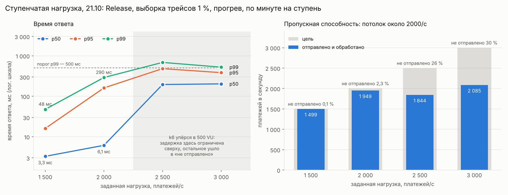
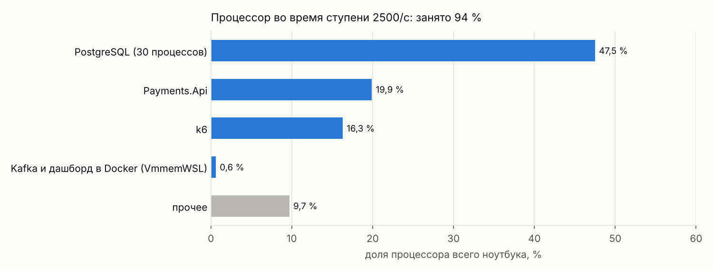
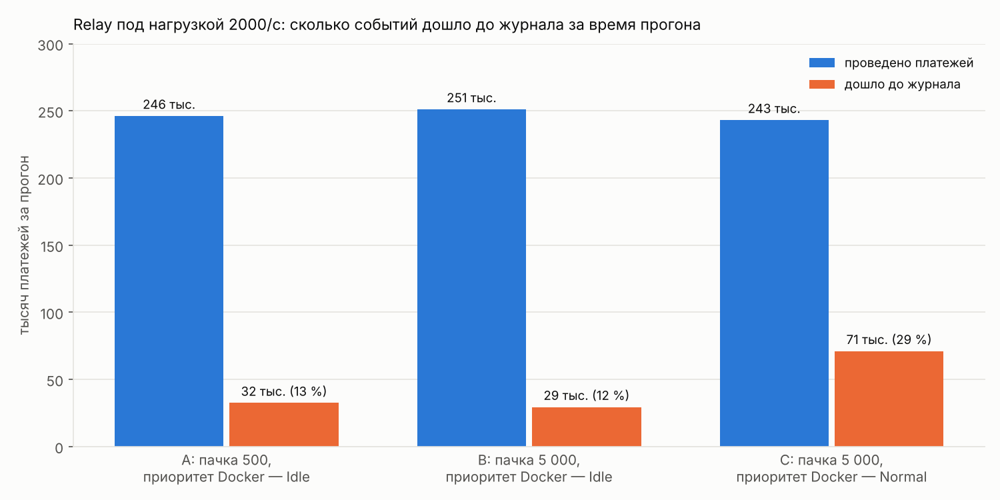
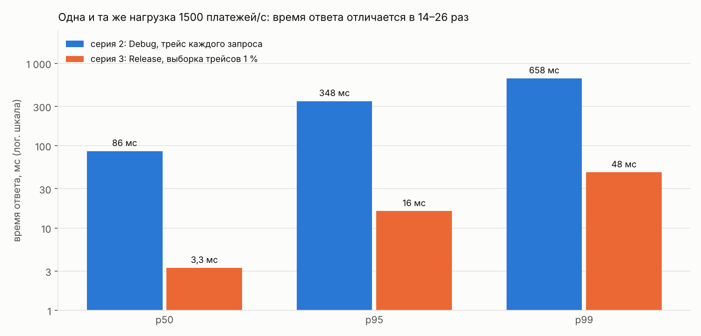

# Нагрузочное тестирование этапа 1

Сколько платежей в секунду выдерживает этап 1 на ноутбуке, где у него колено, во что он упирается и сходятся ли деньги под перегрузкой. Путь платежа: k6 → Payments.Api → БД payments (платёж и строка outbox) → OutboxRelay → Kafka → Ledger.Service → БД ledger.

## Коротко

- **Приём платежей держит 1500 в секунду с p99 = 48 мс.** Колено — между 1500 и 2000: на 2000 p99 вырастает в 6 раз, до 290 мс, и k6 уже не успевает отправить 2,3 % платежей. Потолок — около 1850–2100 платежей в секунду, когда процессор ноутбука занят на 94 %.
- **Вся система без отставания журнала держит около 1500 в секунду.** Выше платежи по-прежнему принимаются, а события копятся в outbox и разбираются после пика: outbox работает как буфер.
- **Деньги сходятся и под перегрузкой.** После ступеней до 3000 в секунду, когда в outbox копилось до 116 тысяч событий, сверка показала 1 553 112 проведённых платежей в базе платежей и ровно столько же в журнале. Зависших платежей нет.
- **Асинхронная часть на стенде упирается в проброс порта Docker Desktop.** Весь трафик Kafka идёт через процесс `com.docker.backend`, а Windows держала его в режиме эффективности с приоритетом `Idle`. При загрузке процессора 94 % он почти не получал времени, и relay переносил около 100 событий в секунду вместо 1900.
- **Методика важна не меньше железа.** Одна и та же нагрузка 1500 в секунду в Debug с трейсом каждого запроса и в Release с выборкой трейсов 1 % отличается по времени ответа в 14–26 раз.

## Стенд

| | |
|---|---|
| Ноутбук | тот же, что в [исследовании PostgreSQL](postgres-experiments.md): Intel Core i5-8250U (4 ядра / 8 потоков, под нагрузкой ~2,27 ГГц), 24 ГБ, SSD, Windows 11 |
| PostgreSQL | 15.12, нативно, порт 5433, `shared_buffers` = 1 ГБ |
| Kafka | apache/kafka 4.0.0, один узел в режиме KRaft, в Docker Desktop (WSL2); топик `payments.captured`, 8 партиций |
| Телеметрия | Aspire Dashboard в Docker, OTLP |
| Payments.Api | .NET 10, Release; пул 16 соединений, `statement_timeout` = 5 с; relay читает outbox пачками по 500 |
| Ledger.Service | .NET 10, Release; пул 8 соединений; пачка на партицию — до 500 платежей или 20 мс |
| Банк | заглушка внутри Payments.Api: отвечает без задержки, отклоняет 2 % платежей |
| Генератор нагрузки | k6 на той же машине |

Всё работает на одном ноутбуке и делит один процессор. Это главное ограничение стенда, и ниже оно видно во всех выводах.

## Методика

- **Открытая модель нагрузки.** Сценарий `constant-arrival-rate` в [load/payments.js](../load/payments.js): платежи приходят с заданной частотой, как бы медленно ни отвечал сервис. В закрытой модели, где N пользователей отправляют запросы по кругу, медленный сервис незаметно снижает себе нагрузку.
- **Виртуальные пользователи (VU).** Заранее создаются 10 % от заданной частоты (не меньше 50), всего не больше 500. Если в момент отправки свободного VU нет, k6 платёж не отправляет и считает его в `dropped_iterations`. Таких платежей нет ни в нагрузке, ни в перцентилях, поэтому их доля — отдельный порог.
- **Пороги, при которых ступень засчитывается:** ошибок меньше 1 %, p95 < 200 мс, p99 < 500 мс, не отправлено меньше 1 % запланированных платежей.
- **Сборка и телеметрия.** Сервисы в Release. Трейсы — выборка 1 % (`OTEL_TRACES_SAMPLER=parentbased_traceidratio`, `OTEL_TRACES_SAMPLER_ARG=0.01`); метрики считаются по всем запросам.
- **Прогрев.** Перед первой ступенью — 20 секунд нагрузки не выше 1000 в секунду без замера. Ступени запускает [load/ladder.ps1](../load/ladder.ps1); графики каждой ступени он сохраняет в HTML-отчёт k6.
- **Чистое состояние.** Ступень начинается при пустом outbox.
- **Корректность.** После каждой ступени — `/invariants` (двойная запись, совпадение балансов с проводками, нулевая сумма балансов), после серии — сверка базы платежей с журналом.
- **Отставание журнала.** Сравниваю прирост `payments` в `/invariants` с числом проведённых платежей. Проведённых — 98 % успешных запросов: остальные 2 % отклоняет банк (по сверке 31 492 из 1 584 604).

К этой методике я пришёл не сразу. Первые серии шли в Debug, без прогрева и с трейсом каждого запроса. Что это меняет — в разделе [«Что исказило первые серии»](#что-исказило-первые-серии).

## Ступенчатая нагрузка

Серия 21.10, 19:47–19:53: Release, выборка трейсов 1 %, прогрев, по минуте на ступень.

| Цель, /с | Факт, /с | p50, мс | p95, мс | p99, мс | Максимум, мс | Не отправлено | Ошибки |
|---|---|---|---|---|---|---|---|
| 1500 | 1499 | 3,3 | 16 | 48 | 189 | 0,07 % | 0 |
| 2000 | 1949 | 6,1 | 161 | 290 | 1 300 | 2,3 % | 0 |
| 2500 | 1844 | 195 | 481 | 686 | 1 880 | 26 % | 0 |
| 3000 | 2085 | 202 | 383 | 523 | 979 | 30 % | 147 |



- **1500 — все пороги пройдены.** Отдельный двухминутный прогон на 1500 дал p50 = 3,6 мс, p99 = 76 мс, не отправлено 0,3 %, и журнал к концу прогона полностью догнал платежи.
- **2000 — колено.** p99 вырос в 6 раз, а k6 не отправил 2,3 % платежей.
- **2500 и 3000 — насыщение.** Фактическая скорость перестаёт расти и держится около 1850–2100 в секунду. k6 упёрся в лимит 500 VU (`Insufficient VUs` в логе), поэтому дальше задержка не растёт: при 500 запросах в работе и ~1850 ответах в секунду она около 500 / 1850 ≈ 0,27 с (закон Литтла). Всё, что сверх, уходит в «не отправлено».
- **147 ошибок на 3000 — отказы TCP в первую секунду** (`connectex: ... actively refused it`). k6 открывает 300 соединений разом, очередь входящих соединений переполняется, и Windows отвечает отказом. Сам сервис не вернул ни одной ошибки ни на одной ступени.

## Корректность под перегрузкой

Сверка после ступеней, когда очередь разобралась:

| | |
|---|---|
| Проведено в базе платежей (`status = 'captured'`) | 1 553 112 |
| Учтено в журнале (`processed_payments`) | 1 553 112 |
| Отклонено банком | 31 492 (2,0 %) |
| Зависших в `created` | 0 |
| Строк в outbox | 0 |
| `/invariants` | ok: несбалансированных платежей 0, расхождений балансов с проводками 0, сумма всех балансов 0 |

Это итог за все прогоны с начала тестов, включая ступени до 3000 в секунду. Ни один платёж не потерян и не учтён дважды. Так работают три механизма: строка outbox пишется той же SQL-командой, что и смена статуса; Kafka доставляет событие хотя бы один раз; журнал отсекает повторы по `processed_payments`. После прогонов A–C (ниже), где отставание доходило примерно до 220 тысяч событий, `/invariants` тоже каждый раз возвращал ok.

## Во что упирается приём платежей



- **Процессор ноутбука занят на 94 %:** PostgreSQL — 47,5 %, Payments.Api — 19,9 %, k6 — 16,3 %.
- **База не заставляет себя ждать.** В `pg_stat_activity` из соединений Payments.Api 11–18 простаивают (`idle`, `ClientRead`), активны 1–5. Запросы ждут процессора в самом приложении, а не ответа базы.
- **Прогноз из исследования PostgreSQL подтвердился.** Там без горячих строк база давала ~4600 транзакций в секунду, «то есть грубо ~2 300 платежей при двух транзакциях на платёж». Вышло 1850–2100, и теперь процессор делят ещё k6, сервисы и Kafka.
- **k6 сам отнимает шестую часть процессора.** На отдельной машине для генератора нагрузки потолок был бы выше.

## Асинхронная часть: почему отстаёт журнал

### Наблюдение

На ступенях от 2000 outbox рос почти со скоростью проведения платежей. Оценка — по снимкам `count(*)` раз в несколько секунд:

| Ступень | Рост outbox | Проводится платежей |
|---|---|---|
| 2000 | ~1870 в секунду | ~1910 в секунду |
| 2500 | ~2000 в секунду | ~1810 в секунду |
| 3000 | ~2160 в секунду | ~2040 в секунду |

Значит, под нагрузкой relay почти ничего не переносил. Ledger в это время простаивал: событий не поступало. Как только ступень заканчивалась, outbox быстро разбирался. Ошибок relay в логах Payments.Api нет — он не падал, а голодал.

### Где relay теряет время

Метрика `payments.outbox.stage.duration` делит цикл relay на этапы. P50 при нагрузке 2000 в секунду:

| Этап | Пачка 500 (прогон A) | Пачка 5000 (прогон B) |
|---|---|---|
| Чтение пачки из outbox (`read`) | 5–25 мс | 25–75 мс |
| Отправка в Kafka и ожидание подтверждений (`produce`) | от 2,5 до 10 с и больше | 10 с и больше |
| Удаление отправленных строк (`delete`) | 5–50 мс | до 50 мс, разовый выброс 500 мс |

10 с — верхняя граница корзин гистограммы по умолчанию, на деле могло быть дольше. Когда outbox небольшой (прогон на 1500 в секунду), то же чтение занимает меньше миллисекунды: `EXPLAIN ANALYZE` показал 0,9 мс. Postgres для relay не узкое место — узкое место отправка в Kafka.

### Эксперименты A, B, C

Нагрузка 2000 в секунду, 2 минуты, прогрев, пустой outbox на старте.

| | A | B | C |
|---|---|---|---|
| Пачка relay | 500 | 5000 | 5000 |
| Приоритет `com.docker.backend` | `Idle` (режим эффективности) | `Idle` | `Normal` |
| Проведено за прогон, с прогревом | 246 тыс. | 251 тыс. | 243 тыс. |
| Дошло до журнала за прогон | 32 тыс. (13 %) | 29 тыс. (12 %) | 71 тыс. (29 %) |
| Приём: p50 / p95 / p99, мс | 13 / 260 / 425 | 9 / 126 / 266 | 36 / 290 / 412 |
| Не отправлено | 3,5 % | 1,4 % | 4,8 % |



- **B: большие пачки не помогли.** Если бы relay ограничивало время одного обмена с Kafka, пачка в 10 раз больше дала бы в 10 раз больше событий. Вместо этого время отправки выросло вместе с пачкой: путь до Kafka ограничен объёмом данных, а не числом обменов.
- **Почему путь до Kafka такой узкий.** Kafka работает в виртуальной машине Docker Desktop, а порт 9092 на Windows слушает процесс `com.docker.backend` и копирует байты внутрь неё. Windows держала этот процесс в режиме эффективности, то есть с приоритетом `Idle` и правом выполнять его на медленных ядрах. При загрузке процессора 94 % он получал время только в паузах. Виртуальная машина с Kafka в это время занимала 0,6 % процессора: до брокера почти ничего не доходило.
- **C: обычный приоритет помог больше чем вдвое.** До журнала дошла 71 тысяча событий против 29–32, но и это меньше трети проведённых платежей. По оценке из `pg_stat_user_tables` relay под нагрузкой переносил около 1000 событий в секунду, а до журнала к концу прогона дошло меньше: Ledger читает Kafka через тот же процесс Docker.
- **Процессор приходится делить.** Время, которое получила асинхронная часть, ушло у приёма платежей: в C время ответа хуже, чем в B. Разброс между прогонами большой — A и B отличаются вдвое при одном изменённом параметре, — но направление логичное.

**Итог.** На 2000 в секунду этому ноутбуку не хватает процессора на обе половины системы: приём держится, только пока асинхронная часть голодает. Без отставания журнала стенд держит около 1500 в секунду. Выше outbox работает как буфер и разбирается после пика, без потерь.

## Что исказило первые серии

| | Серия 1, 20.10 | Серия 2, 21.10, ночь | Серия 3, 21.10, вечер |
|---|---|---|---|
| Сборка и трейсы | Debug, трейс каждого запроса | Debug, трейс каждого запроса | Release, выборка 1 % |
| Прогрев | нет | нет | 20 с |
| Заранее созданных VU | 50 | 10 % от частоты | 10 % от частоты |

Серия 1:

| Цель, /с | Факт, /с | p50, мс | p95, мс | p99, мс | Не отправлено |
|---|---|---|---|---|---|
| 200 | 200 | 3,4 | 7,7 | 18 | 0 |
| 500 | 491 | 4,4 | 37 | 125 | 1,8 % |
| 1000 | 997 | 6,5 | 26 | 51 | 0,3 % |

Серия 2 (ступень 1000 шла сразу после перезапуска сервисов, с открытой живой страницей k6):

| Цель, /с | Факт, /с | p50, мс | p95, мс | p99, мс | Не отправлено |
|---|---|---|---|---|---|
| 1000 | 990 | 7,8 | 56 | 144 | 1,0 % |
| 1500 | 1362 | 86 | 348 | 658 | 9,1 % |
| 2000 | 1675 | 183 | 423 | 670 | 16 % |
| 2500 | 1894 | 213 | 383 | 639 | 24 % |
| 3000 | 1815 | 241 | 433 | 637 | 39 % |



1. **Release и выборка трейсов.** `dotnet run` по умолчанию собирает Debug. Трейс на каждый запрос — это тысячи спанов в секунду, которые дашборд принимает на том же ноутбуке. Медиана на 1500 в секунду упала с 86 до 3,3 мс.
2. **Прогрев.** Первый прогон в Release (1500 в секунду, 2 минуты) прошёл без прогрева: медиана уже 4,2 мс, но p99 = 656 мс и не отправлено 3,7 %. Тот же прогон с прогревом и пустым outbox: p99 = 76 мс, не отправлено 0,3 %.
3. **Пул VU.** В серии 1 k6 заранее создавал 50 VU. Любая заминка длиннее 50 / RATE секунды превращалась в неотправленные платежи, которых нет в перцентилях, и хвост выглядел лучше, чем был. Теперь пул — 10 % от частоты.
4. **Один прогон — не замер.** В серии 1 ступень 500 вышла хуже 1000 (p99 125 мс против 51) из-за заминки посреди прогона, а прогоны A и B различаются вдвое. Сравнивать можно только прогоны из одинакового состояния, а неожиданный результат — проверять повтором.
5. **Живая страница k6 держит процесс.** Пока открыта вкладка web dashboard, k6 не завершается: так задумано, чтобы успеть скачать отчёт. В `ladder.ps1` живая страница выключена, графики сохраняются в HTML.

## Особенности стенда

- **Генератор нагрузки на той же машине** забирает 16 % процессора.
- **Проброс порта Docker Desktop и режим эффективности Windows.** Перед прогоном проверяй приоритет процесса, который слушает порт Kafka, — должен быть `Normal`. После перезапуска Docker Desktop режим эффективности может вернуться.
- **Лимит 500 VU** ограничивает сверху измеренную задержку на насыщении.
- **Отказы TCP в первую секунду**, когда заранее создано 250–300 VU и больше.
- **`/invariants` читает все проводки.** При 3,5–4,5 миллиона проводок проверка под нагрузкой не укладывалась в `statement_timeout` = 10 с и возвращала 500. Теперь у неё свой лимит — 2 минуты (`SET LOCAL statement_timeout`), а консьюмер сохраняет свои 10 секунд.
- **Retention Kafka на стенде — 1 час и 64 МБ на партицию.** Если Ledger отстанет сильнее, события удалятся непрочитанными. В продакшене retention должен быть с запасом больше худшего отставания.
- **Оценка размера outbox.** `n_live_tup` из статистики — приблизительная. `count(*)` точнее, но под нагрузкой по раздутой таблице сам выполнялся секундами.

## Что из этого следует для продакшена

- **Kafka — на своих машинах**, без посредника между сервисом и брокером. Relay и консьюмеры масштабируются отдельно от приёма платежей.
- **Метрики отставания асинхронной части и алерт на них:** возраст самой старой строки outbox и lag консьюмера Ledger. В этих прогонах они сразу показали бы проблему, а не по сверке.
- **Рабочая нагрузка — с запасом ниже точки, где система держится целиком.** Для этого стенда это около 1100–1200 платежей в секунду.
- **Outbox как буфер — достоинство архитектуры:** приём платежей не зависит от Kafka. Но буфер нужно мониторить, а retention брокера — считать от худшего отставания.
- **Замерять в Release и с выборкой трейсов, генератор нагрузки — на отдельной машине.**

## Дальнейшие шаги

- Метрики отставания: возраст самой старой строки outbox (gauge в Payments.Api) и lag консьюмера Ledger.
- Точное колено: ступени от 1500 до 2000 через 100.
- Длительный прогон: 10–15 минут на ~1200 в секунду — чекпоинты, автовакуум, стабильность.
- Снизить нагрузку на процессор от Postgres: автоподготовка запросов в Npgsql (`Max Auto Prepare`), микропачки в Payments.Api.
- Статистика клиента Kafka (librdkafka: `rtt`, `int_latency`): разделить задержку внутри клиента и на пути до брокера.
- Хаос-тест (этап 3): остановить Ledger и Payments.Api посреди нагрузки и проверить сверку.

## Как воспроизвести

Сервисы — каждый в своём окне:

```powershell
docker compose up -d

# окно Ledger
$env:OTEL_TRACES_SAMPLER = "parentbased_traceidratio"
$env:OTEL_TRACES_SAMPLER_ARG = "0.01"
dotnet run -c Release --project src\Ledger.Service

# окно Payments.Api: те же две переменные и метрики раз в 5 секунд
$env:OTEL_TRACES_SAMPLER = "parentbased_traceidratio"
$env:OTEL_TRACES_SAMPLER_ARG = "0.01"
$env:OTEL_METRIC_EXPORT_INTERVAL = "5000"
dotnet run -c Release --project src\Payments.Api
```

Приоритет процесса, который пробрасывает порт Kafka, — должен быть `Normal`:

```powershell
Get-Process -Id (Get-NetTCPConnection -LocalPort 9092 -State Listen).OwningProcess | Select-Object Id, ProcessName, PriorityClass
```

Во время прогона — что делают соединения Postgres и сколько строк в outbox (`psql -p 5433 -U postgres -d payments`):

```sql
SELECT datname, state, wait_event_type, wait_event, count(*),
       (SELECT n_live_tup FROM pg_stat_user_tables WHERE relname = 'outbox') AS outbox
FROM pg_stat_activity
WHERE backend_type = 'client backend' AND pid <> pg_backend_pid()
GROUP BY 1, 2, 3, 4
ORDER BY 5 DESC \watch 2
```

Ступени и эксперимент с пачкой relay:

```powershell
powershell -ExecutionPolicy Bypass -File load\ladder.ps1 -Rates "1500,2000,2500,3000"
powershell -ExecutionPolicy Bypass -File load\ladder.ps1 -Rates "2000" -Duration 120s

# пачка relay 5000: в окне Payments.Api перед dotnet run
$env:Outbox__BatchSize = "5000"
```

Этапы цикла relay — в дашборде: Metrics → `payments-api` → `payments.outbox.stage.duration`, фильтр `stage`.

Сверка, когда outbox опустеет: `captured` должно совпасть с `payments` из `/invariants`, `stuck` и `outbox` — нули.

```powershell
psql -p 5433 -U postgres -d payments -c "SELECT count(*) FILTER (WHERE status = 'captured') AS captured, count(*) FILTER (WHERE status = 'declined') AS declined, count(*) FILTER (WHERE status = 'created') AS stuck, (SELECT count(*) FROM outbox) AS outbox FROM payments"
Invoke-RestMethod http://localhost:5200/invariants
```

Очистка перед новой серией — после сверки, при остановленных сервисах:

```powershell
psql -p 5433 -U postgres -d payments -c "TRUNCATE payments, outbox"
psql -p 5433 -U postgres -d ledger -c "TRUNCATE postings, processed_payments, accounts"
```

# Этап 3: горячий продавец

Один продавец получает половину или 90 % всех платежей. Вопрос: мешает ли он остальным 49 — при приёме платежей и в асинхронной части, где все его события попадают в одну партицию Kafka. Ниже замер **до** изменений лимитера и **после** шага 4а, где лимитер перестал выключаться при сбоях Redis.

## Коротко

- **Лимитер защищает остальных продавцов, пока отвечает Redis.** На 1500 платежей в секунду с горячим продавцом на 90 % у остальных p99 = 126 мс и пороги пройдены. Без лимитера — 758 мс, и k6 не отправил 15 % платежей.
- **Когда Redis не отвечает, лимитер выключается — и горячий продавец перегружает стенд.** Лимитер ждёт Redis 100 мс и после таймаута пропускает всех без лимита 5 секунд. В повторе 5c таких таймаутов было 211: горячий продавец получил 512 платежей в секунду при лимите 200, p99 остальных вырос до 1053 мс, не отправлено 18 %. В прогоне 2 (горячий на 50 %) медиана — 2962 платежа сверх лимита за 2 минуты.
- **Kafka изолирует горячего продавца в асинхронной части.** Без лимитера его партиция получает 1000–1200 событий в секунду, её lag доходит до 9 500 (медиана максимумов; в 6a — 18 000), у остальных партиций — около 170. Журнал догоняет за 1–5 секунд после конца нагрузки.
- **Колено стенда без перекоса — между 1000 и 1500 в секунду.** На этапе 1 оно было между 1500 и 2000, но тогда банк был заглушкой внутри Payments.Api. Теперь это эмулятор по HTTP с задержкой 50 ± 20 мс, и на каждый платёж есть запрос к Redis.
- **Деньги сходятся:** `/invariants` ok после каждого из 18 повторов.
- **После шага 4а сбой Redis больше не снимает лимит.** На время сбоя каждый экземпляр Payments.Api ограничивает продавцов сам. В остальное время платёж проходит, только если согласны и Redis, и локальный бакет. Сверх лимита — 0 во всех 15 повторах с лимитером. До шага 4а худший повтор дал 37 036.
- **Таймауты Redis на 1500 в секунду — от загрузки ноутбука, а не от Redis.** Redis отвечает всегда, просто иногда позже 100 мс: медиана таких ответов — 121 мс. Ответ ждёт процессора вместе со всем стендом.
- **Раз в 5 минут стенд тормозил из-за пула соединений Npgsql.** Пул закрывал простаивающие соединения, а нагрузка тут же открывала их снова. С `Minimum Pool Size`, равным максимуму, это прошло.
- **С двумя экземплярами Payments.Api сбой Redis на 10 секунд стоит около 3 000 платежей сверх лимита**, с одним — от 0 до 83. Локальный бакет каждого экземпляра видит только половину платежей продавца и к началу сбоя полон.
- **Квота горячего продавца (шаг 5) работает как условие договора.** С квотой 1000 в секунду он получает 429 только сверх неё, у остальных нет ни одного 429, а их p99 — как при равномерной нагрузке того же объёма: 185 мс против 167.
- **Отказ банка одному продавцу больше не останавливает остальных (шаг 6).** Пока все вызовы банка шли через один circuit breaker, отказы горячего продавца размыкали его для всех: у остальных 99,9 % ответов — 202. Со своим конвейером у продавца с квотой — 0 %.

## Стенд и методика

Отличия от этапа 1:

| | |
|---|---|
| Банк | эмулятор на Go по HTTP: задержка 50 ± 20 мс, отклоняет 2 % |
| Лимитер | токен-бакет в Redis на продавца: 200 в секунду, всплеск 400. До шага 4а: Redis не ответил за 100 мс — лимит не действует 5 секунд (`RedisCircuitBreaker`). Что изменилось — в разделе «После» |
| Kafka | apache/kafka 4.3.2: в 4.0.0 координатор групп после сдвига часов назад переставал записывать состояние группы, и Ledger терял партиции ([KAFKA-19888](https://issues.apache.org/jira/browse/KAFKA-19888)) |
| Нагрузка | 50 продавцов; горячий — продавец 1, остальные платежи поровну у 49 других. Пороги — на запросах `merchant:other`: p95 < 200 мс, p99 < 500 мс, ошибок < 1 %, не отправлено < 1 % |

- **Матрица** — [load/Matrix](../load/Matrix): шесть прогонов по 120 секунд, каждый трижды; повторы идут по кругу (1a, 2a … 6a, потом 1b …), чтобы медленная минута ноутбука не попала в один прогон. Прогон 6 — без лимитера, после перезапуска Payments.Api.
- **Одна стартовая точка.** Матрица запущена с `--fresh`: базы payments и ledger пусты, топик и группа Ledger созданы заново. К концу матрицы в журнале 1,9 млн платежей. Без очистки сравнивать матрицы нельзя: проверка `/invariants` и поиск зависших платежей в `PaymentRecovery` медленнее на больших таблицах. На 6 млн платежей `PaymentRecovery` почти на каждом проходе сканировал всю таблицу `payments` и падал по таймауту, и стенд был заметно медленнее.
- **Прогрев** — 60 секунд после каждого запуска Payments.Api.
- **Outbox и lag** матрица замеряет раз в секунду; замер, на который Postgres или Kafka отвечали дольше 2 секунд, отбрасывается — lag в нём завышен.
- В таблице — медиана трёх повторов.

## До изменений лимитера

Матрица 08.11, 18:19–18:59.

| Прогон | Платежей/с | Горячий | Лимитер | p99 остальных, мс | p99 горячего (201), мс | Горячему прошло, /с | Сверх лимита | Отключений лимитера | Не отправлено | Lag: горячая / прочие партиции | Пороги |
|---|---|---|---|---|---|---|---|---|---|---|---|
| 1 | 1000 | — | вкл. | 181 | — | — | — | 9 | 0,21 % | — / 116 | не прошли в 1 из 3 |
| 2 | 1000 | 50 % | вкл. | 209 | 285 | 228 | 2 962 | 13 | 0,62 % | 185 / 52 | не прошли в 1 из 3 |
| 3 | 1000 | 90 % | вкл. | 93 | 101 | 203 | 0 | 0 | 0 % | 32 / 6 | ok |
| 4 | 1500 | — | вкл. | 460 | — | — | — | 113 | 2,3 % | — / 267 | не прошли в 3 из 3 |
| 5 | 1500 | 90 % | вкл. | 126 | 172 | 204 | 38 | 5 | 0,5 % | 101 / 16 | не прошли в 1 из 3 |
| 6 | 1500 | 90 % | выкл. | 758 | 750 | 1 139 | — | — | 15 % | 9 516 / 167 | не прошли в 3 из 3 |

**Сверх лимита** — на сколько принятых платежей горячего продавца больше, чем пропускает его бакет за прогон: 400 + 200 × 120 = 24 400. **Отключений лимитера** — сколько раз Redis не ответил за 100 мс.

- **С лимитером горячий продавец на 90 % облегчает стенд, а не нагружает.** Прогоны 3 и 5 быстрее прогонов 1 и 4 без перекоса: ответ 429 стоит дёшево, а принятых платежей горячего продавца — около 200 в секунду. Прогон 5 при 1500 в секунду быстрее прогона 1 при 1000.
- **Без лимитера (прогон 6) горячий продавец забирает процессор у всех.** Payments.Api принимает 1100–1200 его платежей в секунду, и остальные получают p99 = 758 мс — в 6 раз хуже прогона 5 с той же нагрузкой.
- **Утечки лимитера идут от таймаутов Redis.** В 3b, 3c и 5b таймаутов не было — и сверх лимита ноль. Один таймаут в повторе 3a — 4 075 лишних платежей: 5 секунд без лимита при 900 запросах горячего продавца в секунду. В повторе 5c таймауты шли сериями, лимит не действовал большую часть минуты, и стенд вёл себя почти как без лимитера.
- **Асинхронная часть изолирует горячую партицию.** В прогоне 6 lag горячей партиции растёт всю нагрузку, до 9 500 сообщений, у остальных держится около 150: один писатель на партицию в Ledger не даёт горячему продавцу задерживать чужие события. Outbox при этом не копится — не старше 1,3 секунды.
- **1500 без перекоса — уже за коленом** (прогон 4): p99 = 460 мс, не отправлено 2,3 %, пороги не пройдены ни в одном повторе. При 1000 пороги пройдены в двух повторах из трёх.

**Оговорки.**
- Первый круг повторов медленнее остальных и после 60 секунд прогрева: 1a — 562 мс против 180 и 181 у 1b и 1c, 4a — 876 против 460 и 365. Медиана трёх повторов это сглаживает, а причину стоит найти: возможно, база, только что очищенная, растёт с нуля, или Kafka после пересоздания.
- Повтор 5c — сбой Redis посреди нагрузки, не свойство прогона: в 5a и 5b таймаутов 5 и 0. Но этот сбой и показывает главный риск нынешнего лимитера.
- Приоритет процесса Docker матрица проверить не смогла: порт 9092 на Windows не слушает ни один процесс. `com.docker.backend` работал с приоритетом `Normal`.

## После: локальный лимит при сбое Redis

Шаг 4а изменил две вещи в `Payments.Api/RateLimiting`:

- **Пока Redis не отвечает, лимит считает сам экземпляр.** Раньше после таймаута лимит не действовал 5 секунд. Теперь в это время решает `LocalMerchantLimiter` — токен-бакет на продавца в памяти процесса (`PartitionedRateLimiter`) с тем же лимитом, 200 в секунду и всплеск 400.
- **Breaker замыкает только пробный запрос.** Раньше его замыкал любой ответ Redis, в том числе на запрос, отправленный до сбоя. Под нагрузкой breaker мерцал: размыкался и замыкался по нескольку раз в секунду, и каждый раз запросы снова ждали зависший Redis. Теперь после паузы в 5 секунд в Redis идёт один пробный запрос, и только его ответ возвращает общий лимит.

Матрица 09.11, 17:00–17:40, с теми же настройками и тоже с `--fresh`. Медианы трёх повторов, «до» → «после»:

| Прогон | Платежей/с | Горячий | Лимитер | p99 остальных, мс | Не отправлено | Сверх лимита | Сбоев Redis |
|---|---|---|---|---|---|---|---|
| 1 | 1000 | — | вкл. | 181 → 157 | 0,21 → 0,05 % | — | 9 → 0 |
| 2 | 1000 | 50 % | вкл. | 209 → 128 | 0,62 → 0,13 % | 2 962 → 774 | 13 → 1 |
| 3 | 1000 | 90 % | вкл. | 93 → 93 | 0 → 0 % | 0 → 0 | 0 → 0 |
| 4 | 1500 | — | вкл. | 460 → 360 | 2,3 → 1,1 % | — | 113 → 16 |
| 5 | 1500 | 90 % | вкл. | 126 → 125 | 0,5 → 0,12 % | 38 → 754 | 5 → 1 |
| 6 | 1500 | 90 % | выкл. | 758 → 383 | 15 → 0,81 % | — | — |

**Сбоев Redis** — строк `Redis did not answer` в логе Payments.Api. До шага 4а мерцающий breaker писал по строке на каждое размыкание, поэтому число «до» больше числа сбоев. После — строка на сбой.

- **Худший случай закрыт.** Из девяти повторов с горячим продавцом и лимитером больше всего сверх лимита — 1 858 (2a, три сбоя Redis). До шага 4а был повтор 5c: 37 036 сверх лимита, горячий продавец получал 512 платежей в секунду при лимите 200, а остальные — p99 = 1053 мс.
- **Цена одного сбоя — около двух всплесков бакета.** Один сбой Redis — 754–784 платежа сверх лимита (5a, 5c, 2c). Первые 400: локальный бакет в начале сбоя полный, он не знает, сколько продавец уже потратил в Redis. Ещё до 400: бакет в Redis за время сбоя пополняется, потому что не видит платежей, пропущенных локально. Оба компромисса записаны в `LocalMerchantLimiter`.
- **Типичный повтор прогона 5 стал хуже: 38 → 754.** До шага 4а большинство «отключений» были мерцанием: breaker замыкался через миллисекунды, и короткий сбой почти ничего не пропускал. Теперь каждый сбой — это 5 секунд локального лимита и два всплеска. Это плата за то, что длинный сбой больше не снимает лимит совсем.
- **Мерцания больше нет.** В логе строки идут парами: «did not answer», затем «answers again», когда ответил пробный запрос, — обычно через 5 секунд, изредка через 10, если первый пробный тоже не дождался Redis. На 1500 в секунду без перекоса (прогон 4) Redis не отвечал за 100 мс 16 раз за повтор. Продавцам это ничем не грозило: у каждого около 30 платежей в секунду, ниже лимита.
- **Время ответа между матрицами сравнивать нельзя.** Прогон 6 идёт без лимитера, шаг 4а его не касается, а p99 остальных упал с 758 до 383 мс, «не отправлено» — с 15 % до 0,81 %. Так же отличаются от дня ко дню и прогоны 1 и 4. Поэтому о шаге 4а говорят столбцы «Сверх лимита» и «Сбоев Redis», а не p99.
- **Первый круг повторов по-прежнему медленнее:** 1a — 456 мс против 157 и 147 у 1b и 1c.

### Локальный бакет следует за Redis

Пока Redis отвечает, фильтр на каждый пропущенный Redis платёж тратит токен и в локальном бакете. Сбой начинается с того, что у продавца осталось, а не с полного бакета. Матрица 09.11, 17:51–18:30, медианы; в скобках — матрица после первой части шага 4а:

| Прогон | Платежей/с | Горячий | Лимитер | p99 остальных, мс | Не отправлено | Сверх лимита | Сбоев Redis |
|---|---|---|---|---|---|---|---|
| 1 | 1000 | — | вкл. | 140 (157) | 0 % (0,05 %) | — | 0 (0) |
| 2 | 1000 | 50 % | вкл. | 126 (128) | 0 % (0,13 %) | 0 (774) | 1 (1) |
| 3 | 1000 | 90 % | вкл. | 84 (93) | 0 % (0 %) | 0 (0) | 0 (0) |
| 4 | 1500 | — | вкл. | 277 (360) | 0,45 % (1,1 %) | — | 12 (16) |
| 5 | 1500 | 90 % | вкл. | 112 (125) | 0,04 % (0,12 %) | 465 (754) | 1 (1) |
| 6 | 1500 | 90 % | выкл. | 762 (383) | 8,2 % (0,81 %) | — | — |

- **Один сбой Redis теперь стоит около 400 платежей сверх лимита вместо 750–800.** Повторы с одним сбоем — 408, 411, 465; 5c с четырьмя сбоями — 1 551, по 390 на сбой. Худший повтор — 1 551 против 1 858 в прошлой матрице и 37 036 до шага 4а.
- **Оставшиеся ~400 — второй всплеск.** Бакет в Redis не видит платежей, пропущенных локально, за 5 секунд сбоя наполняется до 400 и после сбоя пропускает их разом. Убрать его можно, если и после сбоя пропускать платёж, только когда согласны и Redis, и локальный бакет; локальный видит лишь часть платежей продавца при том же лимите, так что общий лимит не ужесточает. Цена — расхождения часов двух бакетов у продавца, который ровно на лимите.
- **Прогон 6 снова на уровне «до» — 762 мс.** Прошлая матрица дала 383 мс на том же коде без лимитера: ещё одно подтверждение, что время ответа между матрицами отличается вдвое и без изменений в коде.
- **Первый круг повторов на этот раз не медленнее остальных:** 1a — 146 мс, 1b и 1c — 140 и 122. Значит, и это различие между матрицами — разброс стенда, а не свойство первого круга.

### Redis и локальный бакет решают вместе

Последняя часть шага 4а:

- **Платёж проходит, только если согласны оба бакета** — не только во время сбоя, но и после. Redis разрешил — фильтр берёт токен и из локального бакета; токена нет — 429. Бакет Redis, наполнившийся за время сбоя, больше не пропускает лишний всплеск: его токены уходят на платежи, которые не пропустил локальный бакет.
- **Пауза breaker — 1 секунда вместо 5.** Общий лимит возвращается быстрее. Пока Redis не отвечает, пробный запрос уходит раз в секунду на экземпляр.
- **Сбой пишет в лог, что делал процесс.** Сколько из 100 мс ожидания процесс простоял в GC, сколько потоков в пуле и сколько работы ждёт в очереди. Отдельной строкой — через сколько Redis всё-таки ответил.

Матрица 09.11, 19:00–19:40, медианы; в скобках — предыдущая матрица, 17:51–18:30:

| Прогон | Платежей/с | Горячий | Лимитер | p99 остальных, мс | Не отправлено | Сверх лимита | Сбоев Redis |
|---|---|---|---|---|---|---|---|
| 1 | 1000 | — | вкл. | 147 (140) | 0 % (0 %) | — | 0 (0) |
| 2 | 1000 | 50 % | вкл. | 128 (126) | 0,13 % (0 %) | 0 (0) | 1 (1) |
| 3 | 1000 | 90 % | вкл. | 89 (84) | 0 % (0 %) | 0 (0) | 0 (0) |
| 4 | 1500 | — | вкл. | 359 (277) | 1,2 % (0,45 %) | — | 37 (12) |
| 5 | 1500 | 90 % | вкл. | 117 (112) | 0,02 % (0,04 %) | 0 (465) | 1 (1) |
| 6 | 1500 | 90 % | выкл. | 253 (762) | 0,63 % (8,2 %) | — | — |

- **Сверх лимита — 0 во всех 15 повторах с лимитером**, в том числе в пяти повторах прогонов 2 и 5, где Redis сбоил. В прошлой матрице — от 408 до 1 551 в четырёх повторах из шести.
- **Цена — 27–38 платежей за прогон в другую сторону.** Горячий продавец получил 24 362–24 373 платежа из 24 400, которые пропускает его бакет; в прошлой матрице в 2a и 2b, где сверх лимита не прошло ничего, — 24 397 и 24 394. Это расхождение двух бакетов на границе лимита: локальный пополняется раз в 100 мс, Redis — непрерывно, и локальный иногда отказывает в платеже, который Redis уже разрешил. Каждый такой отказ оставляет в локальном бакете лишний токен, так что отказы прекращаются сами. Разница одинакова в повторах со сбоем и без — около двух порций по 20 токенов.
- **Сбоев Redis в прогоне 4 втрое больше: 37 против 12.** Самих сбоев больше не стало, просто раньше их не было видно: с паузой 5 секунд следующий сбой часто приходился на паузу и в лог не попадал. В прошлой матрице строки шли раз в 6–8 секунд: 5 секунд паузы и ещё несколько секунд до следующего сбоя.
- **Прогон 4 медленнее: 359 мс против 277**, не отправлено 1,2 % против 0,45 %. Прогон 6 без лимитера при этом втрое быстрее — 253 против 762, так что в основном это разброс стенда. Но часть разницы может дать и короткая пауза: с паузой 5 секунд прогон 4 около 60 секунд из 120 обходился без Redis, теперь — около 37.

### Откуда таймауты Redis на 1500 в секунду

По новым строкам лога, матрица 19:00–19:40. Сбоев 132: 111 — в прогоне 4, 7 — на прогреве, 14 — в остальных прогонах.

- **Redis отвечает всегда, просто поздно.** Все 132 вызова, которые лимитер перестал ждать, получили ответ, ни один не упал по таймауту самого StackExchange.Redis. Для 114 известно, через сколько: медиана — 121 мс, 9 из 10 — до 178 мс, самый долгий — 462 мс.
- **GC ни при чём.** За 100 мс ожидания GC останавливал процесс в 19 сбоях из 132, на 17–82 мс, и ни разу на все 100.
- **Дело в нагрузке стенда, а не Redis.** Почти все сбои — в прогоне 4, где принимаются все 1500 платежей в секунду. В прогоне 5 запросов к Redis столько же, но три четверти из них кончаются быстрым 429, и сбой один на повтор. В момент сбоя в пуле Payments.Api 10–11 потоков, а в очереди ждёт работа: медиана — 32 задачи, до 287. Работа идёт, но процессора не хватает: ноутбук на 4 ядрах держит весь стенд, и ответ Redis ждёт своей очереди, как и всё остальное. Самые долгие задержки задевают и звонки в банк: в те же секунды бывают пачки таймаутов по 300 мс, до 185 за секунду, а эмулятор банка работает не в Docker.
- **Лимиту эти сбои больше не вредят.** Секунда локального лимита у одного экземпляра — тот же лимит. Поэтому таймаут 100 мс увеличивать не нужно: он ограничивает, сколько платёж ждёт Redis, который действительно завис.
- **Отдельно — сбой раз в 5 минут.** Сбои вне прогона 4 почти все приходятся на 5, 10, 15… минут после старта Payments.Api — с точностью до нескольких секунд, в обеих матрицах. Это пул соединений Npgsql, ниже.

### Сбой раз в 5 минут: пул соединений Npgsql

- **Тормозил весь стенд, а не Redis.** В матрицах 17:51 и 19:00 в секунды +5, +10, +15… минут от старта Payments.Api собственные запросы матрицы к Postgres отвечали 15–55 мс вместо 1–3, к Kafka — 48–183 мс вместо 10–15, а в outbox на секунду копилось до 220 строк вместо обычных 10–50.
- **Причина — чистка пула в Npgsql.** Раз в `Connection Idle Lifetime`, по умолчанию 300 секунд, Npgsql закрывает столько соединений, сколько простаивало в медиане его замеров; замеры он делает раз в 10 секунд. Под нагрузкой эти соединения нужны снова, и пул открывает их все разом. В песочнице ровно через 5 минут после открытия пула 11 из 16 соединений Payments.Api и соединение Ledger открылись заново за 0,4 секунды. На Windows каждое соединение с Postgres — новый процесс сервера.
- **Исправление — `Minimum Pool Size`, равный `Maximum Pool Size`**: 16 у Payments.Api, 8 у Ledger. Ниже минимума Npgsql соединения не закрывает. В песочнице через 5 минут 40 секунд все соединения остались теми, что открылись при старте.
- **На ноутбуке всплески пропали.** В двух сериях с паузой Redis (ниже) в отметки +5 и +10 минут Postgres отвечал матрице за 1–9 мс, Kafka — за 7–33 мс, и сбоев Redis в эти секунды не было.

### Два экземпляра Payments.Api

Два новых параметра матрицы. `--instances 2` запускает второй экземпляр на порту 5101, и k6 шлёт запросы обоим по очереди; outbox и поиск зависших платежей ведёт один из них, тот, что взял лидерскую блокировку. `--redis-pause 10` в середине каждого повтора на 10 секунд задерживает все команды к Redis (`CLIENT PAUSE`) — как зависший Redis, одинаково в каждом повторе. Две серии 09.11, прогоны 2 и 5 по три повтора, обе с `--fresh`: 20:21–20:34 с одним экземпляром, 20:36–20:50 с двумя. Медианы:

| Прогон | Платежей/с | Горячий | Экземпляров | p99 остальных, мс | p99 горячего (201), мс | Горячему прошло, /с | Сверх лимита | Сбоев Redis | Lag горячей партиции |
|---|---|---|---|---|---|---|---|---|---|
| 2 | 1000 | 50 % | 1 | 123 | 135 | 203 | 0 | 1 | 151 |
| 2 | 1000 | 50 % | 2 | 141 | 163 | 229 | 3 050 | 2 | 301 |
| 5 | 1500 | 90 % | 1 | 112 | 143 | 204 | 51 | 1 | 53 |
| 5 | 1500 | 90 % | 2 | 122 | 320 | 227 | 2 879 | 2 | 654 |

**Сбоев Redis** с двумя экземплярами — по строке от каждого: одна пауза дала две строки.

- **С одним экземпляром пауза почти ничего не стоит:** сверх лимита от 0 до 83 за повтор, меньше полсекунды лимита. Локальный бакет к началу сбоя пуст, как и бакет Redis, а после сбоя не даёт Redis пропустить наполнившийся за паузу всплеск.
- **С двумя — около 3 000 за одну паузу.** Каждый экземпляр видит половину платежей, которые пропустил Redis, — 100 в секунду при пополнении 200, — так что к началу сбоя его локальный бакет полон. Пауза вместе с ожиданием пробного запроса длится около 10,2 секунды, и за это время каждый экземпляр пропускает свои 400 и по 200 в секунду: вместе около 4 900, а по лимиту — около 2 000. После паузы оба бакета пусты, но пополняются вдвое быстрее, чем Redis, и пропускают ещё около 200 из его всплеска. Итого около 3 000; медианы — 3 050 и 2 879.
- **Повторы выше медианы — с лишним сбоем.** В 2b (3 592) и 5b (3 477) Redis ещё раз не ответил вне паузы. Пока бакеты полны, секунда локального лимита добавляет ещё сотни платежей: всплеск и секунду лимита на каждый экземпляр, который не дождался Redis.
- **Платят горячий продавец и его партиция, не остальные.** p99 остальных — 141 и 122 мс против 123 и 112 с одним экземпляром, пороги пройдены во всех повторах. Платежей горячего продавца за паузу проходит больше: его p99 в прогоне 5 — 320 мс против 143, lag его партиции — 654 против 53.
- **Это тот компромисс, что записан в `LocalMerchantLimiter`.** Бакет, который следует за Redis, помогает, только если экземпляр видит все платежи продавца. При N ≥ 2 экземплярах сбой длиной T стоит около N × всплеск + (N − 1) × лимит × T.

**Что ещё можно сделать:**
- Давать локальному бакету долю лимита: 1/N лимита и всплеска на каждый из N экземпляров. Тогда во время сбоя они вместе пропускают один лимит, а пока Redis отвечает, каждый видит свою долю платежей и снова следует за Redis. Для этого нужно знать N — например, каждый экземпляр раз в несколько секунд отмечается в Redis ключом с коротким TTL, а во время сбоя действует последнее известное число. Цена — неровная балансировка: если продавцу шлёт запросы в основном один экземпляр, его доля станет узким местом и, пока Redis отвечает, будет отказывать в платежах, которые Redis пропускает.

## Шаг 5: квоты продавцов

У крупного продавца своя квота поверх общего лимита: `RateLimiting:Merchant:Overrides` в `appsettings.json`, merchantId → скорость и всплеск. Квоты перечитываются при изменении файла, без перезапуска, а отказы размечены атрибутом `quota` — `default` или `override`. Горячему продавцу дана квота 1000 в секунду и всплеск 2000 (`--hot-quota 1000`): стенд держит около 1500 в секунду, и 500 остаётся остальным.

Матрица 09.11, 23:22–23:48, с `--fresh`, прогоны 1, 3, 4 и 5 по три повтора. Медианы:

| Прогон | Платежей/с | Горячий | Стенд принимает, /с | p99 остальных, мс | 429 у горячего | Горячему прошло, /с | Lag: горячая / прочие партиции |
|---|---|---|---|---|---|---|---|
| 1 | 1000 | — | ≈ 1 000 | 167 | — | — | — / 125 |
| 3 | 1000 | 90 % | ≈ 1 000 | 185 | 0 % | 900 | 543 / 11 |
| 4 | 1500 | — | ≈ 1 500 | 265 | — | — | — / 230 |
| 5 | 1500 | 90 % | ≈ 1 165 | 199 | 25 % | 1 015 | 472 / 14 |

- **429 у горячего продавца — только сверх квоты.** В прогоне 3 он шлёт 900 в секунду, меньше квоты, и отказов у него нет. В прогоне 5 шлёт 1 350, а проходит 1 015: 1000 в секунду и всплеск 2000, растянутый на 120 секунд. Сверх квоты — 0 во всех повторах, у остальных 49 продавцов — ни одного 429.
- **Соседи замечают горячего продавца не больше, чем равномерную нагрузку того же объёма.** Прогон 3 принимает столько же, сколько прогон 1, и p99 остальных — 185 мс против 167. Прогон 5 принимает около 1 165 в секунду, и его 199 мс лежат между 167 при 1000 и 265 при 1500 без перекоса. Разница меньше разброса повторов: в 1c, без горячего продавца, p99 был 855 мс.
- **Цена квоты — нагрузка, которую раньше отсекал лимит.** С общим лимитом 200 стенд в прогонах 3 и 5 принимал 300–350 платежей в секунду, и p99 остальных был 84–126 мс. С квотой горячий продавец проходит, и стенд работает у своего колена, как без перекоса.
- **Горячая партиция отстаёт сильнее остальных.** При 900–1000 событиях в секунду её lag доходит до 472–543 сообщений (медианы максимумов), у прочих — 11–14, и журнал догоняет за секунду после нагрузки. С этих цифр начинается эксперимент шага 7.
- **Серия — после перезагрузки ноутбука.** Предыдущая серия того же вечера шла на стенде, замедлившемся к концу дня в 3–10 раз даже в прогонах без горячего продавца: таймаутов звонков в банк было 7 660 против 979 здесь. В сравнение она не взята.

## Шаг 6: банк отказывает одному продавцу

Эмулятор отвечает 500 на каждую авторизацию горячего продавца, а остальных обслуживает как обычно (`--bank-fails-hot`, в эмуляторе — `BANK_ERROR_MERCHANT`). Нагрузка — прогон 3: 1000 платежей в секунду, 90 % у горячего продавца. Квота 1000 в секунду (`--hot-quota 1000`) нужна, чтобы все его платежи доходили до банка. По одному повтору с `--fresh`, 10.11: «до» — 00:33–00:36 на коммите `0c0c6fa`, «после» — 00:37–00:40 на `11ddf30`.

До шага 6 все вызовы банка шли через один конвейер устойчивости с одним circuit breaker. После у продавца со своей квотой свой конвейер (`BankPipeline`), у остальных — общий.

| | 202 у остальных | 202 у горячего | p99 остальных, мс | Какой breaker размыкался | Восстановление |
|---|---|---|---|---|---|
| До: один конвейер | 99,9 % (11 972 из 11 987) | 100 % | 10 | общий, 36 раз | стоит: 15 пауз «Bank unavailable», ни одного разобранного платежа |
| После: свой у горячего | 0 % (из 12 139) | 100 % | 117 | только `merchant-1`, 36 раз | отклонило 92 000 платежей горячего продавца |

Размыкания breaker — по логу Payments.Api за прогрев и прогон, около трёх минут: раз в 5 секунд, после каждой паузы.

- **До: отказ банка одному продавцу останавливает всех.** 90 % вызовов — отказы горячего продавца, и общий breaker (размыкается при 50 % отказов) после каждой паузы почти сразу размыкается снова. Остальные 49 продавцов получают 202 почти на каждый платёж, хотя банк их обслуживает. Их p99 = 10 мс — это быстрый отказ без вызова банка, а не хорошая работа.
- **И восстановление тоже стоит.** Поиск решения шёл через тот же breaker, а проход восстановления прерывается на первом платеже без ответа. Когда банк снова ответит, платежи остальных продавцов будут отклонены: банк их не видел. Для клиента это 202, а потом отказ.
- **После: размыкается только breaker горячего продавца.** Общий не разомкнулся ни разу, у остальных ни одного 202, пороги пройдены. Горячий продавец получает 202 сразу, без трёх попыток: его breaker открыт.
- **Восстановление работает без пауз.** Поиск решения идёт через общий конвейер, банк отвечает на него 404 — решения нет, — и платежи горячего продавца отклоняются: 92 000 к концу прогона.
- **p99 остальных — 117 мс, меньше 185 в прогоне 3 шага 5.** Платежи горячего продавца до банка не доходят и не проводятся: ни outbox, ни Kafka, ни журнала, только запись в `created` и ответ 202. Стенд проводит около 100 платежей в секунду, а не 1000, зато параллельно восстановление отклоняет сотни в секунду.

## Как воспроизвести

Нужны Postgres и `docker compose up -d`; эмулятор банка и сервисы матрица запускает сама:

```powershell
dotnet run --project load\Matrix -c Release -- --fresh --repeats 3

# Пауза Redis на 10 секунд в каждом повторе: один экземпляр Payments.Api, потом два
dotnet run --project load\Matrix -c Release -- --fresh --runs 2,5 --repeats 3 --redis-pause 10
dotnet run --project load\Matrix -c Release -- --fresh --runs 2,5 --repeats 3 --redis-pause 10 --instances 2

# Квота 1000 в секунду для горячего продавца и прогоны без перекоса для сравнения
dotnet run --project load\Matrix -c Release -- --fresh --runs 1,3,4,5 --repeats 3 --hot-quota 1000

# Банк отказывает горячему продавцу: «до» — на коммите 0c0c6fa, «после» — на 11ddf30
dotnet run --project load\Matrix -c Release -- --fresh --runs 3 --repeats 1 --hot-quota 1000 --bank-fails-hot
```

Итог — `load\reports\matrix-<время>\table.md`, рядом итоги и графики k6, замеры outbox и lag по секундам, логи сервисов. Полная матрица — около 50 минут, серия с паузой Redis — около 18, прогон шага 6 — около 5.
