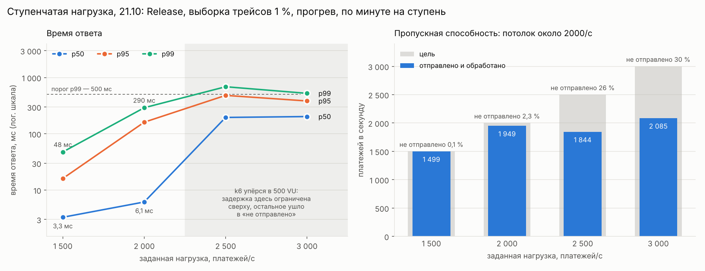
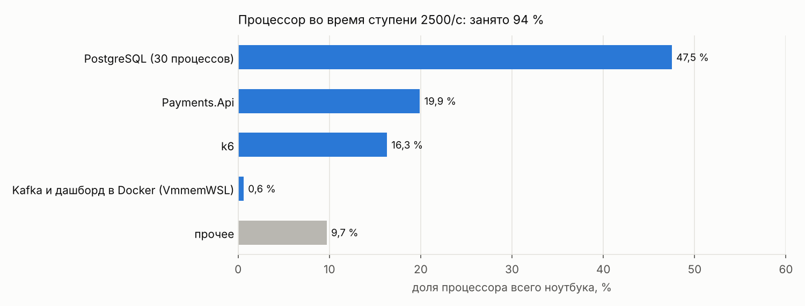
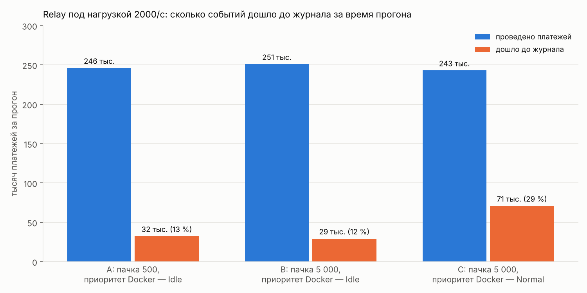
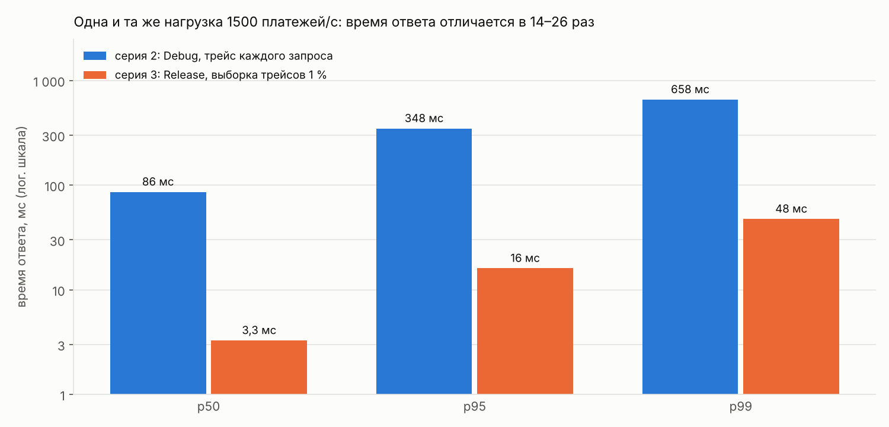

# Нагрузочное тестирование этапа 1

Сколько платежей в секунду выдерживает этап 1 на ноутбуке, где у него колено, во что он упирается и сходятся ли деньги под перегрузкой. Путь платежа: k6 → Payments.Api → БД payments (платёж и строка outbox) → OutboxRelay → Kafka → Ledger.Service → БД ledger.

## Коротко

- **Приём платежей держит 1500 в секунду с p99 = 48 мс.** Колено — между 1500 и 2000: на 2000 p99 вырастает в 6 раз, до 290 мс, и k6 уже не успевает отправить 2,3 % платежей. Потолок — около 1850–2100 платежей в секунду, когда процессор ноутбука занят на 94 %.
- **Вся система без отставания журнала держит около 1500 в секунду.** Выше платежи по-прежнему принимаются, а события копятся в outbox и разбираются после пика: outbox работает как буфер.
- **Деньги сходятся и под перегрузкой.** После ступеней до 3000 в секунду, когда в outbox копилось до 116 тысяч событий, сверка показала 1 553 112 проведённых платежей в базе платежей и ровно столько же в журнале. Зависших платежей нет.
- **Асинхронная часть на стенде упирается в проброс порта Docker Desktop.** Весь трафик Kafka идёт через процесс `com.docker.backend`, а Windows держала его в режиме эффективности с приоритетом `Idle`. При загрузке процессора 94 % он почти не получал времени, и relay переносил около 100 событий в секунду вместо 1900.
- **Методика важна не меньше железа.** Одна и та же нагрузка 1500 в секунду в Debug с трейсом каждого запроса и в Release с выборкой трейсов 1 % отличается по времени ответа в 14–26 раз.

## Стенд

| | |
|---|---|
| Ноутбук | тот же, что в [исследовании PostgreSQL](postgres-experiments.md): Intel Core i5-8250U (4 ядра / 8 потоков, под нагрузкой ~2,27 ГГц), 24 ГБ, SSD, Windows 11 |
| PostgreSQL | 15.12, нативно, порт 5433, `shared_buffers` = 1 ГБ |
| Kafka | apache/kafka 4.0.0, один узел в режиме KRaft, в Docker Desktop (WSL2); топик `payments.captured`, 8 партиций |
| Телеметрия | Aspire Dashboard в Docker, OTLP |
| Payments.Api | .NET 10, Release; пул 16 соединений, `statement_timeout` = 5 с; relay читает outbox пачками по 500 |
| Ledger.Service | .NET 10, Release; пул 8 соединений; пачка на партицию — до 500 платежей или 20 мс |
| Банк | заглушка внутри Payments.Api: отвечает без задержки, отклоняет 2 % платежей |
| Генератор нагрузки | k6 на той же машине |

Всё работает на одном ноутбуке и делит один процессор. Это главное ограничение стенда, и ниже оно видно во всех выводах.

## Методика

- **Открытая модель нагрузки.** Сценарий `constant-arrival-rate` в [load/payments.js](../load/payments.js): платежи приходят с заданной частотой, как бы медленно ни отвечал сервис. В закрытой модели, где N пользователей отправляют запросы по кругу, медленный сервис незаметно снижает себе нагрузку.
- **Виртуальные пользователи (VU).** Заранее создаются 10 % от заданной частоты (не меньше 50), всего не больше 500. Если в момент отправки свободного VU нет, k6 платёж не отправляет и считает его в `dropped_iterations`. Таких платежей нет ни в нагрузке, ни в перцентилях, поэтому их доля — отдельный порог.
- **Пороги, при которых ступень засчитывается:** ошибок меньше 1 %, p95 < 200 мс, p99 < 500 мс, не отправлено меньше 1 % запланированных платежей.
- **Сборка и телеметрия.** Сервисы в Release. Трейсы — выборка 1 % (`OTEL_TRACES_SAMPLER=parentbased_traceidratio`, `OTEL_TRACES_SAMPLER_ARG=0.01`); метрики считаются по всем запросам.
- **Прогрев.** Перед первой ступенью — 20 секунд нагрузки не выше 1000 в секунду без замера. Ступени запускает [load/ladder.ps1](../load/ladder.ps1); графики каждой ступени он сохраняет в HTML-отчёт k6.
- **Чистое состояние.** Ступень начинается при пустом outbox.
- **Корректность.** После каждой ступени — `/invariants` (двойная запись, совпадение балансов с проводками, нулевая сумма балансов), после серии — сверка базы платежей с журналом.
- **Отставание журнала.** Сравниваю прирост `payments` в `/invariants` с числом проведённых платежей. Проведённых — 98 % успешных запросов: остальные 2 % отклоняет банк (по сверке 31 492 из 1 584 604).

К этой методике я пришёл не сразу. Первые серии шли в Debug, без прогрева и с трейсом каждого запроса. Что это меняет — в разделе [«Что исказило первые серии»](#что-исказило-первые-серии).

## Ступенчатая нагрузка

Серия 21.10, 19:47–19:53: Release, выборка трейсов 1 %, прогрев, по минуте на ступень.

| Цель, /с | Факт, /с | p50, мс | p95, мс | p99, мс | Максимум, мс | Не отправлено | Ошибки |
|---|---|---|---|---|---|---|---|
| 1500 | 1499 | 3,3 | 16 | 48 | 189 | 0,07 % | 0 |
| 2000 | 1949 | 6,1 | 161 | 290 | 1 300 | 2,3 % | 0 |
| 2500 | 1844 | 195 | 481 | 686 | 1 880 | 26 % | 0 |
| 3000 | 2085 | 202 | 383 | 523 | 979 | 30 % | 147 |



- **1500 — все пороги пройдены.** Отдельный двухминутный прогон на 1500 дал p50 = 3,6 мс, p99 = 76 мс, не отправлено 0,3 %, и журнал к концу прогона полностью догнал платежи.
- **2000 — колено.** p99 вырос в 6 раз, а k6 не отправил 2,3 % платежей.
- **2500 и 3000 — насыщение.** Фактическая скорость перестаёт расти и держится около 1850–2100 в секунду. k6 упёрся в лимит 500 VU (`Insufficient VUs` в логе), поэтому дальше задержка не растёт: при 500 запросах в работе и ~1850 ответах в секунду она около 500 / 1850 ≈ 0,27 с (закон Литтла). Всё, что сверх, уходит в «не отправлено».
- **147 ошибок на 3000 — отказы TCP в первую секунду** (`connectex: ... actively refused it`). k6 открывает 300 соединений разом, очередь входящих соединений переполняется, и Windows отвечает отказом. Сам сервис не вернул ни одной ошибки ни на одной ступени.

## Корректность под перегрузкой

Сверка после ступеней, когда очередь разобралась:

| | |
|---|---|
| Проведено в базе платежей (`status = 'captured'`) | 1 553 112 |
| Учтено в журнале (`processed_payments`) | 1 553 112 |
| Отклонено банком | 31 492 (2,0 %) |
| Зависших в `created` | 0 |
| Строк в outbox | 0 |
| `/invariants` | ok: несбалансированных платежей 0, расхождений балансов с проводками 0, сумма всех балансов 0 |

Это итог за все прогоны с начала тестов, включая ступени до 3000 в секунду. Ни один платёж не потерян и не учтён дважды. Так работают три механизма: строка outbox пишется той же SQL-командой, что и смена статуса; Kafka доставляет событие хотя бы один раз; журнал отсекает повторы по `processed_payments`. После прогонов A–C (ниже), где отставание доходило примерно до 220 тысяч событий, `/invariants` тоже каждый раз возвращал ok.

## Во что упирается приём платежей



- **Процессор ноутбука занят на 94 %:** PostgreSQL — 47,5 %, Payments.Api — 19,9 %, k6 — 16,3 %.
- **База не заставляет себя ждать.** В `pg_stat_activity` из соединений Payments.Api 11–18 простаивают (`idle`, `ClientRead`), активны 1–5. Запросы ждут процессора в самом приложении, а не ответа базы.
- **Прогноз из исследования PostgreSQL подтвердился.** Там без горячих строк база давала ~4600 транзакций в секунду, «то есть грубо ~2 300 платежей при двух транзакциях на платёж». Вышло 1850–2100, и теперь процессор делят ещё k6, сервисы и Kafka.
- **k6 сам отнимает шестую часть процессора.** На отдельной машине для генератора нагрузки потолок был бы выше.

## Асинхронная часть: почему отстаёт журнал

### Наблюдение

На ступенях от 2000 outbox рос почти со скоростью проведения платежей. Оценка — по снимкам `count(*)` раз в несколько секунд:

| Ступень | Рост outbox | Проводится платежей |
|---|---|---|
| 2000 | ~1870 в секунду | ~1910 в секунду |
| 2500 | ~2000 в секунду | ~1810 в секунду |
| 3000 | ~2160 в секунду | ~2040 в секунду |

Значит, под нагрузкой relay почти ничего не переносил. Ledger в это время простаивал: событий не поступало. Как только ступень заканчивалась, outbox быстро разбирался. Ошибок relay в логах Payments.Api нет — он не падал, а голодал.

### Где relay теряет время

Метрика `payments.outbox.stage.duration` делит цикл relay на этапы. P50 при нагрузке 2000 в секунду:

| Этап | Пачка 500 (прогон A) | Пачка 5000 (прогон B) |
|---|---|---|
| Чтение пачки из outbox (`read`) | 5–25 мс | 25–75 мс |
| Отправка в Kafka и ожидание подтверждений (`produce`) | от 2,5 до 10 с и больше | 10 с и больше |
| Удаление отправленных строк (`delete`) | 5–50 мс | до 50 мс, разовый выброс 500 мс |

10 с — верхняя граница корзин гистограммы по умолчанию, на деле могло быть дольше. Когда outbox небольшой (прогон на 1500 в секунду), то же чтение занимает меньше миллисекунды: `EXPLAIN ANALYZE` показал 0,9 мс. Postgres для relay не узкое место — узкое место отправка в Kafka.

### Эксперименты A, B, C

Нагрузка 2000 в секунду, 2 минуты, прогрев, пустой outbox на старте.

| | A | B | C |
|---|---|---|---|
| Пачка relay | 500 | 5000 | 5000 |
| Приоритет `com.docker.backend` | `Idle` (режим эффективности) | `Idle` | `Normal` |
| Проведено за прогон, с прогревом | 246 тыс. | 251 тыс. | 243 тыс. |
| Дошло до журнала за прогон | 32 тыс. (13 %) | 29 тыс. (12 %) | 71 тыс. (29 %) |
| Приём: p50 / p95 / p99, мс | 13 / 260 / 425 | 9 / 126 / 266 | 36 / 290 / 412 |
| Не отправлено | 3,5 % | 1,4 % | 4,8 % |



- **B: большие пачки не помогли.** Если бы relay ограничивало время одного обмена с Kafka, пачка в 10 раз больше дала бы в 10 раз больше событий. Вместо этого время отправки выросло вместе с пачкой: путь до Kafka ограничен объёмом данных, а не числом обменов.
- **Почему путь до Kafka такой узкий.** Kafka работает в виртуальной машине Docker Desktop, а порт 9092 на Windows слушает процесс `com.docker.backend` и копирует байты внутрь неё. Windows держала этот процесс в режиме эффективности, то есть с приоритетом `Idle` и правом выполнять его на медленных ядрах. При загрузке процессора 94 % он получал время только в паузах. Виртуальная машина с Kafka в это время занимала 0,6 % процессора: до брокера почти ничего не доходило.
- **C: обычный приоритет помог больше чем вдвое.** До журнала дошла 71 тысяча событий против 29–32, но и это меньше трети проведённых платежей. По оценке из `pg_stat_user_tables` relay под нагрузкой переносил около 1000 событий в секунду, а до журнала к концу прогона дошло меньше: Ledger читает Kafka через тот же процесс Docker.
- **Процессор приходится делить.** Время, которое получила асинхронная часть, ушло у приёма платежей: в C время ответа хуже, чем в B. Разброс между прогонами большой — A и B отличаются вдвое при одном изменённом параметре, — но направление логичное.

**Итог.** На 2000 в секунду этому ноутбуку не хватает процессора на обе половины системы: приём держится, только пока асинхронная часть голодает. Без отставания журнала стенд держит около 1500 в секунду. Выше outbox работает как буфер и разбирается после пика, без потерь.

## Что исказило первые серии

| | Серия 1, 20.10 | Серия 2, 21.10, ночь | Серия 3, 21.10, вечер |
|---|---|---|---|
| Сборка и трейсы | Debug, трейс каждого запроса | Debug, трейс каждого запроса | Release, выборка 1 % |
| Прогрев | нет | нет | 20 с |
| Заранее созданных VU | 50 | 10 % от частоты | 10 % от частоты |

Серия 1:

| Цель, /с | Факт, /с | p50, мс | p95, мс | p99, мс | Не отправлено |
|---|---|---|---|---|---|
| 200 | 200 | 3,4 | 7,7 | 18 | 0 |
| 500 | 491 | 4,4 | 37 | 125 | 1,8 % |
| 1000 | 997 | 6,5 | 26 | 51 | 0,3 % |

Серия 2 (ступень 1000 шла сразу после перезапуска сервисов, с открытой живой страницей k6):

| Цель, /с | Факт, /с | p50, мс | p95, мс | p99, мс | Не отправлено |
|---|---|---|---|---|---|
| 1000 | 990 | 7,8 | 56 | 144 | 1,0 % |
| 1500 | 1362 | 86 | 348 | 658 | 9,1 % |
| 2000 | 1675 | 183 | 423 | 670 | 16 % |
| 2500 | 1894 | 213 | 383 | 639 | 24 % |
| 3000 | 1815 | 241 | 433 | 637 | 39 % |



1. **Release и выборка трейсов.** `dotnet run` по умолчанию собирает Debug. Трейс на каждый запрос — это тысячи спанов в секунду, которые дашборд принимает на том же ноутбуке. Медиана на 1500 в секунду упала с 86 до 3,3 мс.
2. **Прогрев.** Первый прогон в Release (1500 в секунду, 2 минуты) прошёл без прогрева: медиана уже 4,2 мс, но p99 = 656 мс и не отправлено 3,7 %. Тот же прогон с прогревом и пустым outbox: p99 = 76 мс, не отправлено 0,3 %.
3. **Пул VU.** В серии 1 k6 заранее создавал 50 VU. Любая заминка длиннее 50 / RATE секунды превращалась в неотправленные платежи, которых нет в перцентилях, и хвост выглядел лучше, чем был. Теперь пул — 10 % от частоты.
4. **Один прогон — не замер.** В серии 1 ступень 500 вышла хуже 1000 (p99 125 мс против 51) из-за заминки посреди прогона, а прогоны A и B различаются вдвое. Сравнивать можно только прогоны из одинакового состояния, а неожиданный результат — проверять повтором.
5. **Живая страница k6 держит процесс.** Пока открыта вкладка web dashboard, k6 не завершается: так задумано, чтобы успеть скачать отчёт. В `ladder.ps1` живая страница выключена, графики сохраняются в HTML.

## Особенности стенда

- **Генератор нагрузки на той же машине** забирает 16 % процессора.
- **Проброс порта Docker Desktop и режим эффективности Windows.** Перед прогоном проверяй приоритет процесса, который слушает порт Kafka, — должен быть `Normal`. После перезапуска Docker Desktop режим эффективности может вернуться.
- **Лимит 500 VU** ограничивает сверху измеренную задержку на насыщении.
- **Отказы TCP в первую секунду**, когда заранее создано 250–300 VU и больше.
- **`/invariants` читает все проводки.** При 3,5–4,5 миллиона проводок проверка под нагрузкой не укладывалась в `statement_timeout` = 10 с и возвращала 500. Теперь у неё свой лимит — 2 минуты (`SET LOCAL statement_timeout`), а консьюмер сохраняет свои 10 секунд.
- **Retention Kafka на стенде — 1 час и 64 МБ на партицию.** Если Ledger отстанет сильнее, события удалятся непрочитанными. В продакшене retention должен быть с запасом больше худшего отставания.
- **Оценка размера outbox.** `n_live_tup` из статистики — приблизительная. `count(*)` точнее, но под нагрузкой по раздутой таблице сам выполнялся секундами.

## Что из этого следует для продакшена

- **Kafka — на своих машинах**, без посредника между сервисом и брокером. Relay и консьюмеры масштабируются отдельно от приёма платежей.
- **Метрики отставания асинхронной части и алерт на них:** возраст самой старой строки outbox и lag консьюмера Ledger. В этих прогонах они сразу показали бы проблему, а не по сверке.
- **Рабочая нагрузка — с запасом ниже точки, где система держится целиком.** Для этого стенда это около 1100–1200 платежей в секунду.
- **Outbox как буфер — достоинство архитектуры:** приём платежей не зависит от Kafka. Но буфер нужно мониторить, а retention брокера — считать от худшего отставания.
- **Замерять в Release и с выборкой трейсов, генератор нагрузки — на отдельной машине.**

## Дальнейшие шаги

- Метрики отставания: возраст самой старой строки outbox (gauge в Payments.Api) и lag консьюмера Ledger.
- Точное колено: ступени от 1500 до 2000 через 100.
- Длительный прогон: 10–15 минут на ~1200 в секунду — чекпоинты, автовакуум, стабильность.
- Снизить нагрузку на процессор от Postgres: автоподготовка запросов в Npgsql (`Max Auto Prepare`), микропачки в Payments.Api.
- Статистика клиента Kafka (librdkafka: `rtt`, `int_latency`): разделить задержку внутри клиента и на пути до брокера.
- Хаос-тест (этап 3): остановить Ledger и Payments.Api посреди нагрузки и проверить сверку.

## Как воспроизвести

Сервисы — каждый в своём окне:

```powershell
docker compose up -d

# окно Ledger
$env:OTEL_TRACES_SAMPLER = "parentbased_traceidratio"
$env:OTEL_TRACES_SAMPLER_ARG = "0.01"
dotnet run -c Release --project src\Ledger.Service

# окно Payments.Api: те же две переменные и метрики раз в 5 секунд
$env:OTEL_TRACES_SAMPLER = "parentbased_traceidratio"
$env:OTEL_TRACES_SAMPLER_ARG = "0.01"
$env:OTEL_METRIC_EXPORT_INTERVAL = "5000"
dotnet run -c Release --project src\Payments.Api
```

Приоритет процесса, который пробрасывает порт Kafka, — должен быть `Normal`:

```powershell
Get-Process -Id (Get-NetTCPConnection -LocalPort 9092 -State Listen).OwningProcess | Select-Object Id, ProcessName, PriorityClass
```

Во время прогона — что делают соединения Postgres и сколько строк в outbox (`psql -p 5433 -U postgres -d payments`):

```sql
SELECT datname, state, wait_event_type, wait_event, count(*),
       (SELECT n_live_tup FROM pg_stat_user_tables WHERE relname = 'outbox') AS outbox
FROM pg_stat_activity
WHERE backend_type = 'client backend' AND pid <> pg_backend_pid()
GROUP BY 1, 2, 3, 4
ORDER BY 5 DESC \watch 2
```

Ступени и эксперимент с пачкой relay:

```powershell
powershell -ExecutionPolicy Bypass -File load\ladder.ps1 -Rates "1500,2000,2500,3000"
powershell -ExecutionPolicy Bypass -File load\ladder.ps1 -Rates "2000" -Duration 120s

# пачка relay 5000: в окне Payments.Api перед dotnet run
$env:Outbox__BatchSize = "5000"
```

Этапы цикла relay — в дашборде: Metrics → `payments-api` → `payments.outbox.stage.duration`, фильтр `stage`.

Сверка, когда outbox опустеет: `captured` должно совпасть с `payments` из `/invariants`, `stuck` и `outbox` — нули.

```powershell
psql -p 5433 -U postgres -d payments -c "SELECT count(*) FILTER (WHERE status = 'captured') AS captured, count(*) FILTER (WHERE status = 'declined') AS declined, count(*) FILTER (WHERE status = 'created') AS stuck, (SELECT count(*) FROM outbox) AS outbox FROM payments"
Invoke-RestMethod http://localhost:5200/invariants
```

Очистка перед новой серией — после сверки, при остановленных сервисах:

```powershell
psql -p 5433 -U postgres -d payments -c "TRUNCATE payments, outbox"
psql -p 5433 -U postgres -d ledger -c "TRUNCATE postings, processed_payments, accounts"
```
