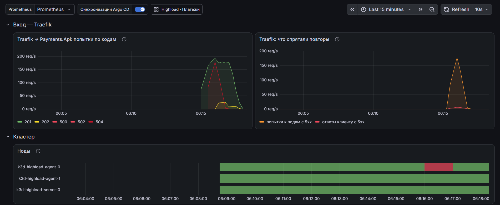
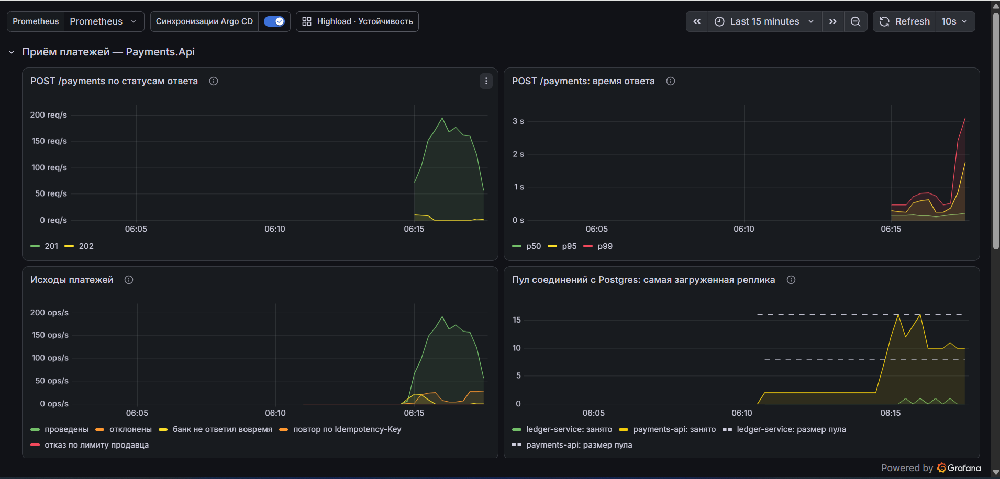
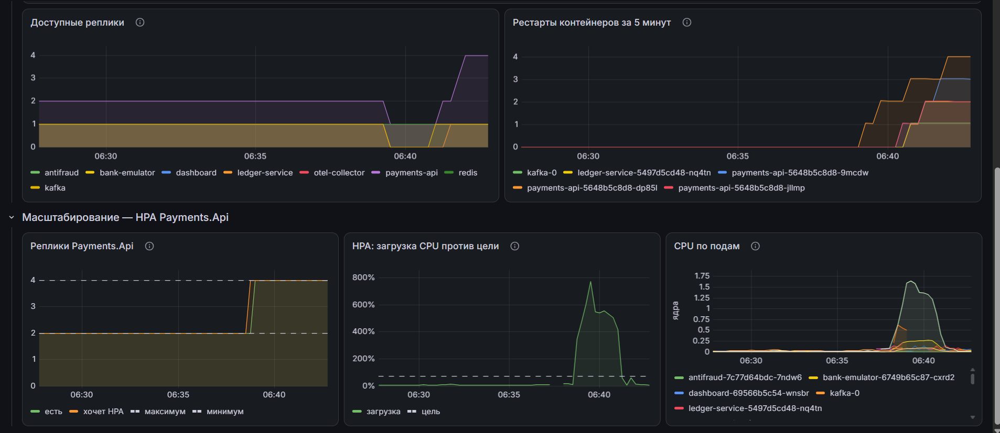
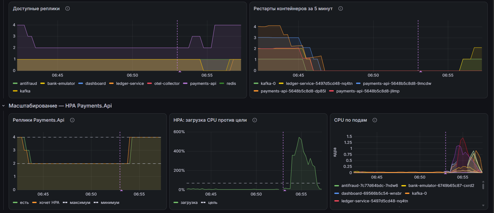
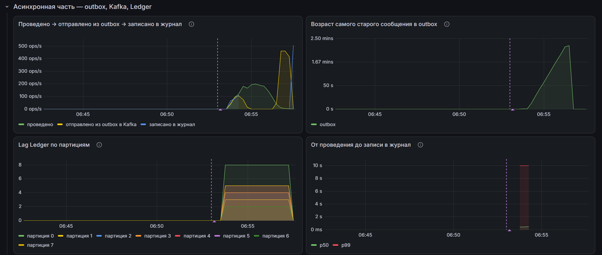
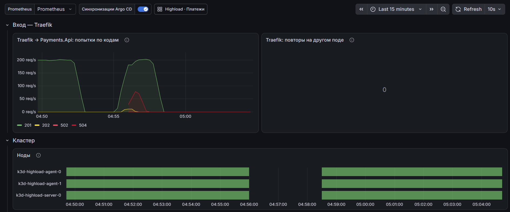

# Наблюдаемость: Prometheus, Grafana и отказы нод

Метрики стенда собираются в Prometheus и показываются на двух дашбордах Grafana, которые лежат в git рядом с манифестами. На них проверены отказы нод: с репликой Payments.Api и с Kafka. Половина находок оказалась не про сервис, а про сам мониторинг — они в разделе [«Чему научил мониторинг»](#чему-научил-мониторинг). Кластер и выкатка — в [deploy/k8s/README.md](../deploy/k8s/README.md) и [gitops.md](gitops.md).

## Как устроено

```
 Payments.Api, Ledger ──OTLP──► OpenTelemetry Collector ──OTLP──► Prometheus ◄── scrape: kubelet, kube-state-metrics,
        (каждые 15 с)                  │                        (namespace          node-exporter, Traefik, Argo CD
                                       └──► Aspire dashboard     monitoring)
                                            (трейсы, логи)            │
                                                                      ▼
                                                   Grafana: «Highload · Платежи», «Highload · Устойчивость»
```

- **kube-prometheus-stack** ставит Argo CD из Helm-чарта: [deploy/argocd/monitoring.yaml](../deploy/argocd/monitoring.yaml), значения — [deploy/monitoring/values.yaml](../deploy/monitoring/values.yaml). Alertmanager и правила алертов выключены: на ноутбуке будить некого.
- **Метрики сервисов приходят по OTLP**, а не через scrape. Сервисы отправляют их в Collector ([deploy/k8s/otel-collector.yaml](../deploy/k8s/otel-collector.yaml)), тот — в OTLP-приёмник Prometheus и в Aspire dashboard. Имена при переводе: точки → `_`, у счётчиков `_total`, единица — суффиксом (`ledger.payment.delay`, мс → `ledger_payment_delay_milliseconds`), `service.name` → `job`, `service.instance.id` → `instance`.
- **Traefik и Argo CD** Prometheus опрашивает сам: PodMonitor и ServiceMonitor в [deploy/k8s/monitors.yaml](../deploy/k8s/monitors.yaml).
- **Дашборды — JSON в [deploy/k8s/dashboards](../deploy/k8s/dashboards)**, kustomize собирает из них ConfigMap с меткой `grafana_dashboard: "1"`, sidecar Grafana находит его и кладёт файлы на диск. Правка дашборда — коммит, как и всё остальное. Изменённый в интерфейсе дашборд при следующей синхронизации вернётся к версии из git.
- **Мониторинг живёт на server-0**: Prometheus, kube-state-metrics, Grafana и Collector закреплены за нодой control-plane. Почему — в находках.

## Дашборды

**«Highload · Платежи»** — путь платежа:

| Панель | На какой вопрос отвечает |
|---|---|
| POST /payments по статусам ответа | Сколько принято и с каким исходом: 201, 202 (банк не ответил вовремя), 422, 429 |
| Время ответа | p50, p95, p99 по всем репликам |
| Исходы платежей | Проведены, отклонены (включая те, что отклонило восстановление), без ответа банка, повторы по ключу идемпотентности, лимиты |
| Пул соединений с Postgres | Сколько соединений занято у самой загруженной реплики против размера пула |
| Проведено → отправлено из outbox → записано в журнал | Три скорости на одном графике. Разошлись — где-то копится очередь |
| Возраст самого старого сообщения в outbox | Насколько отстаёт отправка в Kafka |
| Lag Ledger по партициям | Сколько сообщений ещё не в журнале; перекос одной партиции виден только так |
| От проведения до записи в журнал | Весь асинхронный путь в одном числе |

**«Highload · Устойчивость»** — что происходит со стендом:

| Панель | На какой вопрос отвечает |
|---|---|
| Traefik → Payments.Api: попытки по кодам | Попытки, а не запросы: попытка к мёртвому поду, повторённая на другом, тоже здесь |
| Traefik: что спрятали повторы | Попытки к подам с 5xx против ответов 5xx клиенту. Разница — работа повторов |
| Ноды | Ready по мнению Kubernetes |
| Доступные реплики, рестарты | Readiness и падения контейнеров |
| HPA | Сколько реплик есть и сколько хочет HPA, загрузка CPU против цели, CPU по подам |

Вертикальные пунктиры на обоих — синхронизации Argo CD: видно, какой коммит что поменял.

## Решения и почему

| Что | Почему |
|---|---|
| Метрики сервисов по OTLP через Collector, а не scrape `/metrics` | Сервисы уже отдают трейсы и логи по OTLP в Aspire dashboard; Collector раздаёт один поток в оба места |
| `enableOTLPReceiver`, `outOfOrderTimeWindow: 5m` | Пакеты OTLP приходят с опозданием, и без окна Prometheus отбрасывает такие точки |
| Хранение 12 ч, 1 ГБ, без диска | Хватает сравнить прогон с предыдущим. Цена: перезапуск пода Prometheus стирает историю |
| Пароль Grafana — Secret `grafana-admin`, созданный руками | Чарт генерирует случайный пароль при каждом рендере, а Argo CD рендерит чарт на каждый коммит: пароль менялся бы с каждым push |
| `REQ_BASIC_AUTH_ENCODING: utf-8` у sidecar'ов Grafana | По умолчанию sidecar кодирует пароль в Latin-1, а в пароле кириллица: запрос на перечитывание дашбордов падал, sidecar при старте тоже |
| Prometheus, kube-state-metrics, Grafana, Collector — на server-0 | Опыты останавливают рабочие ноды. Наблюдатель на такой ноде ослепнет ровно в момент отказа |
| Счётчики выставляются в 0 при старте, `service.instance.id` — имя пода | Иначе всплеск, попавший в первую точку новой серии, на графиках не виден |
| Дашборды в git, а не в базе Grafana | У Grafana нет диска, база создаётся заново при каждом перезапуске. Дашборд из git переживает это и меняется через коммит |

## Опыты: отказ ноды под нагрузкой

[load/node-failure.ps1](../load/node-failure.ps1): переносит одну реплику Payments.Api на выбранную ноду, даёт 200 платежей в секунду на 150 секунд, через 30 секунд останавливает контейнер ноды (как будто машина умерла) и через 90 секунд запускает снова. Перед опытами единственные экземпляры — Traefik, bank-emulator, Redis, metrics-server и одна из двух реплик CoreDNS — перенесены на server-0: иначе отказ ноды смешивается с отказом единственной копии важного сервиса. Kafka переносу не поддаётся: её том (local-path) лежит на agent-1.

### Нода с репликой Payments.Api (agent-0)



- **Повторы Traefik спрятали почти всё.** 9 667 попыток получили 504: под на остановленной ноде не принял соединение за 1 с. Пик — около 180 неудачных попыток в секунду против единиц ответов 5xx клиенту.
- **Kubernetes заметил отказ через 49 секунд**: стоп в 06:15:02, NotReady в 06:15:51. Всё это время под оставался в балансировке. Ещё через 37 секунд (`tolerationSeconds: 30`) под удалили, замена была готова в 06:16:41.
- **Одна реплика держала всё.** Первые ~55 секунд весь поток шёл в реплику на server-0: CPU 600 % от requests, пул 16 из 16, p99 до 3 с, 2 636 ответов 202. Потом восстановление отклонило эти платежи: банк по ним не принял решения.
- **Клиент**: 419 ошибок из 28 635 (1,46 %), 1 366 пропущенных итераций, p99 6,45 с. Ответов 5xx — около сотни, остальное — 60-секундные ожидания запросов, отправленных в момент остановки. На графиках Traefik их нет: они застряли ниже, в балансировщике k3d, который отправляет соединения на все три ноды.



### Нода с Kafka и Ledger (agent-1): до и после

Первый прогон показал, что outbox работает, но новые реплики не стартуют. После правки — второй прогон.

| | До | После |
|---|---|---|
| Рестарты новых реплик Payments.Api | 2–4 у каждой | 0 |
| Реплик готово, пока Kafka лежит | 1 | 4 |
| Пик загрузки CPU реплики | 800 % | ~540 % |
| Попытки Traefik с 504 | 10 064 | 4 480 |
| Ошибки у клиента | 446 (1,50 %) | 133 (0,46 %) |
| Самый долгий запрос | 60 с (таймаут k6) | 14 с |

До правки:



После:



- **Outbox сработал в обоих прогонах.** Приём шёл около 200 платежей в секунду; возраст outbox рос до ~2,5 минуты; когда Kafka вернулась, relay отправлял накопленное со скоростью ~460–510 сообщений в секунду, Ledger записывал ~450–500 в секунду.
- **Почему не стартовали реплики.** Payments.Api при старте создавал топик в Kafka и без неё падал. Принимать платежи без Kafka сервис умеет, но запуститься без неё не мог: в отказ Kafka весь поток держала одна реплика. Теперь топик создаёт outbox-relay перед первым сообщением, а старт от Kafka не зависит.
- **Что осталось.** k6 пропустил 1 340 итераций в конце прогона: отправка накопленного и запись в журнал совпали с приёмом новых платежей, p99 вырос до 4,5 с. Похоже, всё боролось за один Postgres и одни ядра; лечится ограничением скорости relay, но это не проверено.



## Чему научил мониторинг

1. **Наблюдатель падает вместе с наблюдаемым.** В первом опыте kube-state-metrics был на остановленной ноде: панели нод, реплик и HPA оборвались ровно в момент отказа, нода так и не покраснела. Мониторинг закреплён за server-0; в продакшене — отдельные ноды или Prometheus в HA.

   

2. **Метрики, которой нет.** Панель «повторы на другом поде» строилась по `traefik_service_retries_total`, а middleware retry этот счётчик не пишет вовсе: в коде Traefik она создаётся без слушателей, с комментарием `TODO missing metrics`. Заменена на сравнение попыток 5xx с ответами 5xx клиенту.
3. **«0» вместо «No data» прячет поломку.** Это и скрыло предыдущий пункт. `noValue: "0"` оставлен только там, где метрика точно существует.
4. **Стопка прячет маленькую серию.** Со стекингом линия 202 лежала прямо на линии 201 и закрашивала её: казалось, что почти все ответы — 202. Коды ответа теперь без стека.
5. **Первая точка серии не считается.** `rate()` — разница между точками. Новый лидер outbox до отказа Kafka ничего не отправлял, и весь накопленный хвост попал в первую точку его счётчика: догоняющей волны на графике не было. Теперь все счётчики выставляются в 0 при старте, а `service.instance.id` — имя пода, чтобы перезапуск контейнера продолжал серию. У гистограммы так нельзя: задержку первой пачки после долгого простоя Ledger график по-прежнему не покажет.
6. **Ноль до старта уходит в никуда.** Первая версия выставляла нули до `app.Run()`, а OpenTelemetry SDK начинает слушать счётчики только со стартом хоста. Теперь — по `ApplicationStarted`.
7. **Последнее значение держится 5 минут.** У серий из OTLP нет маркеров устаревания: после смерти пода Prometheus ещё 5 минут показывает его последнее значение. Застывшие на 5 минут линии lag — это мёртвый Ledger, а не замерший.
8. **Короткий прогон врёт о скорости.** Минутный прогон при окне `rate` в минуту даёт треугольник с вершиной ниже настоящей скорости, а не полку. Для скриншотов — прогоны по 5 минут.
9. **DNS — тоже зависимость.** Вместе с нодой умерла одна из двух реплик CoreDNS, и пока её не убрали из Service (те же ~50 секунд), половина DNS-запросов висела. Новые реплики HPA падали при старте на разрешении адреса Postgres. Теперь подключение к Postgres при старте повторяется до 20 секунд; в продакшене ставят NodeLocal DNSCache.

## Что упрощено по сравнению с продакшеном

- Один Prometheus без диска и без HA; в продакшене — постоянное хранилище, две реплики или Thanos/Mimir.
- Нет алертов: Alertmanager выключен, правила не созданы.
- Мониторинг закреплён за control-plane, а не за отдельными нодами.
- Логи и трейсы — в Aspire dashboard в памяти, а не в Loki и Tempo.

## Как повторить

```powershell
# Grafana: логин admin, пароль из Secret grafana-admin
while ($true) { kubectl -n monitoring port-forward svc/monitoring-grafana 3000:80; Start-Sleep 2 }

# Полка 200/с для дашборда «Платежи» и HPA
k6 run -e BASE_URL=http://localhost:8080 -e DURATION=5m load/payments.js

# Отказ ноды: перед этим проверить, что на ней нет Traefik, bank-emulator и CoreDNS
kubectl get pods -A -o wide --field-selector spec.nodeName=k3d-highload-agent-0
.\load\node-failure.ps1 -Node k3d-highload-agent-0 -Log node-failure-agent0.log
.\load\node-failure.ps1 -Node k3d-highload-agent-1 -Log node-failure-agent1.log
```

Скриншоты для документации удобнее снимать в режиме киоска: `&kiosk` в конце адреса дашборда.
