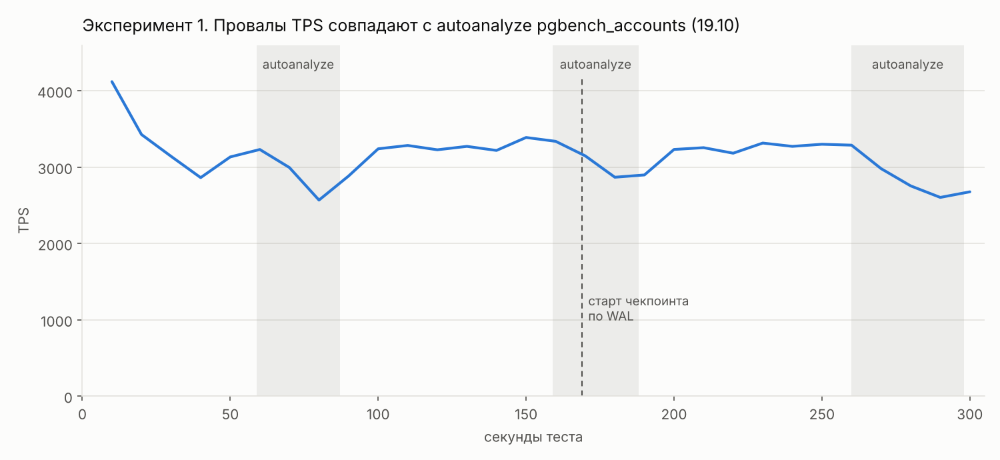
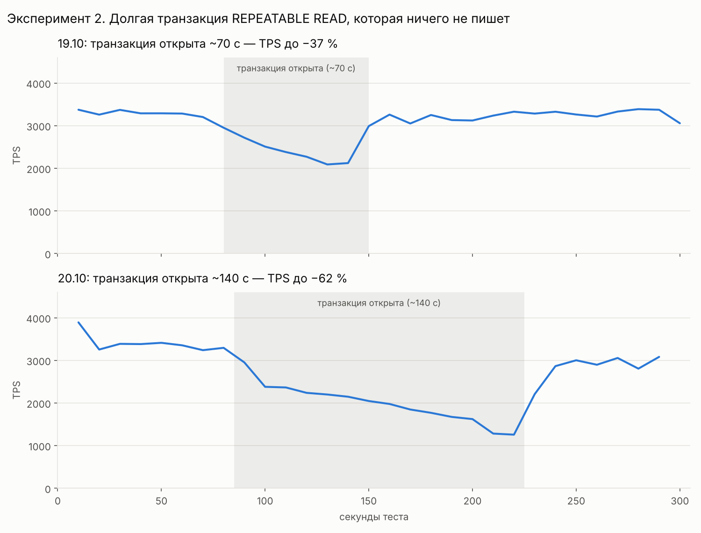
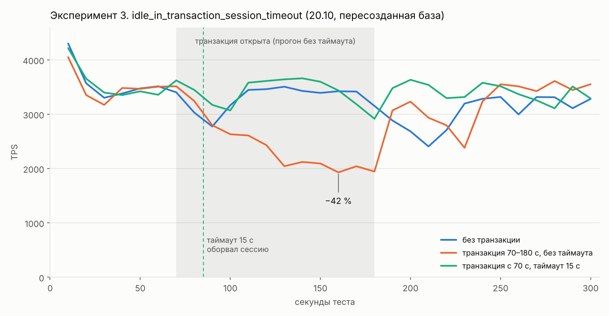
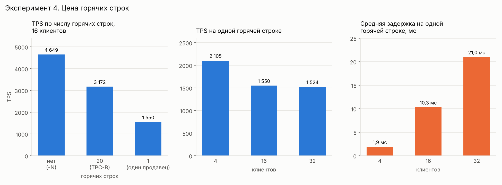
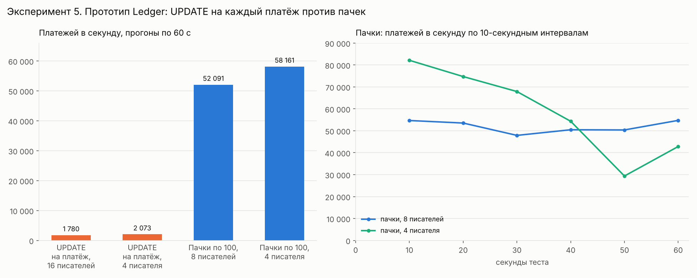

# Исследование: PostgreSQL под нагрузкой на ноутбуке

Прежде чем писать платёжный сервис, я измерил потолок записи PostgreSQL на своём стенде и разобрался, что мешает ему держать ровную нагрузку. Встроенный сценарий pgbench (TPC-B) — по сути банковский перевод: обновить счёт, кассира и отделение, записать операцию в историю. Поэтому выводы напрямую переносятся на платёжный сервис.

## Стенд

| | |
|---|---|
| Ноутбук | HP Laptop 14-cf0xxx |
| Процессор | Intel Core i5-8250U: 4 ядра / 8 потоков, 15 Вт; под длительной нагрузкой держит ~2,27 ГГц |
| Память | 24 ГБ |
| Диск | SSD 256 ГБ |
| ОС | Windows 11 |
| СУБД | PostgreSQL 15.12, установлен нативно (не в Docker); `shared_buffers` = 1 ГБ, остальные параметры по умолчанию |
| Нагрузка | pgbench 15.12 на той же машине, сценарий TPC-B, масштаб 20 (2 млн счетов, 200 кассиров, 20 отделений), 16 клиентов, 4 потока |

Строки `pgbench_branches` — горячие: все 16 клиентов постоянно обновляют одни и те же 20 строк. В платёжном сервисе так ведёт себя строка баланса крупного продавца.

## Базовая линия

| Прогон | Длительность | TPS | Средняя задержка |
|---|---|---|---|
| 19.10 | 120 с | 3117 | 5,1 мс |
| 19.10, повтор | 300 с | 3140 | 5,1 мс |
| 20.10, пересозданная база | 300 с | 3259 | 4,9 мс |

**Итог:** около 3100–3300 транзакций записи в секунду при задержке ~5 мс. Как выяснилось позже, это потолок именно этого сценария с горячими строками, а не железа (эксперимент 4).

Методические замечания:
- Разброс между одинаковыми прогонами — 5–6 %. Разницу меньше этого считаю шумом.
- Первые 10–20 секунд процессор работает в турбобусте (4000+ tps). При подсчёте средних эти интервалы отбрасываю как прогрев.

## Эксперимент 1. Откуда периодические провалы TPS

**Наблюдение.** Примерно раз в 100 секунд TPS проседал на 12–21 %, а разброс задержки вырастал примерно вдвое.

**Гипотезы:**
1. **Троттлинг процессора** — исключён: частота весь прогон держалась на ~2,27 ГГц.
2. **Чекпоинт** — не основная причина: чекпоинт по объёму WAL стартовал на 169-й секунде и мог усилить второй провал, но первый и третий прошли без него.
3. **Фоновая работа autovacuum.**

**Метод.** Включил логирование autovacuum, сбросил накопленное перед прогоном и привязал время прогона к логу сервера:

```sql
ALTER SYSTEM SET log_autovacuum_min_duration = 0;
SELECT pg_reload_conf();
CHECKPOINT;
```

```powershell
Get-Date; pgbench -U postgres -c 16 -j 4 -T 300 -P 10 pgbench_test
```

**Результат.** Все три провала совпали с запусками autoanalyze большой таблицы `pgbench_accounts`:

| Провал TPS | Autoanalyze `pgbench_accounts` | Мёртвых, но неудаляемых версий в `pgbench_branches` |
|---|---|---|
| 70–90 с, минимум 2569 | 59–87 с (28,8 с) | 56 796 |
| 180–190 с, минимум 2868 | 159–188 с (28,3 с) | 60 933 |
| 270–300 с, минимум 2604 | 260–298 с (38,1 с) | 57 509 |

Вне этих окон таких версий было в основном десятки, изредка — тысячи и больше: сразу после окончания анализа и во время коротких анализов `pgbench_history`.



**Механизм:**
1. Каждый UPDATE создаёт новую версию строки (MVCC). Старую версию можно удалить, только когда её уже не видит ни одна транзакция.
2. ANALYZE держит снимок данных всё время работы — здесь 28–38 секунд. Пока он идёт, вакуум не может удалить ни одну версию, ставшую мёртвой после его начала, причём ни в одной таблице.
3. Сильнее всего страдают горячие строки. 20 строк `pgbench_branches` обновляются ~3000 раз в секунду, мёртвые версии копятся десятками тысяч. За 5 минут таблица из 20 строк выросла с 19 до 513 страниц — около 4 МБ.
4. Каждому UPDATE горячей строки приходится пробираться через мёртвые версии, и TPS падает. Анализ заканчивается, вакуум чистит, TPS восстанавливается.

**Почему раз в ~100 секунд.** Autoanalyze срабатывает после 50 + 10 % × 2 млн ≈ 200 тыс. изменённых строк. При ~3100 обновлениях в секунду это ~65 секунд, плюс ~30 секунд длится сам анализ.

**Подтверждение.** Эффект воспроизвёлся 20.10 на пересозданной базе (провалы на 80–100 и 190–220 с). Механизм независимо подтверждает эксперимент 2: снимок, удерживаемый вручную, даёт ту же деградацию.

## Эксперимент 2. Долгая транзакция

**Гипотеза.** Если причина в удерживаемом снимке, то любая долгая транзакция даст тот же эффект — даже если она ничего не пишет и ничего не блокирует.

**Метод.** Во время прогона pgbench во втором окне psql открываю транзакцию и держу её:

```sql
BEGIN ISOLATION LEVEL REPEATABLE READ;
SELECT 1;
-- ждём 1–2 минуты
COMMIT;
```

**Результат:**

| Прогон | Транзакция открыта | TPS: до → минимум | Задержка: до → максимум |
|---|---|---|---|
| 19.10 | 80–150 с (~70 с) | 3290 → 2090 (−37 %) | 4,9 → 7,7 мс |
| 20.10 | ~85–225 с (~140 с) | 3330 → 1260 (−62 %) | 4,8 → 12,8 мс |
| 20.10, пересозданная база | 70–180 с (110 с) | 3490 → 1930 (−45 %); в среднем ~2030 (−42 %) | 4,6 → 8,3 мс |



Выводы:
- Транзакция, которая не пишет и не блокирует, сняла от 37 до 62 % пропускной способности записи.
- Чем дольше она висит, тем сильнее деградация: TPS проседает с каждым 10-секундным интервалом. На пересозданной базе он стабилизировался на ~−42 %.
- Через 10–15 секунд после `COMMIT` система восстанавливается.

**Диагностика.** Виновника видно в `pg_stat_activity`:

```sql
SELECT pid, state, now() - xact_start AS xact_age, backend_xmin
FROM pg_stat_activity
WHERE backend_xmin IS NOT NULL
ORDER BY xact_start
LIMIT 5;
```

Во время эксперимента первой строкой была моя сессия: `idle in transaction`, возраст 1 мин 44 с, `backend_xmin` отставал от активных сессий примерно на 213 тыс. транзакций. Этот запрос — готовая основа для метрики и алерта.

## Эксперимент 3. Защита: idle_in_transaction_session_timeout

**Ловушка.** Первая попытка не сработала:

```sql
ALTER DATABASE pgbench_test SET idle_in_transaction_session_timeout = '15s';
```

Настройка уровня базы применяется только к новым подключениям, а сессия с транзакцией была открыта раньше — и провисела больше двух минут. С пулом соединений Npgsql будет так же: уже открытые физические соединения изменения не увидят. Поэтому в сервисе лимит задаётся в строке подключения: `Options=-c idle_in_transaction_session_timeout=15s`.

**Метод.** Три прогона на пересозданной базе, одинаковый сценарий, перед каждым `CHECKPOINT`:
1. Без параллельной транзакции.
2. Транзакция открыта с 70-й по 180-ю секунду.
3. Транзакция открыта на 70-й секунде, но в сессии заранее выполнено `SET idle_in_transaction_session_timeout = '15s';`.

**Результат:**

| Прогон | Итоговый TPS | Средняя задержка | Разброс задержки | Худший 10-секундный интервал |
|---|---|---|---|---|
| Без транзакции | 3259 | 4,90 мс | 5,6 мс | 2408 tps (210 с) |
| Транзакция 70–180 с, без таймаута | 2976 | 5,37 мс | 6,1 мс | 1930 tps (160 с) |
| Транзакция с 70 с, таймаут 15 с | 3446 | 4,64 мс | 3,2 мс | 2917 tps (180 с) |



Выводы:
- Без таймаута TPS упал на ~42 % и держался там до `COMMIT`.
- С таймаутом Postgres оборвал зависшую сессию через 15 секунд. Провал на 90–100 секунде составил около −11 % — меньше, чем рядовой провал от autoanalyze в базовом прогоне примерно в то же время (−19 %).
- Прогон с таймаутом оказался даже быстрее базового (3446 против 3259 tps), но это укладывается в шум между прогонами.

## Эксперимент 4. Цена горячих строк

**Наблюдение.** Чтобы понять, во что упирается стандартный прогон, я несколько раз снял ожидания активных сессий:

```sql
SELECT wait_event_type, wait_event, count(*)
FROM pg_stat_activity
WHERE state = 'active' AND backend_type = 'client backend'
GROUP BY 1, 2
ORDER BY 3 DESC;
```

В типичном снимке 9 из 11–12 активных сессий ждали блокировку строки (`Lock` / `tuple` и `Lock` / `transactionid`), работали только 2–3. Ожиданий диска (`IO`) не было, `LWLock` попадались единично. По `pg_locks` очередь стояла на `pgbench_branches`.

**Гипотеза.** Потолок ~3100 tps задаёт не диск и не процессор, а горячие строки: 16 клиентов обновляют всего 20 строк `pgbench_branches`, а блокировка строки держится до COMMIT.

**Метод.** Сценарий «все платят одному продавцу» — встроенный TPC-B, в котором номер отделения всегда 1 ([`bench/hot-merchant.sql`](../bench/hot-merchant.sql)). Сначала сравнил три сценария при 16 клиентах, затем прогнал сценарий с одной горячей строкой при 4, 16 и 32 клиентах. Перед каждым прогоном — `CHECKPOINT`, перед прогонами с 4 и 32 клиентами таблицы ещё и пересоздавались.

```powershell
pgbench -U postgres -N -c 16 -j 4 -T 120 -P 10 pgbench_test
pgbench -U postgres -f bench\hot-merchant.sql -c 16 -j 4 -T 120 -P 10 pgbench_test
```

**Результат 1. Сколько горячих строк (16 клиентов)**

| Сценарий | Горячих строк | TPS | Средняя задержка | Разброс задержки |
|---|---|---|---|---|
| Без горячих строк (`-N`) | 0 | 4649 | 3,4 мс | 5,8 мс |
| Стандартный TPC-B | 20 | ~3170, среднее трёх прогонов | 4,9–5,1 мс | 4,3–5,6 мс |
| Один продавец | 1 | 1550 | 10,3 мс | 12,1 мс |

Чистое сравнение — 20 строк против одной: работа одинаковая, а пропускная способность падает вдвое. В `-N` нет двух UPDATE из пяти команд, поэтому часть прироста там объясняется просто меньшим объёмом работы.

С одной горячей строкой участок транзакции от UPDATE этой строки до COMMIT выполняется строго по очереди: каждая транзакция ждёт коммита предыдущей. Значит, блокировка держится ~0,65 мс (1 / 1550). Это остаток транзакции после UPDATE: INSERT в историю, COMMIT и два обращения клиента к базе.

**Результат 2. Сколько писателей у одной горячей строки**

| Клиентов | TPS | Средняя задержка | Разброс задержки |
|---|---|---|---|
| 4 | 2105 | 1,9 мс | 0,37 мс |
| 16 | 1550 | 10,3 мс | 12,1 мс |
| 32 | 1524 | 21,0 мс | 23,0 мс |



Выводы:
- Конкуренция за горячую строку вредит. Четыре клиента провели на 36 % больше транзакций, чем шестнадцать, при задержке в 5 раз ниже и разбросе более чем в 30 раз ниже.
- Дальше 16 клиентов пропускная способность не растёт, а задержка растёт пропорционально числу клиентов: в замкнутом цикле задержка ≈ клиенты / TPS (32 / 1524 ≈ 21 мс). Каждый лишний клиент добавляет только ожидание.
- Вероятная причина выигрыша при 4 клиентах: процессов не больше, чем логических ядер, поэтому держатель блокировки не ждёт процессор, а очереди к строке короткие. Блокировка держится меньше, и строка пропускает больше транзакций.

## Эксперимент 5. Прототип Ledger: UPDATE на каждый платёж против пачек

**Гипотеза.** Если обновлять балансы на каждом платеже, счета клиринга и комиссий, которые задевает каждый платёж, станут горячими строками для всей системы, и пропускная способность упрётся в их потолок из эксперимента 4. Если у каждой партиции один писатель со своими суб-счетами, а проводки пишутся пачками, очередей к строкам нет, а один коммит обслуживает сотню платежей.

**Метод.** Схема — [`bench/ledger-setup.sql`](../bench/ledger-setup.sql): 10 000 продавцов, суб-счета клиринга и комиссий, журнал проводок только на INSERT, суммы в копейках. Платёж — три проводки: клиринг, продавец и комиссия 2 %. Продавцы выбираются с перекосом: при 8 партициях самый крупный продавец партиции получает около 17 % её платежей.

- [`bench/ledger-per-payment.sql`](../bench/ledger-per-payment.sql) — наивный вариант. Один платёж — одна транзакция с тремя UPDATE балансов; общие счета клиринга и комиссий обновляются последними.
- [`bench/ledger-batched.sql`](../bench/ledger-batched.sql) — каждый клиент pgbench играет консьюмера одной партиции: свои продавцы и свои суб-счета, поэтому два клиента никогда не трогают одну строку баланса. Одна транзакция — 100 платежей: проводки одним INSERT, один UPDATE на каждого продавца в пачке.
- [`bench/ledger-check.sql`](../bench/ledger-check.sql) — инварианты после прогона: проводки каждого платежа в сумме дают ноль, каждый баланс равен сумме своих проводок, сумма всех балансов — ноль.

Перед каждым прогоном таблицы журнала пересоздавались и выполнялся `CHECKPOINT`, прогоны по 60 секунд:

```powershell
pgbench -U postgres -n -f bench\ledger-per-payment.sql -D partitions=8 -c 16 -j 4 -T 60 -P 10 pgbench_test
pgbench -U postgres -n -f bench\ledger-batched.sql -D partitions=8 -D batch=100 -c 8 -j 4 -T 60 -P 10 pgbench_test
```

**Результат:**

| Вариант | Писателей | Платежей в секунду | Средняя задержка | Разброс задержки |
|---|---|---|---|---|
| UPDATE на каждый платёж | 16 | 1 780 | 9,0 мс на платёж | 9,5 мс |
| UPDATE на каждый платёж | 4 | 2 073 | 1,9 мс на платёж | 0,5 мс |
| Пачки по 100 | 8 | 52 091 | 15,4 мс на пачку | 14,5 мс |
| Пачки по 100 | 4 | 58 161 | 6,9 мс на пачку | 64,7 мс |

Во всех четырёх прогонах все три инварианта равны нулю — в последнем на 3,5 млн платежей и 10,5 млн проводок.



Выводы:
- Пачки с одним писателем на партицию дали в 25–33 раза больше платежей в секунду на этапе записи в журнал — на той же машине и той же базе: около 2 тыс. против 52–58 тыс.
- Наивный вариант упёрся в потолок горячих строк из эксперимента 4: 1 780 и 2 073 платежа в секунду против 1 550 и 2 105 транзакций у сценария «один продавец». Горячие строки здесь — счета клиринга и комиссий.
- Узкое место переехало. С 4 писателями первые 30 секунд пачки давали 68–82 тыс. платежей в секунду, потом пропускная способность упала до 29–54 тыс., а разброс задержки вырос до 188 мс. Вероятная причина — диск: за минуту прогон записал около 0,9 ГБ проводок плюс WAL на почти заполненный SSD. Это следующая гипотеза для проверки.

**Важно: это пропускная способность одного этапа — записи в журнал, — а не всего сервиса.** Платежи в варианте с пачками генерируются прямо в базе (`generate_series`) и не проходят ни через сеть, ни через HTTP, ни через Kafka. Пропускную способность сервиса целиком задаёт самый медленный этап, и на этом стенде это будет не Ledger. Эксперимент показывает другое: с пачками Ledger получает многократный запас и не становится узким местом.

Другие ограничения прототипа: нагрузка между консьюмерами равная, хотя в жизни партиция с крупнейшим продавцом нагружена сильнее; задержка в варианте с пачками относится ко всей пачке, а в реальном консьюмере к ней добавится время набора пачки.

## Что из этого следует для платёжного сервиса

Балансы продавцов и счёт комиссий платформы — такие же горячие строки, как `pgbench_branches`. Поэтому в проекте закладываю:

- **Один писатель на горячий счёт и пачки.** Проводки — только INSERT (append-only). Баланс продавца и счета клиринга и комиссий обновляет только консьюмер нужной партиции Kafka: один UPDATE на пачку событий вместо одного на платёж. Прототип показал разницу на этапе записи в журнал: 1 780–2 073 платежа в секунду при UPDATE на каждый платёж против 52–58 тыс. с пачками (эксперимент 5).
- **Горячая строка — последней в транзакции**, в том же обращении к базе, что и COMMIT: чем короче удержание блокировки, тем выше потолок строки.
- **Небольшой пул соединений.** На конкурентных записях большой пул добавляет задержку, а не пропускную способность. Npgsql по умолчанию разрешает до 100 соединений; размер пула подбираю замером.
- **Никаких внешних вызовов внутри транзакции базы.** Типичная ловушка в .NET: `BeginTransactionAsync` → `await` HTTP-запроса к антифроду или платёжному шлюзу → `CommitAsync`. Пока ждём ответа, транзакция держит снимок, а если уже обновила горячую строку — то и её блокировку. Взаимодействие с внешними системами — через outbox и сагу.
- **Лимит на зависшие транзакции:** `idle_in_transaction_session_timeout` в строке подключения, а не только на уровне базы.
- **Метрика и алерт на возраст самой старой транзакции** по `pg_stat_activity`.
- **Отчёты и аналитика — не на основной базе.**
- **Отдельное внимание autovacuum и autoanalyze больших таблиц:** их работа сама удерживает горизонт и влияет на горячие строки.

## Дальнейшие шаги

- Контрольный прогон с отключённым autovacuum на `pgbench_accounts`, чтобы окончательно подтвердить причину провалов из эксперимента 1.
- Потолок чтения (`pgbench -S`) и эффект подготовленных запросов (`-M prepared`).
- Новое узкое место пачек: проверить по логу чекпоинтов и ожиданиям `IO`, не диск ли это, и повторить прогон с 4 писателями после освобождения места на SSD.
- Размер пачки: `batch=10` и `batch=1000` — компромисс между пропускной способностью и задержкой.
- Прототип записи Payments API: две транзакции на платёж против микропачек. С пачками в Ledger следующий потолок системы — Payments API: без горячих строк база даёт ~4 600 транзакций в секунду, то есть грубо ~2 300 платежей при двух транзакциях на платёж.
- Порядок команд: перенести UPDATE горячей строки в конец транзакции и измерить эффект.
- Подбор размера пула: прогон без горячих строк (`-N`) с 4, 8, 16 и 32 клиентами.
- Нижняя часть кривой для горячей строки: 1 и 2 клиента.
- Тюнинг `max_wal_size` и параметров autovacuum.

## Как воспроизвести

Порт PostgreSQL на стенде — 5433.

```powershell
$env:PGPORT = "5433"
createdb -U postgres pgbench_test
pgbench -U postgres -i -s 20 pgbench_test
psql -U postgres -d pgbench_test -c "CHECKPOINT;"
Get-Date; pgbench -U postgres -c 16 -j 4 -T 300 -P 10 pgbench_test
```
