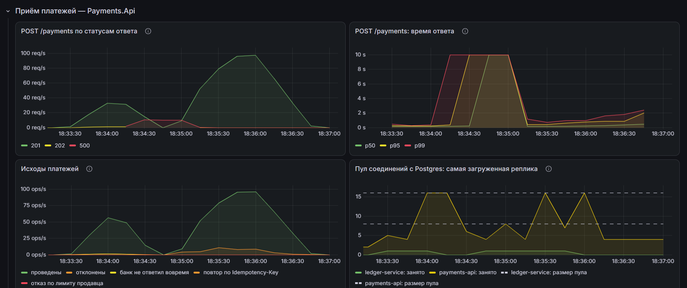
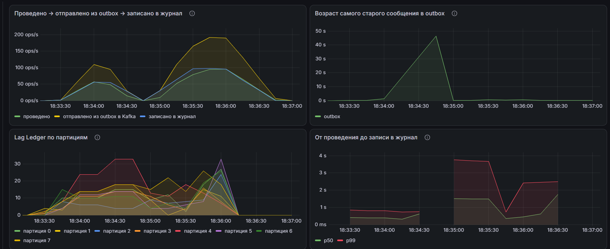
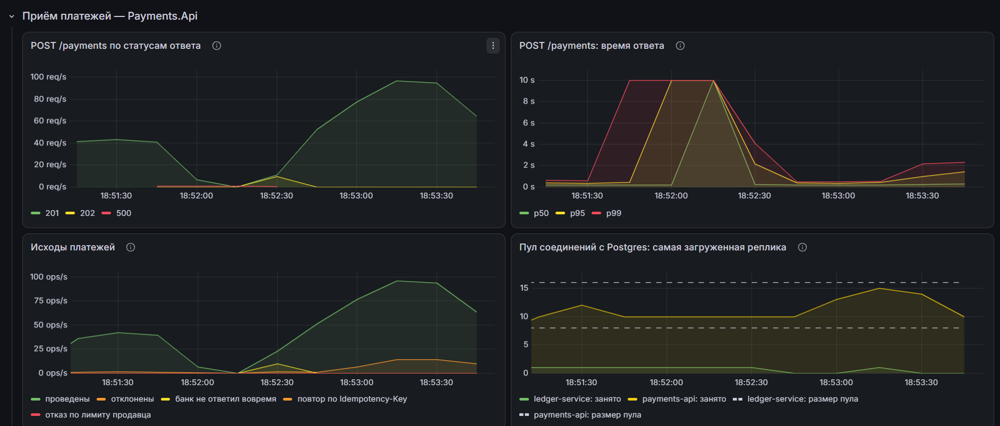
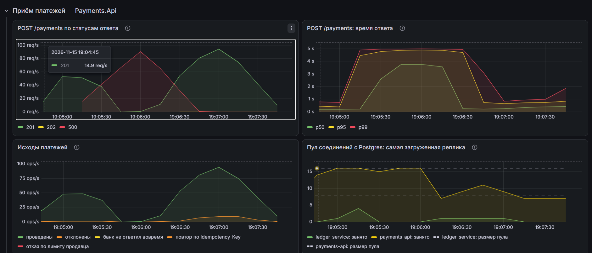

# PostgreSQL в кластере: CloudNativePG и отказ основной базы

PostgreSQL стенда переехал с хоста в кластер k3d под управление оператора CloudNativePG: три экземпляра на трёх нодах, синхронная репликация. Главный вопрос этапа — что увидит платёж, когда умрёт нода с основной базой: потеряется ли подтверждённый клиенту платёж (RPO) и как долго сервис будет недоступен (RTO). Ответ, измеренный на стенде в четырёх опытах: **RPO — ноль, RTO — 45–55 секунд**, и почти всё это время — обнаружение отказа и повышение реплики, на которые настройки сервиса не влияют. Второй вопрос — что делать, когда реплики не помогают: `DELETE FROM payments` по ошибке за миллисекунды доходит до всех трёх экземпляров. Ответ — резервные копии и восстановление на момент времени: **все 73 364 платежа вернулись, новый кластер из копий поднялся за 79 секунд** ([учения](#резервные-копии-и-восстановление-на-момент-времени)). Кластер и манифесты — в [deploy/k8s/README.md](../deploy/k8s/README.md), прошлые опыты с отказом нод — в [observability.md](observability.md).

## Как устроено

```
 payments-api ──┐                          ┌─► pg-1  (agent-1)   реплика
                ├──► Service pg-rw ──► основной экземпляр          ▲ WAL, синхронно: ANY 1
 ledger-service ┘    (всегда указывает     │                       │
                      на основной)         ├─► pg-2  (server-0)  реплика
                                           └─► pg-3  (agent-0)   основной
                 оператор CloudNativePG (cnpg-system) следит за экземплярами,
                 при отказе основного повышает реплику и переключает pg-rw
```

- **Оператор** — Helm-чарт `cloudnative-pg` через Argo CD: [deploy/argocd/cnpg.yaml](../deploy/argocd/cnpg.yaml). **Кластер** — ресурс `Cluster` в [deploy/k8s/postgres.yaml](../deploy/k8s/postgres.yaml), база Ledger — ресурс `Database` там же.
- **Сервисы ходят в Service `pg-rw`**: оператор держит его на текущем основном экземпляре, при переключении сервисы не перенастраиваются.
- **Пароль генерирует оператор** (Secret `pg-app`), Deployments подставляют его в строку подключения через `$(PG_PASSWORD)`. В git пароля нет вообще, даже зашифрованного: Sealed Secret `postgres` удалён.
- **Схему** сервисы создают сами при старте, как и раньше. Данные с Postgres хоста не переносились: на стенде только результаты нагрузочных прогонов, а обе базы пустые одновременно — инварианты сходятся.

## Решения и почему

| Решение | Почему |
|---|---|
| Три экземпляра, по одному на ноду (`podAntiAffinity: required`) | Отказ ноды забирает один экземпляр, никогда — основной вместе с его синхронной репликой |
| Синхронная репликация `ANY 1` из двух реплик | COMMIT возвращается, только когда транзакция есть ещё на одной реплике: платёж, о котором клиенту ответили, переживёт смерть основного |
| `dataDurability: required`, а не `preferred` | С `preferred` запись продолжается без синхронной реплики, и следующий отказ теряет данные. Три экземпляра делают `required` дешёвым: без одного оставшаяся реплика держит запись. С двумя `required` останавливал бы запись до возвращения ноды |
| Оператор, а не StatefulSet с самописной репликацией | Повышение реплики, переключение Service, возврат старого основного через `pg_rewind`, клонирование новых реплик — всё это оператор делает сам |
| Тома local-path (диск ноды) | Так устроен k3s. Экземпляр с мёртвой ноды ждёт её возвращения, остальные работают; в продакшене — сетевые диски или локальные NVMe с тем же подходом |
| Без суперпользователя по сети | Сервисы владеют своими базами (`app`), больше им ничего не нужно |
| Резервные копии через плагин Barman Cloud, а не встроенный `barmanObjectStore` | Встроенный устарел; плагин — его замена от тех же авторов. Архив WAL непрерывно, базовая копия раз в сутки, хранение 7 дней |
| `archive_timeout: 60s` | Сегмент WAL уходит в архив, когда заполнен (16 МБ); при слабой нагрузке это часы. Таймаут закрывает его не реже раза в минуту — столько транзакций, самое большее, нет в архиве |
| Хранилище копий — RustFS в кластере | S3-совместимый сервер, на котором плагин проходит свои тесты. MinIO с октября 2025 года не публикует образы для сообщества |
| NetworkPolicy `postgres` | К 5432 — только payments-api и ledger-service; экземпляры между собой; оператор к менеджеру экземпляра (8000); Prometheus к метрикам (9187) |

## Цена: диск и синхронная репликация

На той же нагрузке (100 платежей в секунду) время ответа выросло:

| | Postgres на хосте | В кластере |
|---|---|---|
| Медиана | 78 мс | 156 мс |
| p95 | 110 мс | 295 мс |
| p99 | 169 мс | 883 мс |

Чего ждут запросы — по `pg_stat_activity` под нагрузкой, пять замеров:

| Ожидание | Запросов в замере |
|---|---|
| `LWLock:WALWrite` | 4–11 |
| `IO:WalSync` | 1 |
| `IPC:SyncRep` | 0–2 |
| CPU | 0–1 |

Один процесс делает `fsync` журнала, остальные коммиты стоят в очереди за ним. Диск — том local-path в контейнере ноды k3d, внутри виртуального диска WSL2. `pg_test_fsync` на нём: **211 операций `fdatasync` в секунду, 4,7 мс на операцию**. У реплик то же самое: `flush_lag` около 11 мс — своя запись плюс запись реплики и сеть.

Вывод: синхронная репликация примерно удваивает ожидание на коммите, но главная цена — медленный `fsync` диска ноутбука, через который проходят все коммиты. Серверный NVMe даёт тысячи `fdatasync` в секунду; на нём и синхронная реплика стоит единицы миллисекунд.

## Опыт 1: отказ ноды с синхронной репликой

Получился случайно: основной экземпляр переехал до начала прогона (см. «Находки»), и остановилась нода с репликой `pg-3` (и с Redis). 100 платежей в секунду, 150 секунд, нода остановлена в 18:27:16, запущена в 18:28:47.

- **Запись не остановилась.** Для коммита хватало второй реплики — ради этого и нужны три экземпляра.
- **Потерь нет**: в базе 14 382 платежа с начала прогона, у k6 — 14 315 успешных ответов. Платежей в `created` не осталось: все 1 592 ответа 202 восстановление довело до решения. Инварианты сходятся.
- **Кластер восстановился сам**: нода вернулась в 18:28:47, в 18:29:30 — снова `3/3 healthy`.
- 98 ошибок у клиента — 60-секундные таймауты запросов, ушедших на мёртвую ноду через балансировщик k3d, как и в прошлых опытах; к базе не относятся.

## Опыт 2: отказ ноды с основной базой

Основной экземпляр `pg-3` на agent-0; Kafka, Redis, банк — на других нодах. 100 платежей в секунду, 150 секунд ([load/node-failure.ps1](../load/node-failure.ps1), журнал раз в ~6 с, время ±6 с). Нода остановлена в 18:33:54.

| Время | Событие | От остановки |
|---|---|---|
| 18:34:07 | нода NotReady; единственная готовая реплика payments-api не готова: её readiness проверяет Postgres | +13 с |
| 18:34:13 | оператор: `Failing over`, `pg-3` unhealthy | +19 с |
| 18:34:26–33 | `pg-1` — основной, `pg-rw` переключён | ~+35 с |
| 18:34:40 | payments-api снова готовы | +46 с |
| 18:35:27 | нода вернулась | |
| 18:36:22 | `pg-3` вернулся репликой, `3/3 healthy` | |





**RPO = 0.** С начала прогона в базе 10 500 платежей (9 716 проведено, 784 отклонено), у k6 — 10 478 успешных ответов. На каждый ответ «платёж принят» есть строка на новом основном экземпляре; лишние 22 — запросы, ответа на которые клиент не дождался. Инварианты сходятся.

**RTO ≈ 40 секунд**, и из них — почти все 3 464 ошибки у клиента (24,8 % прогона): около 35 секунд не было ни одной готовой реплики payments-api, и Traefik сразу отвечал 503. 35 с × 100 платежей в секунду — это они и есть. Время складывается из трёх частей:

1. ~13 с — Kubernetes объявляет ноду NotReady (`node-monitor-grace-period` 20 с, [observability.md](observability.md#время-обнаружения-отказа-50-с--20-с)). CloudNativePG начинает переключение, как только у пода основного сбрасывается Ready.
2. ~15–20 с — оператор повышает реплику и переключает `pg-rw`.
3. ~7 с — readiness подов payments-api снова проходит.

На графиках: время ответа упирается в потолок гистограммы (10 с) с 18:34 до 18:35, пул соединений в 16 из 16 — соединения висят к мёртвому основному. Outbox копится до 46 с и разбирается за секунды после переключения; Ledger догоняет.

Без базы платёж провести нельзя: ошибки в этом окне неизбежны, вопрос в их форме — это опыты 3 и 4.

## Опыты 3 и 4: можно ли сократить недоступность

Опыт 2 показал два места, где сервис сам добавлял к отказу базы: запросы висели на соединениях к мёртвому основному (пул 16 из 16, время ответа в потолке 10 с), и все реплики payments-api выпадали из балансировки, потому что их readiness проверяла Postgres. Два опыта — по одному изменению за раз, тот же сценарий.

- **Опыт 3: таймауты Npgsql и readiness раз в 2 с.** В строке подключения `Timeout=3` (подключение) и `Command Timeout` 5/10 с (как `statement_timeout`): пакеты к мёртвой ноде пропадают, а не отклоняются, и без клиентских таймаутов запрос ждёт 30 с, подключение — 15. Readiness — каждые 2 с вместо 5, чтобы поды быстрее возвращались после переключения.
- **Опыт 4: readiness без базы.** Таймауты те же; readiness payments-api смотрит на `/health/live` — «процесс жив». Базу сервис проверяет на старте: не слушает HTTP, пока не применил схему.

| | Опыт 2: как было | Опыт 3: таймауты, readiness 2 с | Опыт 4: таймауты, readiness без базы |
|---|---|---|---|
| Нода NotReady | +13 с | +20 с | +22 с |
| Новый основной экземпляр | ~+35 с | ~+38 с | ~+45 с |
| Ошибки у клиента | 3 464 | 3 968 | 5 438 |
| Пропущенные итерации k6 | 1 059 | 535 | 477 |
| Не обслужено всего | 4 523 | 4 503 | 5 915 |
| p99 всех запросов | 17,2 с | 5,7 с | 7,5 с |
| Самый долгий успешный запрос | 4,4 с | 3,2 с | 8,7 с |
| Попытки Traefik с 504 / 500 | 466 / 531 | 4 596 / 251 | 1 570 / 5 336 |
| Платежей в базе / успешных ответов | 10 500 / 10 478 | 10 515 / 10 497 | 9 182 / 9 086 |





**Сколько запросов не обслужено, решает длина отказа базы, а не настройки сервиса.** Не обслужено (ошибки плюс пропущенные итерации), делённое на время от остановки ноды до возвращения сервиса, во всех трёх опытах — около 100 в секунду, то есть вся нагрузка: пока нет основного экземпляра, платёж не провести, как бы сервис ни отвечал. Опыт 4 потерял больше не из-за readiness: Kubernetes заметил отказ на 9 секунд позже, чем в опыте 2, и оператор повышал реплику дольше. Один прогон на вариант — разброс обнаружения (13–22 с) и повышения (15–25 с) больше, чем эффект любой из правок.

**Что изменили правки — форму ошибок:**

- **Таймауты Npgsql сократили хвост втрое**: p99 17 → 5,7 с, запросы больше не висят на мёртвых соединениях по 10–30 секунд. Оставлены.
- **Частая readiness на базе сделала хуже.** Здоровые реплики выпали из балансировки через ~8 с после остановки ноды, а реплика на мёртвой ноде числилась готовой до NotReady — её kubelet мёртв и не может сказать обратное. 12 секунд она была *единственной* целью Traefik: каждый запрос — 5 попыток по 1 с к мёртвому поду, 4 596 попыток с 504, p99 ровно ~5,5 с.
- **Readiness без базы** убрала этот перекос: здоровая реплика оставалась в балансировке весь отказ и отвечала 500 за ≤3 с, сервис вернулся в момент появления нового основного, без ожидания readiness. Оставлена — общая зависимость в readiness выключает здоровые реплики раньше мёртвой.

RPO во всех опытах — ноль: на каждый успешный ответ есть строка на новом основном экземпляре.

**Чем сокращать по-настоящему** — обнаружением и повышением, а не сервисом: ноды, которые сообщают о своей смерти быстрее (облачные проверки здоровья машин, `node-monitor-grace-period` ещё короче — ценой ложных отказов), или повтор на стороне клиента: тот же `Idempotency-Key` после 500/503 превращает ошибку в задержку, и без риска двойного списания.

## Резервные копии и восстановление на момент времени

Репликация защищает от потери ноды, но не от ошибки: `DELETE` без `WHERE`, неудачная миграция, `DROP TABLE` — всё это за миллисекунды доходит до всех реплик, синхронная репликация именно так и работает. Вернуть данные можно только из копии, сделанной до ошибки.

```
 pg (основной) ──WAL──► sidecar plugin-barman-cloud ──► RustFS  s3://pg-backups/pg/
                         каждый сегмент, не реже          ├── wals/   архив WAL, непрерывно
 pg (реплика) ──────────► раза в минуту                   └── base/   базовая копия, раз в сутки
                                                                │
          восстановление на момент T:  базовая копия до T + WAL до T ──► новый кластер pg-restore
```

Две части, обе через плагин Barman Cloud ([backups.yaml](../deploy/k8s/backups.yaml)):

- **Архив WAL.** Sidecar основного экземпляра отправляет в хранилище каждый закрытый сегмент журнала. `archive_timeout` закрывает сегмент не реже раза в минуту — это RPO, если потерян весь кластер вместе с дисками.
- **Базовые копии.** Полная физическая копия каталога данных, снимается с реплики, раз в сутки (`ScheduledBackup`). Восстановление берёт последнюю копию до целевого момента и проигрывает архив WAL ровно до него.

Восстанавливают в **новый** кластер рядом со старым, а не поверх: сначала проверить, что вернулось, потом переносить данные или переключать сервисы.

### Учения: удаление всех платежей

Скрипт [load/backup-drill.ps1](../load/backup-drill.ps1), без нагрузки, чтобы счётчики сравнивались точно. Базовая копия была снята минут за двенадцать до учений, так что проигрывать пришлось немного WAL.

| Время | Событие | |
|---|---|---|
| 01:29:57 | в `pg` 73 364 платежа | |
| 01:29:58 | целевой момент T — по часам кластера | |
| 01:30:02 | `DELETE FROM payments` на основном: 73 364 строки, в `pg` осталось 0 | ошибка |
| 01:30:05 | сегмент WAL с удалением в архиве (`pg_switch_wal`, иначе ждать до минуты) | |
| 01:30:06 | создан `pg-restore`: восстановление на момент T | 0 с |
| 01:30:58 | копия скачана, WAL проигран до T | +53 с |
| 01:31:24 | `pg-restore` готов: 73 364 платежа из 73 364 | **+79 с** |
| 01:31:28 | строки перенесены обратно в `pg` (`pg_dump \| psql` внутри кластера): 73 364 | |

**Восстановлено всё, что было в момент T.** Потеряно бы было только то, что записано между T и ошибкой, — здесь 4 секунды без нагрузки, то есть ничего. В жизни T выбирают по логам: последний момент до ошибки.

**79 секунд — для маленькой базы.** Время восстановления растёт с размером базовой копии и объёмом WAL, накопленного после неё: база в сотни гигабайт и сутки WAL — это уже часы. Поэтому RTO восстановления задают частотой базовых копий, а не только скоростью сети.

| | Отказ ноды (failover) | Ошибка в данных (восстановление из копии) |
|---|---|---|
| Что спасает | реплика | копия до ошибки |
| RPO | 0 — синхронная реплика | до момента T; при потере всего кластера — до `archive_timeout`, 60 с |
| RTO | 45–55 с, автоматически | 79 с на этой базе, руками; растёт с размером базы |
| Где данные | на соседней ноде | в объектном хранилище |

## Повтор одной командой: отказ и плановое обслуживание

Опыты 2–4 собирались руками: switchover на нужную ноду, перенос реплики Payments.Api, `node-failure.ps1`, проверки после. Теперь это сценарий `pg-primary` инструмента [load/Failover](../load/Failover): он сам ставит основной экземпляр на останавливаемую ноду (последним шагом, после всех cordon), убирает с неё одиночные сервисы, снимает замеры раз в 2 секунды и проверяет, что подтверждённые платежи на месте. Режим `--mode drain` вместо остановки ноды выводит её на обслуживание: `kubectl drain`, поды выселяются по одному в пределах PodDisruptionBudget, CloudNativePG видит закрытую ноду и сам переключает основной экземпляр.

| | Отказ ноды (`stop`) | Обслуживание (`drain`) |
|---|---|---|
| Новый основной экземпляр | через 45 с | через 25 с |
| Чем вызвано | нода NotReady на +15 с, затем failover | switchover оператора, как только нода закрыта для новых подов |
| Ошибки у клиента | 2 820 из 7 323 (38,5 %) | 1 534 из 7 347 (20,9 %) |
| Самый долгий запрос | 60 с | 15,6 с |
| Outbox снова не копится | +62 с | +41 с |
| Платежей в базе / успешных ответов | 4 521 / 4 503 | 5 877 / 5 813 |

RPO в обоих случаях — ноль. RTO отказа совпал с опытами 2–4 (45–55 с). Обслуживание вдвое короче, но не мгновенное: switchover на стенде занял ~20 секунд, всё это время запись невозможна, и Payments.Api отвечает 500. Повтор с тем же `Idempotency-Key` превратил бы эти ошибки в задержку без риска двойного списания.

```powershell
dotnet run --project load\Failover -c Release -- --scenario pg-primary --node agent-1 --rate 50
dotnet run --project load\Failover -c Release -- --scenario pg-primary --mode drain --node agent-1 --rate 50
```

## Находки

1. **Cordon ноды с основной базой — это switchover.** Перед первым опытом обе agent-ноды были на минуту закрыты для планирования, чтобы перенести metrics-server. Оператор тут же записал в события: `Current primary is running on unschedulable node k3d-highload-agent-0, switching over from pg-3 to pg-2` — и штатно, без потери данных, увёл основной экземпляр на открытую ноду. Это осознанное поведение: cordon обычно предшествует обслуживанию ноды. Для опытов правило: никаких cordon после выбора основного экземпляра.
2. **Readiness на общей зависимости выключает здоровые реплики раньше мёртвой.** Readiness, проверяющая Postgres, выводит из балансировки все живые реплики, а реплика на мёртвой ноде остаётся «готовой» до NotReady — и получает весь трафик (опыт 3). Теперь readiness payments-api проверяет только сам процесс, база — на старте.
3. **Новая реплика, стартующая во время отказа, падает.** HPA добавляет реплики как раз в момент отказа: нагрузка ложится на оставшиеся. Их повторы подключения при старте (20 с) короче переключения базы — `Error`, рестарт, после него поднимаются. Так было во всех трёх опытах с основной базой.
4. **Клонирование реплики ждёт контрольную точку.** Сама копия пустой базы — 3 секунды, а `pg_basebackup` 112 секунд ждал контрольную точку основного: по умолчанию она растягивается во времени. После отказа это не важно — старый основной возвращается через `pg_rewind`, — но новую реплику кластер поднимает минуты две.
5. **Switchover без плагина.** `kubectl cnpg promote` делает то же, что патч статуса кластера: новый `targetPrimary` и фаза `Switchover in progress`. Переключение заняло меньше 30 секунд.
6. **Первые подключения нового пода отбрасываются.** Под, созданный при выкатке, три раза за ~3,5 с не смог подключиться к `pg-rw`, хотя база работала. Скорее всего, kube-router добавляет IP нового пода в разрешающие списки NetworkPolicy не мгновенно; повторы при старте это покрывают. Гипотеза не проверялась.
7. **Bucket сам не создаётся.** Документация плагина обещает создать bucket при первом обращении, но архиватор WAL пишет в него сразу и падает с `NoSuchBucket` (`exit status 4`), а базовая копия падает следом: она требует работающего архива. Bucket теперь создаёт Job при каждой синхронизации Argo CD ([backup-bucket.yaml](../deploy/k8s/backup-bucket.yaml)).
8. **Первая копия падает, пока экземпляры перезапускаются.** `immediate: true` запускает копию в момент создания расписания, а sidecar появляется в подах только после их перезапуска: `plugin is not available`. Сама она не повторяется — следующая по расписанию. Первую копию после включения плагина — руками.
9. **Sidecar — в `initContainers`.** Плагин добавляет sidecar как нативный sidecar Kubernetes (`restartPolicy: Always` у init-контейнера), поэтому в `.spec.containers` его не видно.
10. **RustFS не создаёт каталог данных**, а init-контейнер от root, как в примерах, namespace с профилем `restricted` не пропустит. Данные — в корне тома: local-path создаёт его доступным на запись всем.

## Что упрощено по сравнению с продакшеном

| На стенде | В продакшене |
|---|---|
| Хранилище копий в том же кластере, на том же ноутбуке | Объектное хранилище в другом регионе или аккаунте; кластер может писать туда, но не удалять (Object Lock), — копию не уничтожит ни авария, ни взломанный кластер |
| Восстановление проверено один раз, руками | Регулярные учения по расписанию: восстановить, сверить, замерить время. Непроверенная копия — не копия |
| Нет алерта на возраст последней копии | Алерт, если последняя успешная базовая копия старше суток; алерт на архив WAL уже есть (`PostgresWalArchivingFailing`) |
| Тома на диске ноутбука, `fsync` 4,7 мс | NVMe, тысячи `fsync` в секунду |
| Все экземпляры в одной «зоне» — на одном ноутбуке | Экземпляры в разных зонах доступности |
| Сервисы ходят в базу напрямую | PgBouncer (оператор умеет `Pooler`): переключение не рвёт соединения клиентов |
| Версия PostgreSQL — по умолчанию у оператора | Явный образ, обновление — осознанным коммитом |

## Как повторить

```powershell
# Кластер и роли экземпляров
kubectl -n highload get cluster pg
kubectl -n highload get pods -l cnpg.io/cluster=pg -o wide -L cnpg.io/instanceRole

# Синхронная репликация: обе реплики streaming, quorum
kubectl -n highload exec pg-1 -c postgres -- psql -U postgres -c "select application_name, state, sync_state, flush_lag from pg_stat_replication"

# Чего ждут запросы под нагрузкой
kubectl -n highload exec pg-1 -c postgres -- psql -U postgres -At -c "select coalesce(wait_event_type,'CPU') || ':' || coalesce(wait_event,'-'), count(*) from pg_stat_activity where datname in ('payments','ledger') and state = 'active' group by 1 order by 2 desc"

# Скорость fsync диска тома
kubectl -n highload exec pg-1 -c postgres -- sh -c '$(ls /usr/lib/postgresql/*/bin/pg_test_fsync) -s 2 -f /var/lib/postgresql/data/pgdata/fsync-test.out'

# Основной экземпляр — на agent-0 (там, где нет Kafka). После этого — никаких cordon.
$ts = (Get-Date).ToUniversalTime().ToString("yyyy-MM-ddTHH:mm:ssZ")
kubectl -n highload patch cluster pg --subresource=status --type=merge -p "{`"status`":{`"targetPrimary`":`"pg-3`",`"targetPrimaryTimestamp`":`"$ts`",`"phase`":`"Switchover in progress`",`"phaseReason`":`"Switching over to pg-3`"}}"

# Отказ ноды с основной базой и проверка потерь
$start = (Get-Date).ToUniversalTime().ToString("yyyy-MM-dd HH:mm:ss")
.\load\node-failure.ps1 -Node k3d-highload-agent-0 -Rate 100 -Log node-failure-pg-primary.log
Invoke-RestMethod http://localhost:8080/invariants
$p = kubectl -n highload get cluster pg -o jsonpath='{.status.currentPrimary}'
kubectl -n highload exec $p -c postgres -- psql -U postgres -d payments -c "select status, count(*) from payments where created_at >= '$start' group by 1"
```

Число платежей в базе должно быть не меньше числа успешных ответов k6 (`checks_succeeded`).

Резервные копии и учения:

```powershell
# Архив WAL и последняя копия
kubectl -n highload get cluster pg -o jsonpath='{range .status.conditions[*]}{.type}={.status} {.message}{"\n"}{end}'
kubectl -n highload get backups

# Учения: удаление всех платежей, восстановление на момент до него, перенос строк обратно
.\load\backup-drill.ps1 -Cleanup
```
